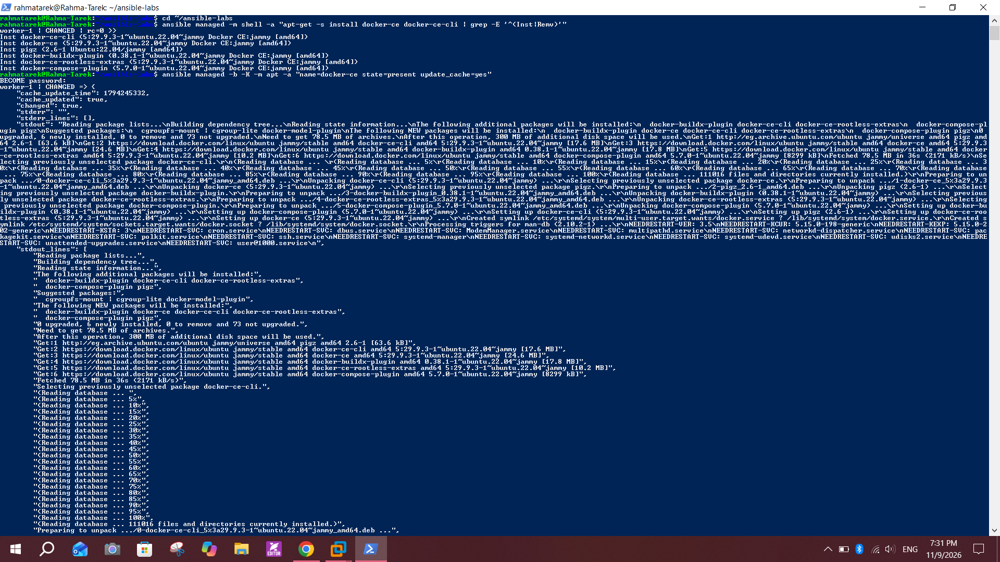
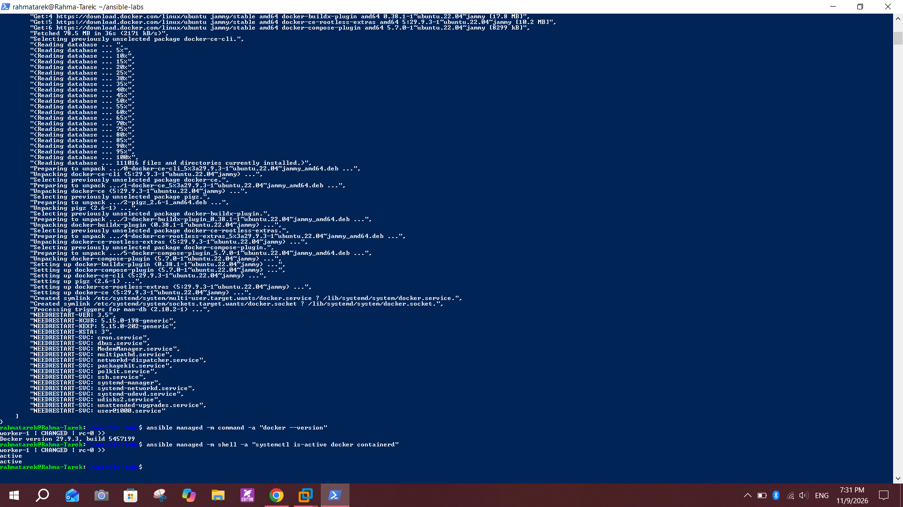

# Lab 24: Initial Ansible Configuration and Ad-Hoc Execution

## Objective
Install and configure Ansible on a control node, set up passwordless SSH to a managed node, create an inventory, and run an ad-hoc command to install Docker.

## Environment
| Role | Machine | Details |
|------|---------|---------|
| Control node | WSL2 (Ubuntu) on Windows | Ansible installed here |
| Managed node | `worker-1` (VMware VM) | Ubuntu 22.04, `192.168.247.131`, user `k8s` |

## Steps

### 1. Install Ansible on the control node
```bash
sudo apt update
sudo apt install -y ansible
ansible --version
```

### 2. Generate a new SSH key
```bash
ssh-keygen -t ed25519 -C "ansible-control"
```

### 3. Copy the public key to the managed node
```bash
ssh-copy-id k8s@192.168.247.131
```

### 4. Create the inventory and config
`inventory.ini`
```ini
[managed]
worker-1 ansible_host=192.168.247.131 ansible_user=k8s
```
`ansible.cfg`
```ini
[defaults]
inventory = inventory.ini
interpreter_python = /usr/bin/python3
host_key_checking = False
```

### 5. Test connectivity
```bash
ansible managed -m ping
```

### 6. Ad-hoc command: install Docker
The worker is a Kubernetes node that already runs `containerd.io`, so I simulated the install first to make sure nothing would be removed (only `Inst` lines, no `Remv`):
```bash
ansible managed -m shell -a "apt-get -s install docker-ce docker-ce-cli | grep -E '^(Inst|Remv)'"
```
Then installed Docker with privilege escalation (`-b`) and the sudo password prompt (`-K`):
```bash
ansible managed -b -K -m apt -a "name=docker-ce state=present update_cache=yes"
```

### 7. Verify
```bash
ansible managed -m command -a "docker --version"
ansible managed -m shell -a "systemctl is-active docker containerd"
```
Result: `Docker version 29.9.3`, and both `docker` and `containerd` are `active`.

## Screenshots
<!-- Add these too: ansible --version, ssh-copy-id output, inventory.ini, ping pong -->

**Simulation (only `Inst`, no `Remv`) and the ad-hoc Docker install**


**Docker version and services active**


## Notes
- The simulation step protects the cluster: installing `docker.io` instead of `docker-ce` could conflict with `containerd.io`.
- `-K` asks for the sudo password of the remote user; it is never stored in the repo.
