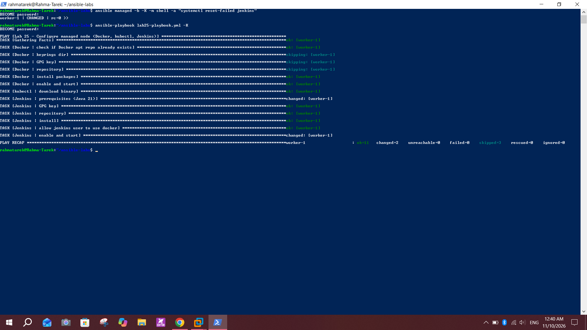
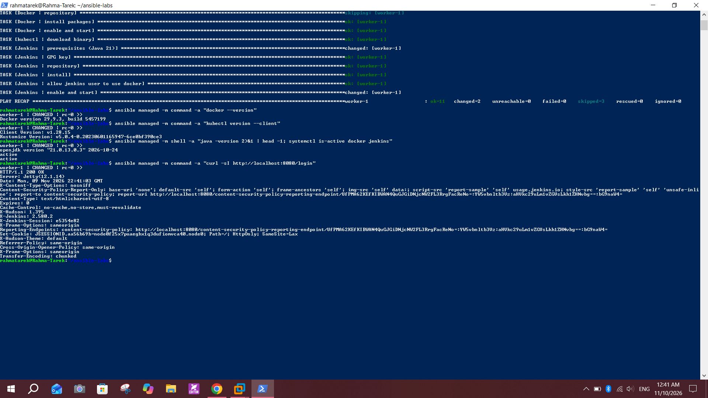
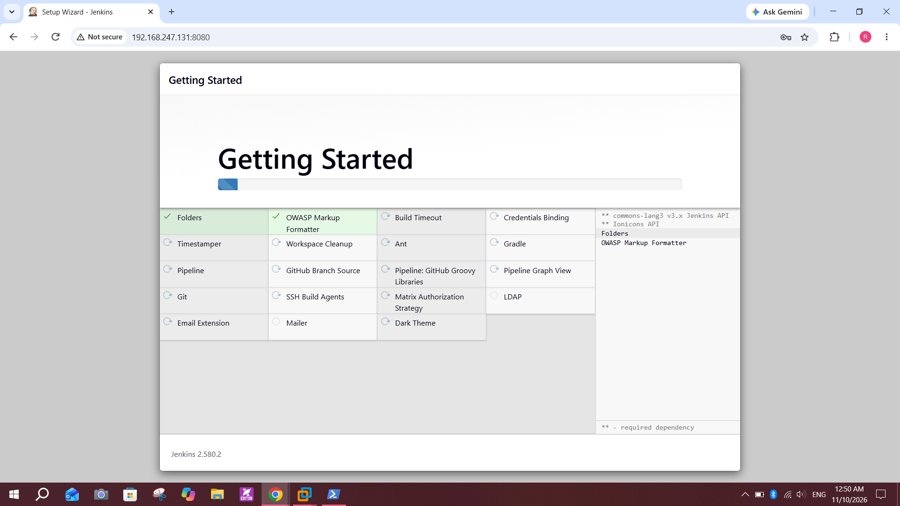
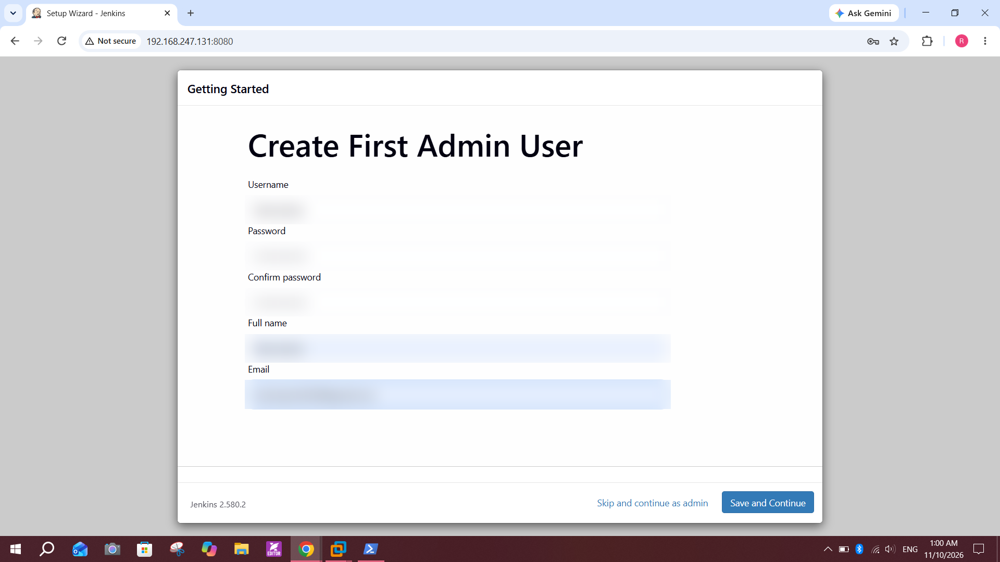
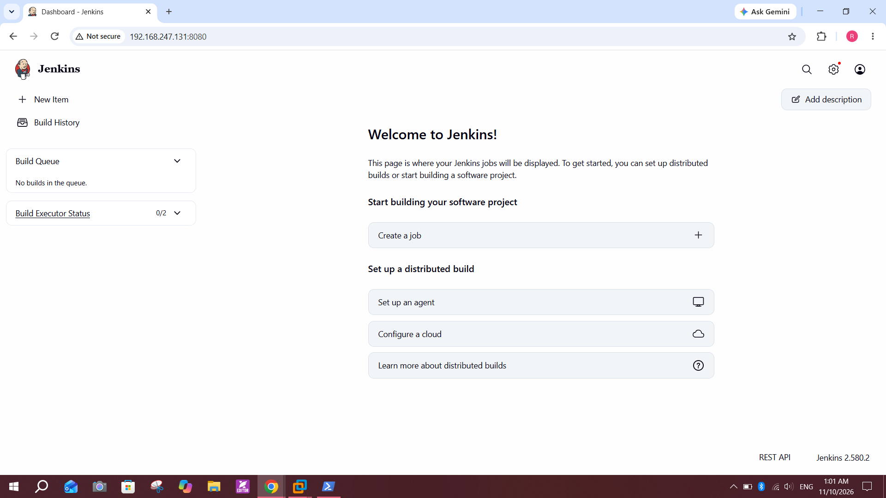

# Lab 25: Automated Configuration Using Ansible Playbooks

## Objective
Write one Ansible playbook that installs **Docker**, **kubectl** and **Jenkins** on the managed node, then verify the result.

## Files
| File | Purpose |
|------|---------|
| `lab25-playbook.yml` | The playbook (Docker, kubectl, Jenkins) |
| `inventory.ini` | Managed node (`worker-1`) |
| `ansible.cfg` | Inventory path, Python interpreter, host key checking |

## What the playbook does
1. **Docker**: adds the Docker apt repo only if missing, installs `docker-ce`, CLI, buildx and compose plugins, enables the service.
2. **kubectl**: downloads `v1.28.15` (same version as the cluster) to `/usr/local/bin`.
3. **Jenkins**: installs Java 21, adds the Jenkins apt key and repo, installs Jenkins, adds the `jenkins` user to the `docker` group, enables and starts the service.

## Run
```bash
ansible-playbook lab25-playbook.yml --syntax-check
ansible-playbook lab25-playbook.yml -K
```

## Verify
```bash
ansible managed -m command -a "docker --version"
ansible managed -m command -a "kubectl version --client"
ansible managed -m shell -a "java -version 2>&1 | head -1; systemctl is-active docker jenkins"
ansible managed -m command -a "curl -sI http://localhost:8080/login"
```
Result: Docker `29.9.3`, kubectl `v1.28.15`, Java `21`, `docker` and `jenkins` both `active`, Jenkins answers `HTTP/1.1 200 OK` (version 2.580.2).

## Screenshots

**Playbook run and PLAY RECAP (`failed=0`)**


**Verification: Docker, kubectl, Java, Jenkins**


**Jenkins setup wizard on the managed node (`192.168.247.131:8080`)**


**Create first admin user (credentials blurred)**


**Jenkins dashboard**


## Problems I hit and how I fixed them
| Problem | Cause | Fix |
|---------|-------|-----|
| `NO_PUBKEY 7198F4B714ABFC68` | The old `jenkins.io-2023.key` expired; Jenkins now signs with a new key | Use `jenkins.io-2026.key`. `get_url` does not overwrite an existing file, so remove the old keyring or use `force: true` once |
| Jenkins service failed to start | Jenkins now requires Java 21 or 25, Java 17 was installed | Install `openjdk-21-jre`, remove Java 17, run `systemctl reset-failed jenkins` |
| SSH `Connection timed out during banner exchange` | The 2.4 GB worker VM was out of memory | Suspend unused VMs, stop Jenkins when not needed |

## Notes
- Jenkins runs on the worker VM (`192.168.247.131:8080`), independent of any Jenkins running on my laptop.
- The initial admin password and the admin account I created are not included in this repo.
