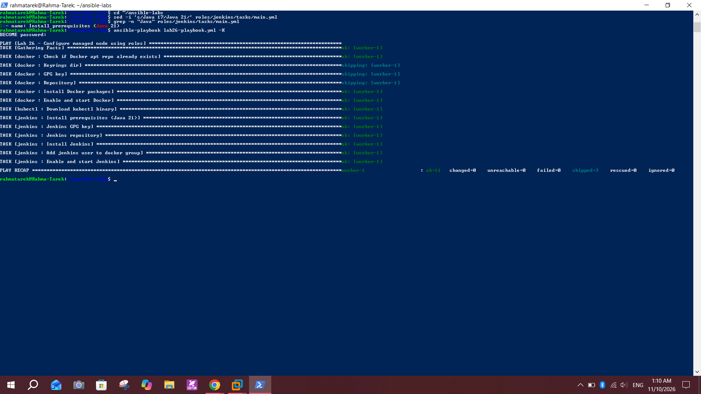
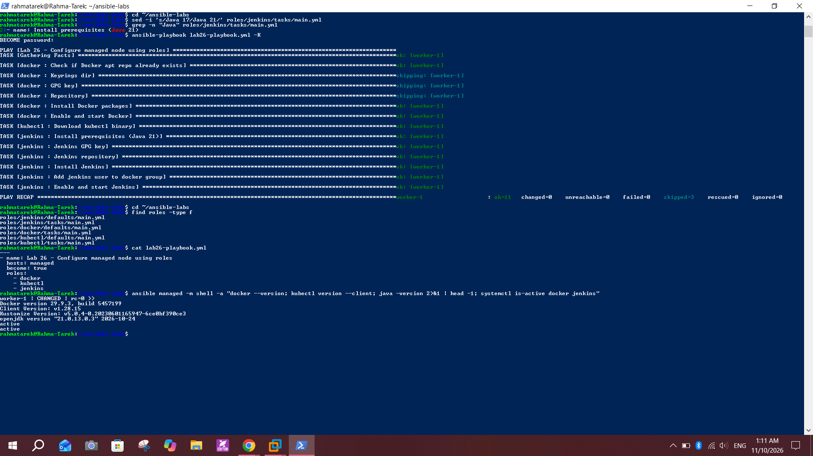
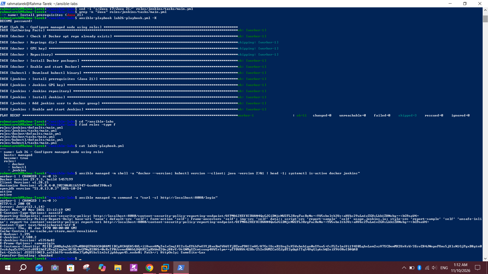
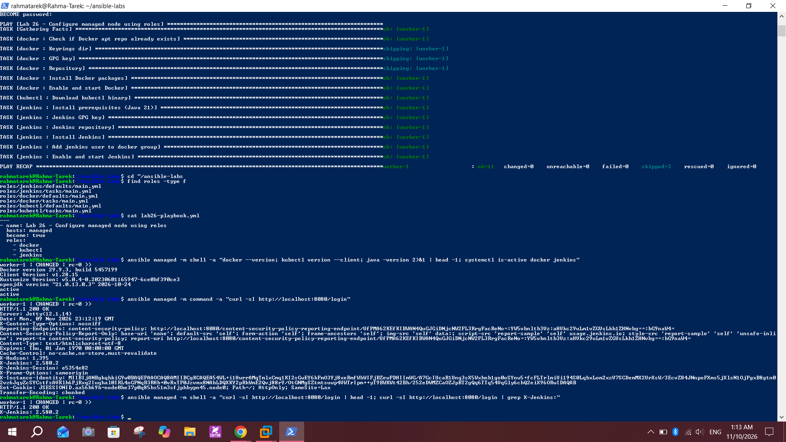

# Lab 26: Structured Configuration Management with Ansible Roles

## Objective
Create separate Ansible roles for Docker, kubectl and Jenkins, and write a playbook that runs them.

## Environment
- Control node: WSL2 (Ubuntu) with Ansible
- Managed node: `worker-1` (`192.168.247.131`), already configured by Lab 25 (Docker, kubectl, Jenkins)

## Structure
```
Lab26-Ansible-Roles/
├── ansible.cfg
├── inventory.ini
├── lab26-playbook.yml
└── roles/
    ├── docker/
    │   ├── defaults/main.yml   # docker_packages
    │   └── tasks/main.yml
    ├── kubectl/
    │   ├── defaults/main.yml   # kubectl_version
    │   └── tasks/main.yml
    └── jenkins/
        ├── defaults/main.yml   # jenkins_key_url
        └── tasks/main.yml
```

## Steps

### 1. Create the role folders (in WSL / bash)
```bash
cd ~/ansible-labs
mkdir -p roles/{docker,kubectl,jenkins}/{tasks,defaults}
```

### 2. Move the tasks from Lab 25 into the roles
| Role | `tasks/main.yml` | `defaults/main.yml` |
|------|------------------|---------------------|
| `docker` | repo check, repo + key, install packages, enable service | `docker_packages` list |
| `kubectl` | download the binary | `kubectl_version: "v1.28.15"` |
| `jenkins` | Java 21, key, repo, install, `docker` group, enable service | `jenkins_key_url` (2026 key) |

Variables live in `defaults/main.yml`, so versions and URLs can be changed without editing the tasks.

### 3. Write the playbook that runs the roles (`lab26-playbook.yml`)
```yaml
---
- name: Lab 26 - Configure managed node using roles
  hosts: managed
  become: true
  roles:
    - docker
    - kubectl
    - jenkins
```
`docker` comes before `jenkins` because the Jenkins role adds the `jenkins` user to the `docker` group.

### 4. Run
```bash
ansible-playbook lab26-playbook.yml --syntax-check
ansible-playbook lab26-playbook.yml -K
```
`PLAY RECAP` shows `ok=11 changed=0 unreachable=0 failed=0 skipped=3`. Everything was already installed by Lab 25, so `changed=0` also shows the roles are idempotent.

### 5. Verify
```bash
find roles -type f
cat lab26-playbook.yml
ansible managed -m shell -a "docker --version; kubectl version --client; java -version 2>&1 | head -1; systemctl is-active docker jenkins"
ansible managed -m shell -a "curl -sI http://localhost:8080/login | head -1; curl -sI http://localhost:8080/login | grep X-Jenkins:"
```
| Check | Result |
|-------|--------|
| Docker | `29.9.3` |
| kubectl | `v1.28.15` |
| Java | `openjdk 21.0.13` |
| `docker` and `jenkins` services | `active` |
| Jenkins `/login` | `HTTP/1.1 200 OK`, `X-Jenkins: 2.580.2` |

## Screenshots

Roles playbook run, `changed=0`



Roles tree, playbook and verification



Jenkins answers `HTTP/1.1 200 OK`



Final verification with a short `curl` output



## Notes and issues
- **Same fixes as Lab 25:** the first version of the Jenkins role still had `openjdk-17-jre` and the expired `jenkins.io-2023.key` (`NO_PUBKEY` and "Java 17 older than the minimum required version (Java 21)" errors). I changed them with `sed` to `openjdk-21-jre` and `jenkins.io-2026.key` before running.
- **Task name still said Java 17:** the package was changed to 21 but the task name `Install prerequisites (Java 17)` stayed. I renamed it to `Install prerequisites (Java 21)` so the recap matches. Re-running still gave `changed=0`.
- **`Connection timed out during banner exchange`:** the first run of the playbook failed with `UNREACHABLE` because the worker was slow (low memory with Jenkins running). After freeing memory and waiting, the run completed.
- **Brace expansion on Windows:** when preparing the repository folder, `mkdir -p roles/{docker,kubectl,jenkins}/{tasks,defaults}` was run in PowerShell. PowerShell does not expand braces, so it created a folder literally named `{docker,kubectl,jenkins}` with an empty `{tasks,defaults}` inside. I deleted it with `Remove-Item -Recurse -Force -LiteralPath "roles\{docker,kubectl,jenkins}"` and copied the real roles. That command only works in bash (WSL).
- **Git ignores empty folders:** every role folder needs a `main.yml` to be pushed.
- **Idempotency:** `changed=0` on a machine that is already configured shows the roles describe the desired state instead of running commands blindly.
- **Worker RAM:** after the screenshots, Jenkins is stopped to free memory for the cluster.

## Conclusion
The Lab 25 playbook is now split into three reusable roles (Docker, kubectl, Jenkins) with their variables in `defaults`, and one short playbook applies them. The run is idempotent, and the node still has Docker 29.9.3, kubectl v1.28.15, Java 21 and a working Jenkins.