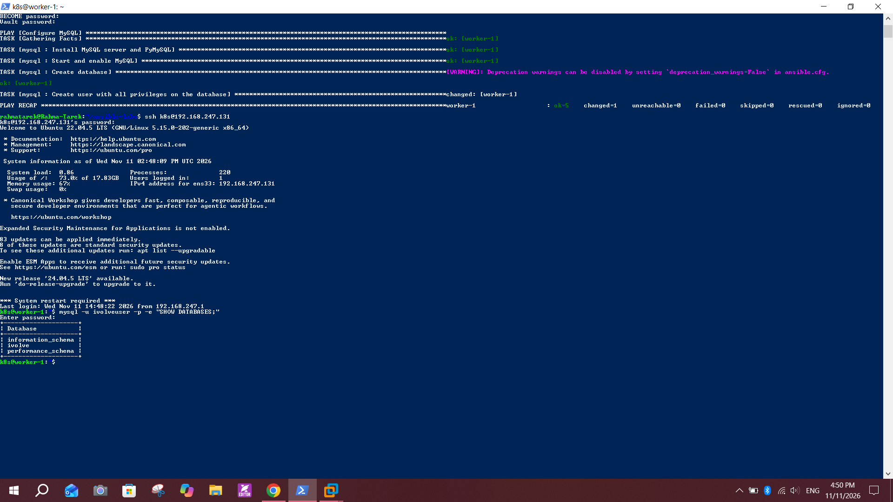

# Lab 27: Securing Sensitive Data with Ansible Vault

## Objective
Create an Ansible role that installs MySQL, creates the `ivolve` database and a user `ivolveuser` with all privileges on it, keep the user's password encrypted with Ansible Vault, and verify the database from the managed node by logging in with that user and listing the databases.

## Environment
- Control node: WSL Ubuntu on Windows 10, folder `~/ansible-labs` (same project as Labs 24 to 26)
- Managed node: the Ubuntu host listed in the `[managed]` group of `inventory.ini`
- Collection: `community.mysql`
- Database: MySQL server from the Ubuntu repository

```
ansible-labs/
├── ansible.cfg
├── inventory.ini
├── mysql.yml
├── group_vars/
│   └── managed/
│       ├── vars.yml         (plain: maps mysql_user_password to the vault variable)
│       └── vault.yml        (ENCRYPTED: holds the real password)
└── roles/
    └── mysql/
        ├── defaults/main.yml
        └── tasks/main.yml
```

## Steps

### 1. Create the role
```bash
mkdir -p roles/mysql/tasks roles/mysql/defaults group_vars/managed
ansible-galaxy collection list community.mysql || ansible-galaxy collection install community.mysql
```
`community.mysql` provides the `mysql_db` and `mysql_user` modules.

`roles/mysql/defaults/main.yml`:
```yaml
---
mysql_db_name: ivolve
mysql_user_name: ivolveuser
mysql_socket: /var/run/mysqld/mysqld.sock
```

`roles/mysql/tasks/main.yml`:
```yaml
---
- name: Install MySQL server and PyMySQL
  apt:
    name:
      - mysql-server
      - python3-pymysql
    state: present
    update_cache: true

- name: Start and enable MySQL
  service:
    name: mysql
    state: started
    enabled: true

- name: Create database
  community.mysql.mysql_db:
    name: "{{ mysql_db_name }}"
    state: present
    login_unix_socket: "{{ mysql_socket }}"

- name: Create user with all privileges on the database
  community.mysql.mysql_user:
    name: "{{ mysql_user_name }}"
    password: "{{ mysql_user_password }}"
    priv: "{{ mysql_db_name }}.*:ALL"
    host: localhost
    state: present
    login_unix_socket: "{{ mysql_socket }}"
  no_log: true
```

| Part | Meaning |
|---|---|
| `python3-pymysql` | Python driver the MySQL modules need on the managed node |
| `login_unix_socket` | Connects as MySQL root through the local socket, so no root password is needed (the play runs with `become`) |
| `priv: "ivolve.*:ALL"` | All privileges, but only on the `ivolve` database |
| `no_log: true` | Hides the password from the task output and logs |

### 2. The playbook `mysql.yml`
```yaml
---
- name: Configure MySQL
  hosts: managed
  become: true
  roles:
    - mysql
```

### 3. Encrypt the password with Ansible Vault
The real password lives in a file that is encrypted, and the role only sees it through an indirection variable.

`group_vars/managed/vault.yml` before encryption (the value here is only a placeholder):
```yaml
vault_mysql_user_password: "CHANGE_ME"
```
```bash
ansible-vault encrypt group_vars/managed/vault.yml
```
`group_vars/managed/vars.yml` (not encrypted):
```yaml
mysql_user_password: "{{ vault_mysql_user_password }}"
```
`cat group_vars/managed/vault.yml` now shows the header `$ANSIBLE_VAULT;1.1;AES256` followed by encrypted text. Using a `vault_` prefix makes it clear which variables are secret and lets the role use the normal name `mysql_user_password`.


### 4. Run the playbook
```bash
ansible-playbook mysql.yml --syntax-check
ansible-playbook mysql.yml --ask-vault-pass
```
Ansible asks for the vault password, then installs MySQL and creates the database and the user.


### 5. Validate on the managed node
Log in to the managed node, connect with the new user, and list the databases:
```bash
mysql -u ivolveuser -p -e "SHOW DATABASES;"
```
Expected: the list contains `information_schema` and `ivolve`. Also check the privileges:
```bash
mysql -u ivolveuser -p -e "SHOW GRANTS FOR CURRENT_USER();"
```
Expected: `GRANT ALL PRIVILEGES ON ivolve.* TO ivolveuser@localhost`.



## Notes and issues
- **Name typo in the lab:** the slide writes `ivovle`. I used the correct name `ivolve`, which matches the database used in the previous labs.
- **Idempotency:** running the playbook a second time should report `changed=0`, because the package, the database and the user already exist.
- **Two vault files:** the encrypted `vault.yml` is the only place with the real password. `vault.yml.example` in this repo only shows the structure with a placeholder.

## Precautions and common errors
- **Never commit the vault password** (or a file that contains it). The encrypted `vault.yml` can be committed, but its password must stay private. `.gitignore` blocks `.vault_pass` files.
- **Do not print secrets:** keep `no_log: true` on the user task, otherwise the password can appear in the output.
- **Do not type the password on the command line** (`-pPassword`). Use `-p` and enter it when asked.
- **`Failed to import the required Python library (PyMySQL)`:** the managed node is missing `python3-pymysql`. It is installed by the first task, so run the full role.
- **`Access denied for user 'root'`:** the play needs `become: true` so it can use the root socket login.
- **`couldn't resolve module/action 'community.mysql.mysql_db'`:** install the collection with `ansible-galaxy collection install community.mysql`.
- **`Attempting to decrypt but no vault secrets found`:** run the playbook with `--ask-vault-pass` or `--vault-password-file`.
- **Choose a strong password** for `ivolveuser` and change it if it was ever shown in a screenshot or log.

## Conclusion
The `mysql` role installs MySQL, creates the `ivolve` database and the `ivolveuser` account with privileges only on that database, and the password stays encrypted with Ansible Vault in the repository and hidden in the output.