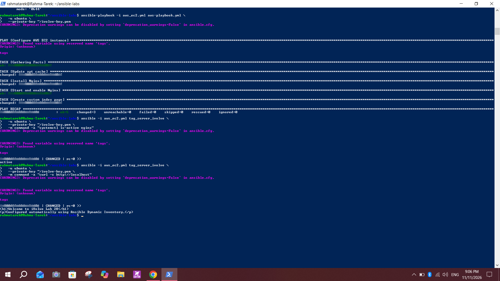

# Lab 28: Automated Host Discovery with Ansible Dynamic Inventory

## Objective
Create an AWS EC2 instance tagged `server=ivolve`, set up an Ansible dynamic inventory that finds running EC2 instances by that tag, list the discovered hosts with `ansible-inventory`, run a playbook on the instance, and verify the result on the EC2.

## Environment
- Control node: WSL Ubuntu 26.04 (`resolute`) on Windows 10, the same `~/ansible-labs` folder used for Labs 24 to 27
- Ansible with the `amazon.aws.aws_ec2` inventory plugin
- AWS CLI 2.31.35, `boto3` / `botocore` 1.40.72
- EC2: Ubuntu Server 26.04 LTS, `t3.micro`, region `eu-north-1` (Stockholm), tag `server=ivolve`
- IAM user `ansible-inventory` with the `AmazonEC2ReadOnlyAccess` policy (read-only, no console access)

| File | Purpose |
|---|---|
| `aws_ec2.yml` | Dynamic inventory definition |
| `aws-playbook.yml` | Installs Nginx and creates a custom page |
| `ansible.cfg` | Defaults (`interpreter_python`, `host_key_checking = False`) |
| `.gitignore` | Keeps `.pem` keys and credentials out of Git |

## Steps

### 1. Prepare the AWS side
1. Created the IAM user `ansible-inventory` (programmatic access only) and attached `AmazonEC2ReadOnlyAccess`.
2. Created an access key for the CLI use case and stored it privately. It was never pasted into a file in the repo.
3. Launched an EC2 instance with a key pair `ivolve-key`, a security group that allows SSH (22), and the tag **`server` = `ivolve`**. The inventory group `tag_server_ivolve` in step 6 is generated from this tag, which confirms it was set.

### 2. Install the AWS dependencies on the control node
```bash
sudo apt update
sudo apt install -y awscli python3-boto3 python3-botocore
aws --version
python3 -c "import boto3, botocore; print(boto3.__version__, botocore.__version__)"
```

### 3. Check the credentials and the instance
```bash
aws configure list
aws sts get-caller-identity
aws ec2 describe-instances --region eu-north-1 \
  --query 'Reservations[].Instances[].[State.Name,PublicIpAddress,InstanceType]' --output table
```
The instance is `running`.

### 4. Copy the key into WSL and test SSH
```bash
cp "/mnt/c/Users/<windows-user>/Downloads/ivolve-key.pem" ~/
chmod 400 ~/ivolve-key.pem
ssh -i ~/ivolve-key.pem ubuntu@<public-ip>
```
The first connection asks to trust the host key (answered `yes`). `hostname` returned the EC2 name.


### 5. Create the dynamic inventory `aws_ec2.yml`
```yaml
plugin: amazon.aws.aws_ec2

regions:
  - eu-north-1

filters:
  instance-state-name: running
  tag:server: ivolve

hostnames:
  - instance-id

compose:
  ansible_host: public_ip_address

keyed_groups:
  - key: tags.server
    prefix: tag_server
    separator: "_"
```

| Setting | What it does |
|---|---|
| `plugin` | Uses the AWS EC2 inventory plugin |
| `regions` | Searches only `eu-north-1` |
| `filters` | Keeps only running instances that have the tag `server=ivolve` |
| `hostnames` | Uses the instance ID as the host name |
| `compose` | Connects to the public IP address |
| `keyed_groups` | Builds the group `tag_server_ivolve` from the tag value |

The file name must end with `aws_ec2.yml` (or `aws_ec2.yaml`), otherwise Ansible does not accept it as a plugin config.

### 6. List the target hosts
```bash
ansible-inventory -i aws_ec2.yml --graph
ansible -i aws_ec2.yml tag_server_ivolve -u ubuntu --private-key ~/ivolve-key.pem -m ping
```
The graph shows the instance under both `@aws_ec2` and `@tag_server_ivolve`, and the ping returns `"ping": "pong"`.


### 7. Run the playbook `aws-playbook.yml`
```yaml
---
- name: Configure AWS EC2 instance
  hosts: tag_server_ivolve
  become: true

  tasks:
    - name: Update apt cache
      ansible.builtin.apt:
        update_cache: true

    - name: Install Nginx
      ansible.builtin.apt:
        name: nginx
        state: present

    - name: Start and enable Nginx
      ansible.builtin.service:
        name: nginx
        state: started
        enabled: true

    - name: Create custom index page
      ansible.builtin.copy:
        content: |
          <h1>Welcome to iVolve Lab 28</h1>
          <p>Configured automatically using Ansible Dynamic Inventory.</p>
        dest: /var/www/html/index.html
        owner: root
        group: root
        mode: '0644'
```
```bash
ansible-playbook -i aws_ec2.yml aws-playbook.yml -u ubuntu --private-key ~/ivolve-key.pem
```
`PLAY RECAP`: `ok=5 changed=3 unreachable=0 failed=0`. `become: true` makes the tasks run with `sudo` on the EC2.

### 8. Verify on the EC2
```bash
ansible -i aws_ec2.yml tag_server_ivolve -u ubuntu --private-key ~/ivolve-key.pem -m command -a "systemctl is-active nginx"
ansible -i aws_ec2.yml tag_server_ivolve -u ubuntu --private-key ~/ivolve-key.pem -m command -a "curl -s http://localhost"
```
- `systemctl is-active nginx` returns `active`
- `curl` returns the custom page (`Welcome to iVolve Lab 28`), tested from inside the EC2, so port 80 did not have to be opened to the internet



## Notes and issues
- **Control node:** the Labs 24 to 27 files were already in WSL (`~/ansible-labs`), so I ran this lab from there and not from a Kubernetes VM.
- **AWS CLI missing:** `aws --version` gave `Command 'aws' not found`. Fixed with `sudo apt install awscli`.
- **boto3 missing:** `ModuleNotFoundError: No module named 'boto3'`. The inventory plugin needs `boto3` and `botocore`, so I installed `python3-boto3` and `python3-botocore`.
- **No credentials:** `aws configure list` showed every value as `<not set>` and `aws sts get-caller-identity` said `Unable to locate credentials`. In WSL, `~/.aws` was a symlink to the Windows folder `.aws`, and that folder was empty. I configured the access key and the region `eu-north-1` for the IAM user, then `describe-instances` worked.
- **Command mistake:** I pasted the text `~/.aws -> /mnt/c/Users/...` into the terminal. That is only how `ls -l` displays a symlink, not a command, and Bash answered `Permission denied`. Use `readlink ~/.aws` to see where a link points.
- **Different Ubuntu version:** WSL and the EC2 use Ubuntu 26.04, while the earlier VMs used 22.04. `apt` and the modules worked the same. The `Ign` line for the Jenkins repository during `apt update` is only a leftover from Lab 25 and does not matter here.
- **Warnings in the output:** `DEPRECATION WARNING ... to_text / to_native` comes from the AWS collection with a newer `ansible-core`, and `Found variable using reserved name 'tags'` comes from the plugin exposing a host variable called `tags`. Neither stopped the run (`failed=0`).
- **The `command` module always shows `CHANGED`:** the `systemctl` and `curl` checks print `CHANGED` because the `command` module cannot know whether a command changed anything. They only read data.
- **Public IP changes:** without an Elastic IP, the public address changes after a stop and start. The dynamic inventory handles this because it asks AWS again on every run, which is the reason to use it instead of a static `inventory.ini`.

## Precautions
- **Least privilege:** Ansible uses an IAM user with read-only EC2 access, not the root account.
- **Keep secrets out of Git:** the access key, the secret key, the `.csv` file and `ivolve-key.pem` are never committed (`.gitignore` blocks `*.pem`, `*.csv` and credentials). Never put keys in `aws_ec2.yml` or in a playbook.
- **Key permissions:** `chmod 400` on the `.pem` file. SSH refuses keys with open permissions, and files under `/mnt/c` always look world-readable, so the key was copied into the WSL home directory.
- **Limit SSH:** in the security group, allow port 22 only from your own IP and not from `0.0.0.0/0`. Port 80 does not need to be opened for this lab.
- **Cost control:** `t3.micro` was chosen for the Free plan. Stop the instance when it is not in use (the disk is still billed a little) and terminate it when the lab is done.
- **Cleanup after the screenshots:** terminate the EC2, delete the access key in IAM, remove the `.pem` file, and clear the credentials from the shell.
- **Screenshots:** the instance ID, public and private IP addresses, host key fingerprint and server host name are blurred. The AWS account ID is not shown or stored.

## Conclusion
The dynamic inventory finds the EC2 from its `server=ivolve` tag without any IP address in a file, and Ansible configured the instance through that group. Nginx is installed, enabled and serving the custom page.