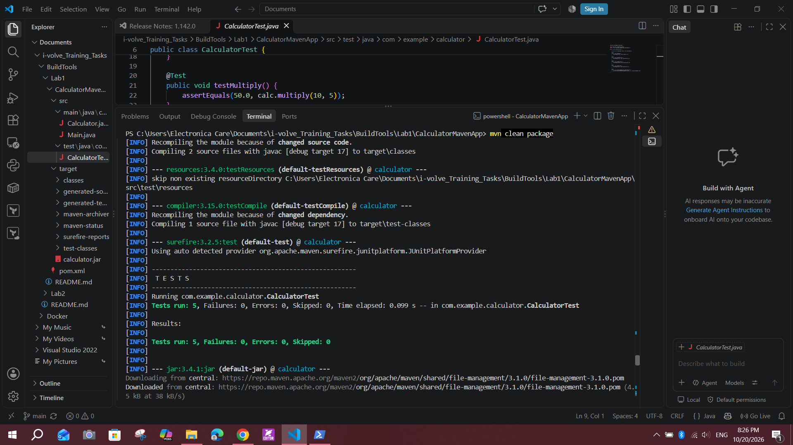
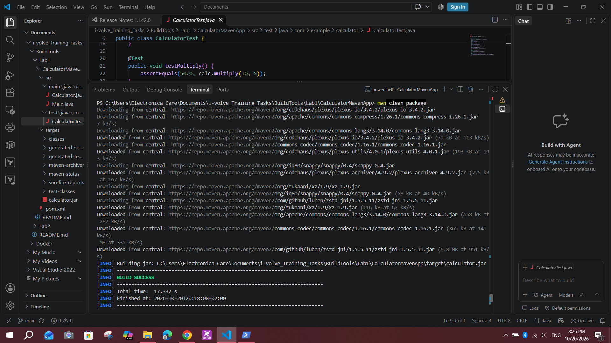
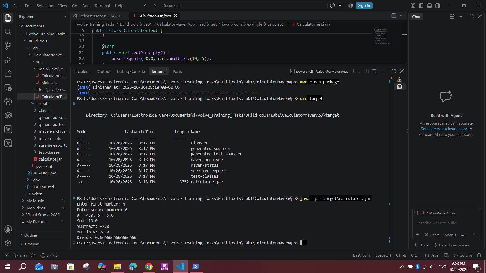

# Lab 1: Building and Packaging a Java Application with Maven

## Objective
Build, test, package, and run a Java calculator application using Maven.

## Environment
- OS: Windows 10 (PowerShell)
- Java: Eclipse Temurin JDK 17
- Maven: 3.9.16
- Source: https://github.com/Ibrahim-Adel15/CalculatorMavenApp.git

## Steps

### 1. Install Java and Maven
Installed Temurin JDK 17 with winget. Maven was not available in winget, so I downloaded the binary zip, extracted it to `C:\Maven\apache-maven-3.9.16`, then set `JAVA_HOME` and added `C:\Maven\apache-maven-3.9.16\bin` to the user `PATH`.

```powershell
java -version
mvn -version
```

### 2. Clone the source code
```powershell
git clone https://github.com/Ibrahim-Adel15/CalculatorMavenApp.git
cd CalculatorMavenApp
```

### 3. Run unit tests
```powershell
mvn test
```
All 5 tests passed (`Tests run: 5, Failures: 0, Errors: 0`). Maven finds tests by convention: classes under `src/test/java` named like `*Test.java` are run by the Surefire plugin.



### 4. Build the application
```powershell
mvn clean package
```
`clean` deletes the old `target/` folder. `package` compiles, runs the tests, and builds the jar. The result was `BUILD SUCCESS`.



The artifact was generated at `target/calculator.jar`.

### 5. Run the application and verify
```powershell
dir target
java -jar target\calculator.jar
```
Test input: `4` and `6`. The output was correct: Sum 10.0, Subtract -2.0, Multiply 24.0, Divide 0.666...



## Result
The build and tests succeeded, `target/calculator.jar` was created, and the app produced correct results.

## Notes
- winget has no Apache Maven package, so Maven was installed manually.
- `target/` is build output and should not be committed to Git (add it to `.gitignore`).