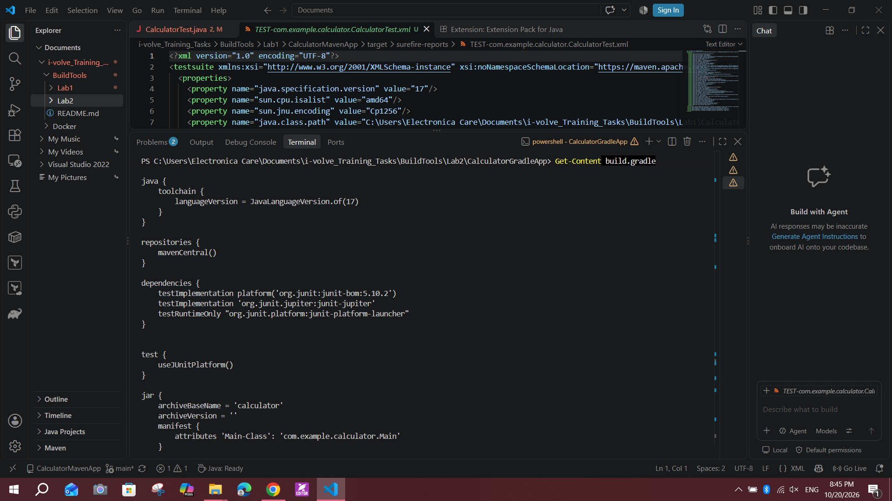
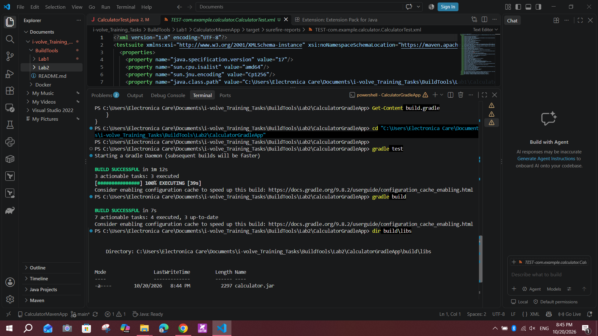
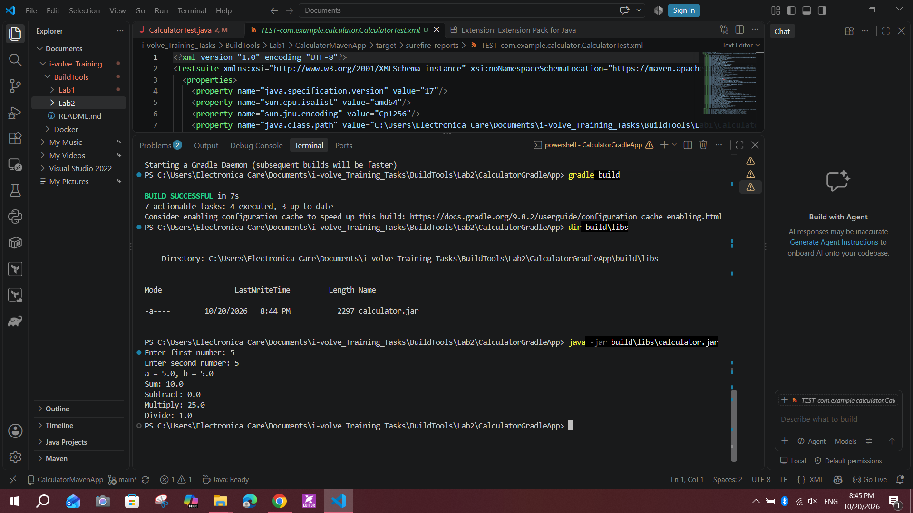

# Lab 2: Building and Packaging a Java Application with Gradle

> Note: the lab slide title says "Go Application", but the project is a Java application (`java` and `application` plugins, `.java` sources, and a `.jar` artifact).

## Objective
Build, test, package, and run the calculator application using Gradle.

## Environment
- OS: Windows 10 (PowerShell)
- Java: Eclipse Temurin JDK 17
- Gradle: 9.8.2
- Source: https://github.com/Ibrahim-Adel15/CalculatorGradleApp.git

## Steps

### 1. Install Gradle
winget has no Gradle package, so I downloaded the binary-only zip, extracted it to `C:\gradle-9.8.2`, and added `C:\gradle-9.8.2\bin` to the user `PATH`.

```powershell
gradle -v
```

### 2. Clone the source code
```powershell
git clone https://github.com/Ibrahim-Adel15/CalculatorGradleApp.git
cd CalculatorGradleApp
```

### 3. Inspect the build file
`build.gradle` uses the `java` and `application` plugins, targets Java 17, uses JUnit 5 for tests, and sets the main class to `com.example.calculator.Main`. The `jar` block names the output `calculator.jar` (no version suffix).



### 4. Run unit tests and build
```powershell
gradle test
gradle build
```
Both finished with `BUILD SUCCESSFUL`.



### 5. Verify the artifact and run the app
```powershell
dir build\libs
java -jar build\libs\calculator.jar
```
The artifact is `build/libs/calculator.jar`. Test input: `5` and `5`. The output was correct: Sum 10.0, Subtract 0.0, Multiply 25.0, Divide 1.0.



## Result
The Gradle build succeeded, `build/libs/calculator.jar` was created, and the app works correctly.

## Maven vs Gradle

| | Maven | Gradle |
|---|---|---|
| Config file | `pom.xml` (XML) | `build.gradle` (Groovy DSL) |
| Run tests | `mvn test` | `gradle test` |
| Build jar | `mvn clean package` | `gradle build` |
| Output folder | `target/` | `build/libs/` |