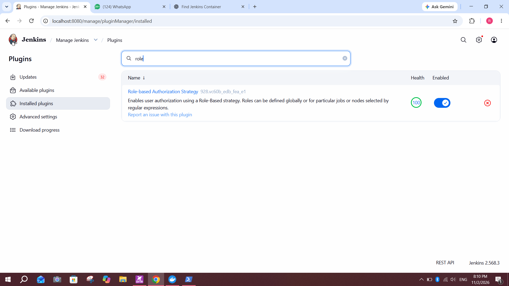
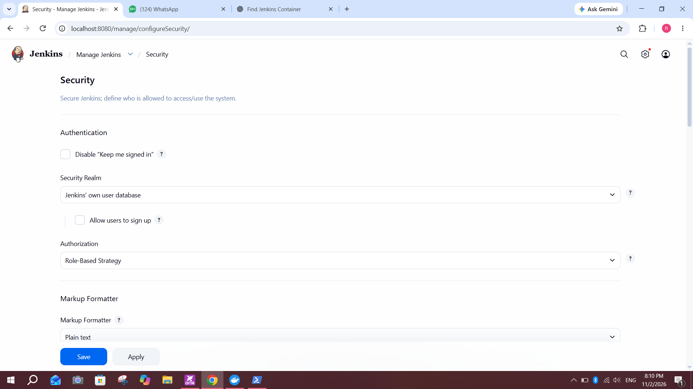
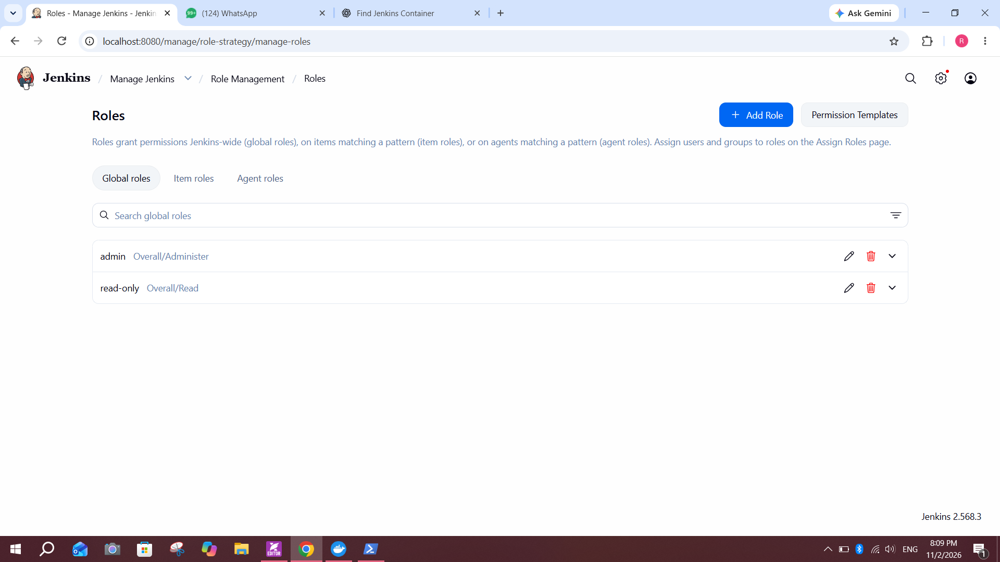
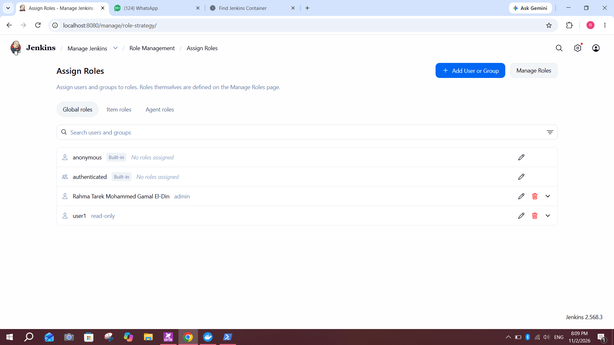
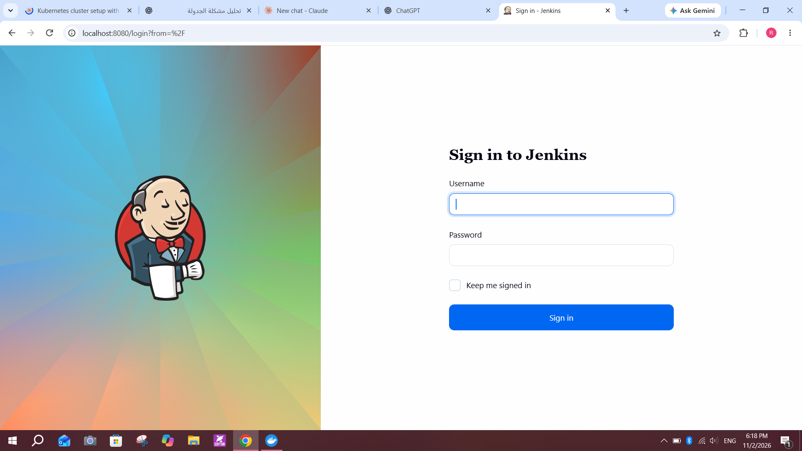
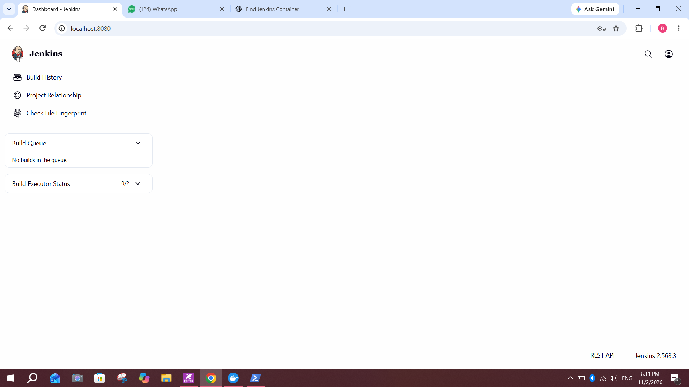
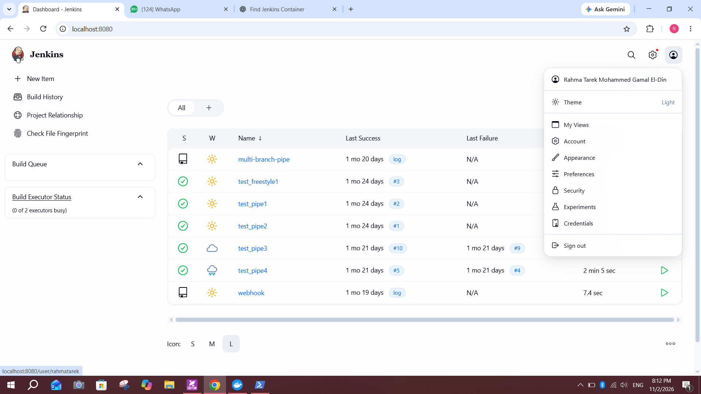

# Lab 20: Role-based Authorization in Jenkins

## Objective
Use the Role-based Authorization Strategy in Jenkins to create an `admin` role and a `read-only` role, assign them to users, and verify that each user only gets the access their role allows.

## Environment
- Jenkins `2.568.3` running in Docker, reachable at `http://localhost:8080`
- Plugin: Role-based Authorization Strategy (`928.vc60b_edb_fea_e1`)
- Security Realm: Jenkins' own user database

## Steps

### 1. Verify the Role-based Authorization Strategy plugin
Go to **Manage Jenkins → Plugins → Installed plugins** and search for `role`.
- The plugin is installed and enabled

### 2. Enable the Role-Based Strategy
Go to **Manage Jenkins → Security**.
- **Security Realm:** Jenkins' own user database
- **Authorization:** Role-Based Strategy
- Click **Save**

### 3. Define the global roles
Go to **Manage Jenkins → Role Management → Manage Roles → Global roles**.

| Role | Permission |
|---|---|
| `admin` | Overall/Administer |
| `read-only` | Overall/Read |

### 4. Assign the roles
Go to **Manage Jenkins → Role Management → Assign Roles → Global roles**.

| User | Role |
|---|---|
| Rahma Tarek Mohammed Gamal El-Din (`rahmatarek`) | `admin` |
| `user1` | `read-only` |

- `anonymous` and `authenticated` are built-in and have no roles assigned

### 5. Test the read-only user
Sign out, then sign in as `user1`.

After login, `user1` sees only **Build History**, **Project Relationship** and **Check File Fingerprint**, plus the build queue and executor status. There is no **New Item**, no **Manage Jenkins** and no settings icon.

### 6. Test the admin user
Sign in as the admin account. The dashboard shows the job list, **New Item**, the settings icon, and the user menu with Account, Preferences, Security, Experiments and Credentials.

## Notes and issues
- **Permissions:** `admin` grants `Overall/Administer`, while `read-only` grants only `Overall/Read`.
- **Built-in groups:** `anonymous` and `authenticated` have no roles, so unauthenticated visitors get no access.
- **Role scope:** besides global roles, Jenkins supports item roles (jobs matched by a regex) and agent roles.
- **Lockout risk:** assign `admin` to your own account before saving the Role-Based Strategy, otherwise you can lock yourself out.
- **Lab wording:** the lab asks for `user1` as admin and `user2` as read-only. In my setup, `user1` has the `read-only` role and my own account has `admin`.

## Conclusion
With the Role-based Authorization Strategy, access is controlled by roles. The admin account has full control of Jenkins, while `user1` can only view it.