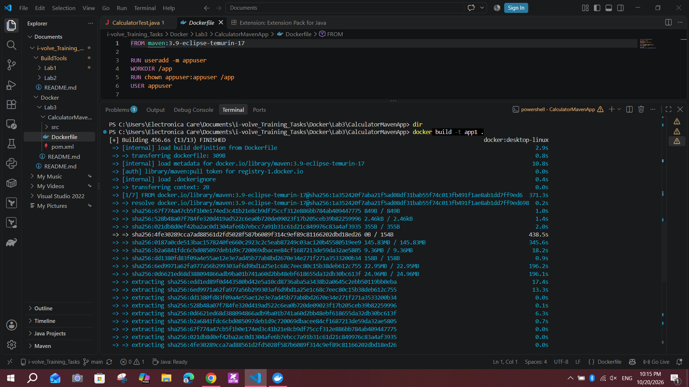
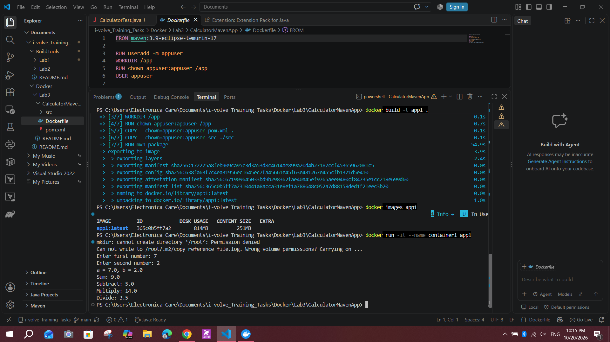
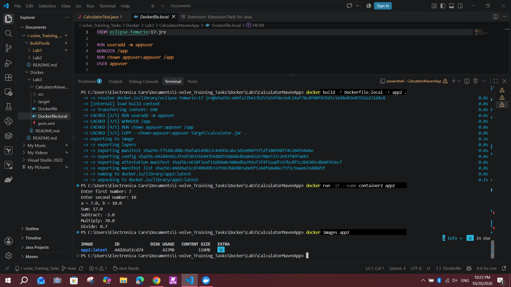
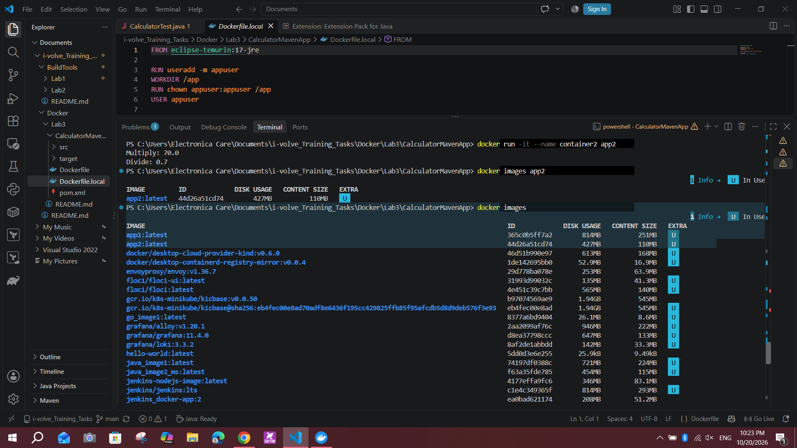

# Lab 3: Creating a Docker Image for a Java Application

## Objective
Containerize the Java calculator app in two ways and compare the resulting image sizes:
1. **Part 1:** build the app inside Docker (image `app1`)
2. **Part 2:** build locally with Maven and package only the JAR (image `app2`)

Source: https://github.com/Ibrahim-Adel15/CalculatorMavenApp.git

## Environment
- Windows 10, Docker Desktop (WSL 2 backend), Docker 29.7.2
- Java 17 (Eclipse Temurin), Maven 3.9

## Part 1: Build inside Docker

### Dockerfile
```dockerfile
FROM maven:3.9-eclipse-temurin-17

RUN useradd -m appuser
WORKDIR /app
RUN chown appuser:appuser /app
USER appuser

COPY --chown=appuser:appuser pom.xml .
COPY --chown=appuser:appuser src ./src
RUN mvn package

EXPOSE 8080
CMD ["java", "-jar", "target/calculator.jar"]
```

### Build, size, and run
```powershell
docker build -t app1 .
docker images app1
docker run -it --name container1 app1
docker rm container1
docker rmi app1
```



Size of `app1`: **251 MB content size (814 MB disk usage)**.

The container ran and the app produced correct output (inputs 7 and 2: Sum 9.0, Subtract 5.0, Multiply 14.0, Divide 3.5).



> The `mkdir: cannot create directory '/root'` message is a harmless warning from the Maven base image's entrypoint script. The container runs as the non-root user `appuser`, which cannot write to `/root`. The app still ran correctly.

## Part 2: Build locally

### Build the JAR on the host
```powershell
mvn clean package
```

### Dockerfile.local
```dockerfile
FROM eclipse-temurin:17-jre

RUN useradd -m appuser
WORKDIR /app
RUN chown appuser:appuser /app
USER appuser

COPY --chown=appuser:appuser target/calculator.jar .

EXPOSE 8080
CMD ["java", "-jar", "calculator.jar"]
```

### Build, size, and run
```powershell
docker build -f Dockerfile.local -t app2 .
docker images app2
docker run -it --name container2 app2
docker rm container2
docker rmi app2
```

Size of `app2`: **110 MB content size (427 MB disk usage)**.

Test inputs were 7 and 10, and the output was correct: Sum 17.0, Subtract -3.0, Multiply 70.0, Divide 0.7.



## Image size comparison

| Image | Approach | Content size | Disk usage |
|---|---|---|---|
| app1 | Build inside Docker | 251 MB | 814 MB |
| app2 | Build locally, copy JAR | 110 MB | 427 MB |



## Bonus: Why the sizes differ

`app2` is about **56% smaller** by content size (141 MB less).

- **app1** is based on the Maven image, which contains the full JDK, Maven, the downloaded dependencies (`~/.m2`), the source code, and the build output. All of that is only needed to *build* the app, not to run it.
- **app2** contains only a Java runtime (JRE) and the finished JAR. It has no build tools and no source code, so it is smaller and has a smaller attack surface.

**Trade-offs**
- Part 1 is reproducible on any machine with only Docker installed, since Java and Maven are not needed on the host. The cost is a larger image and a slower first build (about 7.5 minutes here, including image pulls).
- Part 2 gives a small, fast-building image, but it depends on the host having Java and Maven installed.
- **Best of both:** a multi-stage build compiles in a Maven stage, then copies only the JAR into a JRE image. That gives a reproducible build and a small final image.

## Notes
- The app is interactive (it reads from the keyboard), so containers must be run with `-it`. Without it, the app fails with `NoSuchElementException`.
- `EXPOSE 8080` is a declaration only, since the app is a console program and does not serve on that port.
- Both containers and images were deleted after verification, as the lab requires.
