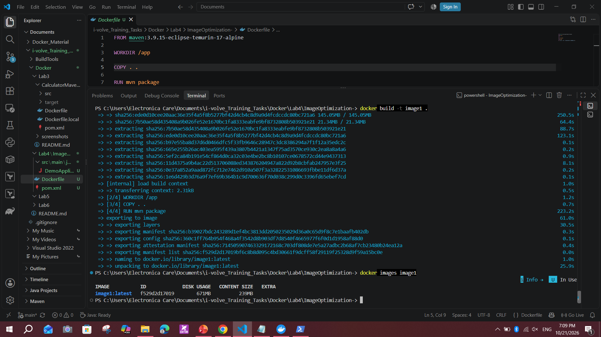
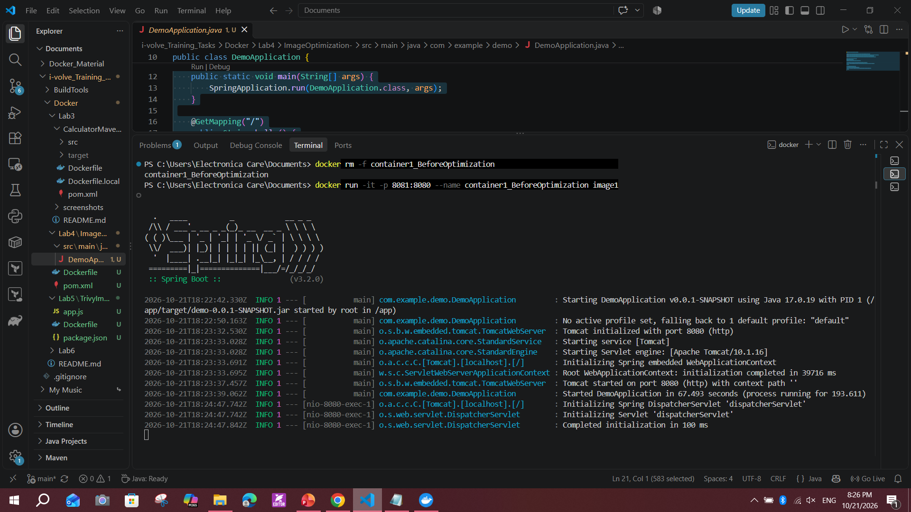
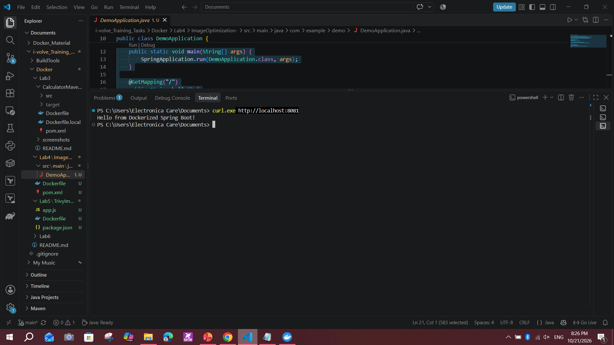
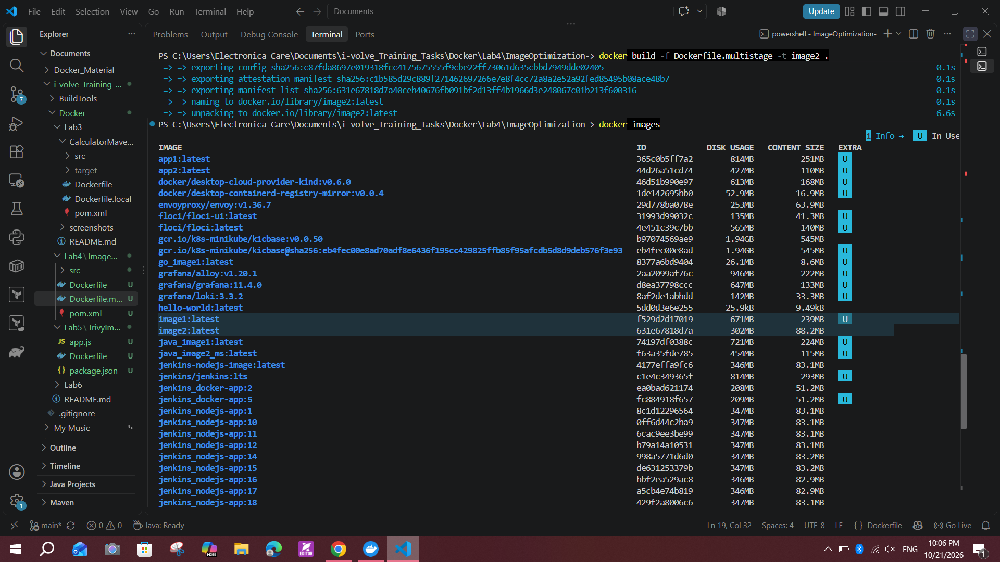
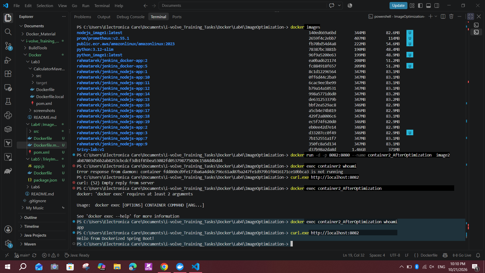
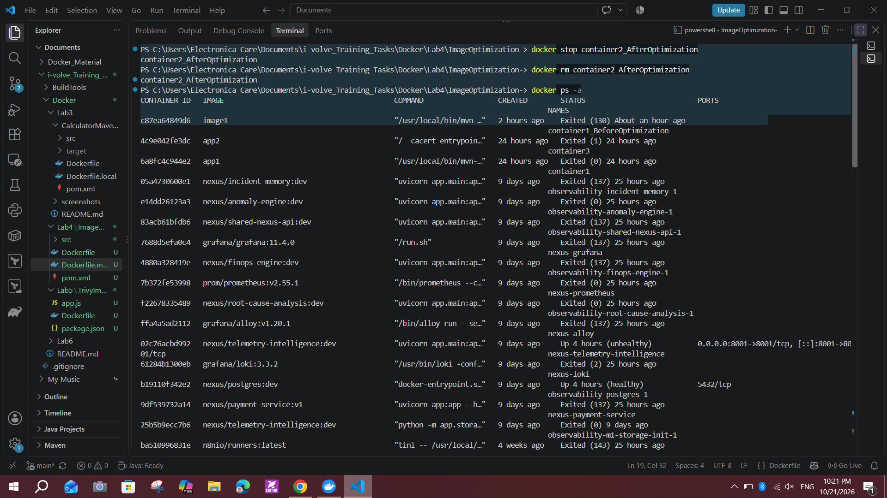
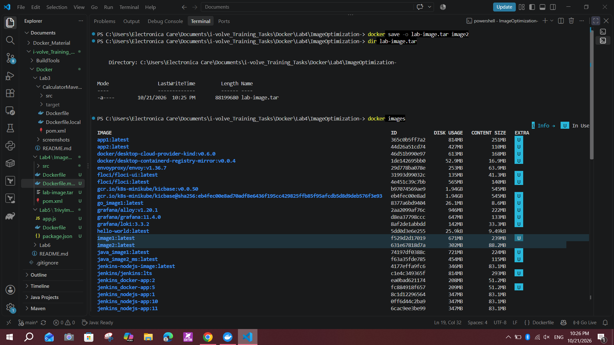
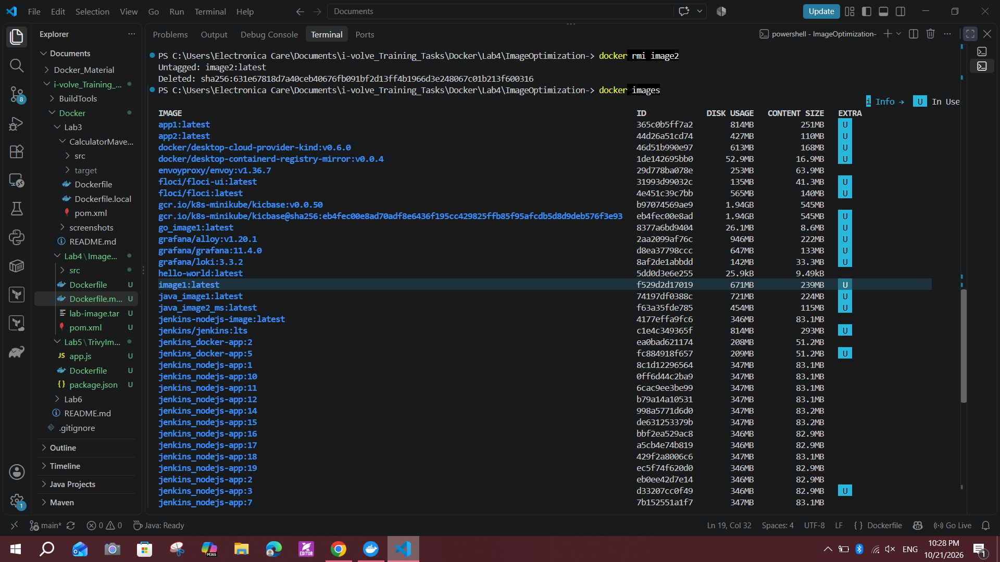
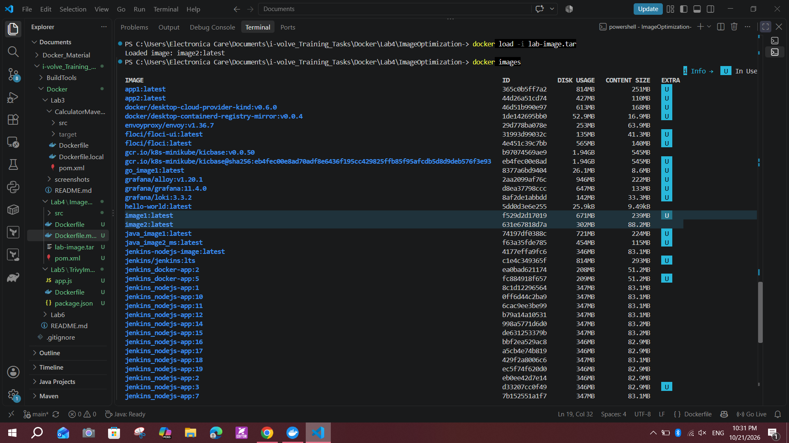

# Lab 4: Docker Image Optimization and Export/Load

## Objective
Build a Spring Boot image with a single-stage Dockerfile (`image1`), optimize it with a multi-stage build that runs as a non-root user (`image2`), compare the sizes, then export `image2` to a TAR file, delete it, and load it back.

Source: https://github.com/Ibrahim-Adel15/ImageOptimization-.git

## Environment
- Windows 10, Docker Desktop (WSL 2), Docker 29.7.2
- App: Spring Boot 3.2.0, Java 17 (endpoint `/` returns "Hello from Dockerized Spring Boot!")

## Part 1: Original image (image1)

### Dockerfile
```dockerfile
FROM maven:3.9.15-eclipse-temurin-17-alpine
WORKDIR /app
COPY . .
RUN mvn package
EXPOSE 8080
CMD ["java", "-jar", "target/demo-0.0.1-SNAPSHOT.jar"]
```

### Build and note the size
```powershell
docker build -t image1 .
docker images image1
```
Size of `image1`: **239 MB content size (671 MB disk usage)**.



### Run, verify, stop, delete
Port 8080 on my machine is used by a local Jenkins, so I mapped the container's 8080 to host port **8081**.
```powershell
docker run -it -p 8081:8080 --name container1_BeforeOptimization image1
curl.exe http://localhost:8081
docker stop container1_BeforeOptimization
docker rm container1_BeforeOptimization
```
The app started in about 67 seconds and answered `Hello from Dockerized Spring Boot!`. The log says it was started **by root**.





## Part 2: Multi-stage, non-root image (image2)

### Dockerfile.multistage
```dockerfile
# Stage 1: build (Maven + JDK, thrown away afterwards)
FROM maven:3.9.15-eclipse-temurin-17-alpine AS build
WORKDIR /app
COPY pom.xml .
COPY src ./src
RUN --mount=type=cache,target=/root/.m2 \
    mvn -q package -DskipTests \
    -Dmaven.wagon.http.retryHandler.count=10 \
    -Daether.connector.http.retryHandler.count=10 \
    -Dmaven.wagon.httpconnectionManager.ttlSeconds=30

# Stage 2: runtime (JRE only, non-root user)
FROM eclipse-temurin:17-jre-alpine
RUN addgroup -S app && adduser -S app -G app
WORKDIR /app
COPY --from=build /app/target/demo-0.0.1-SNAPSHOT.jar app.jar
USER app
EXPOSE 8080
CMD ["java", "-jar", "app.jar"]
```


### Build and compare sizes
```powershell
docker build -f Dockerfile.multistage -t image2 .
docker images
```



| Image | Base / approach | Content size | Disk usage | Runs as |
|---|---|---|---|---|
| image1 | Maven + JDK, single stage | 239 MB | 671 MB | root |
| image2 | Multi-stage, JRE only | 88.2 MB | 302 MB | app (non-root) |

`image2` is about **63% smaller** by content size (151 MB less) and **55% smaller** by disk usage (369 MB less).

### Run container2 and verify non-root
Host port **8082** was used.
```powershell
docker run -d -p 8082:8080 --name container2_AfterOptimization image2
docker exec container2_AfterOptimization whoami
curl.exe http://localhost:8082
```
`whoami` printed **app** (not root), and the app answered `Hello from Dockerized Spring Boot!`.



### Stop and delete container2
```powershell
docker stop container2_AfterOptimization
docker rm container2_AfterOptimization
docker ps -a
```



## Part 3: Export and import

```powershell
docker save -o lab-image.tar image2
dir lab-image.tar
```
`lab-image.tar` is 88,199,680 bytes (about 84 MiB).



```powershell
docker rmi image2
docker images
```
`image2` no longer appears in the list.



```powershell
docker load -i lab-image.tar
docker images
```
Docker reported `Loaded image: image2:latest`. The restored image has the same ID (`631e67818d7a`) and size as before, so it was restored correctly.



## Why image2 is smaller and safer
- **Multi-stage build:** Maven and the JDK are used only in the build stage. The final image has just a JRE and the JAR, with no Maven, no `~/.m2` cache and no source code.
- **Smaller attack surface:** fewer packages means fewer places for vulnerabilities.
- **Non-root user:** the app runs as the unprivileged user `app` instead of root, which limits the damage if the app is compromised.
- **Better caching:** `pom.xml` and the source are copied separately, so dependency layers are reused when only code changes.

## Notes and issues
- **Slide names vs mine:** I used `container1_BeforeOptimization` and `container2_AfterOptimization` instead of `container1` and `container2`.
- **TAR name:** the slide says `lab-image.tar` when saving but `image2.tar` when loading. I used `lab-image.tar` for both.
- **Port 8080 busy:** a local Jenkins already uses 8080, so the containers were mapped to 8081 and 8082.
- **Maven download failure:** the first multi-stage build failed with `SSL peer shut down incorrectly` while downloading Spring Boot from Maven Central (unstable connection). I fixed it by adding Maven retry settings and a BuildKit cache mount so partial downloads are kept.
- **`*.tar` is in `.gitignore`**, so `lab-image.tar` is not pushed to GitHub.