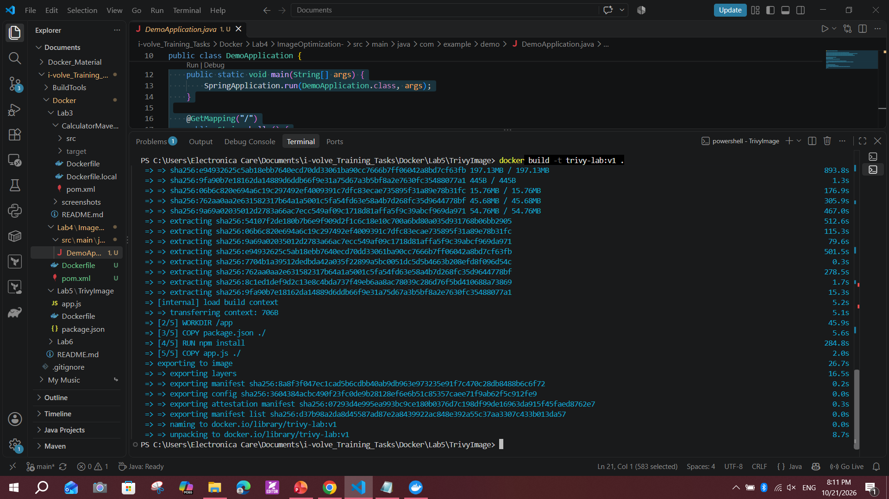
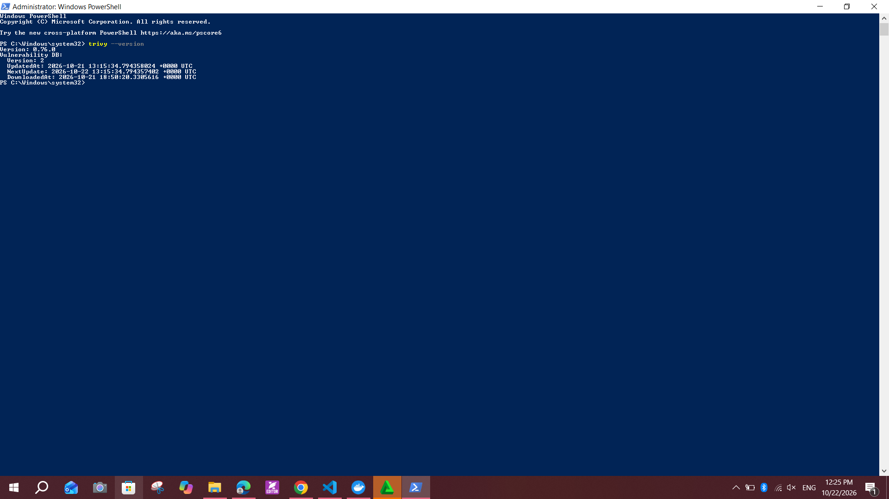
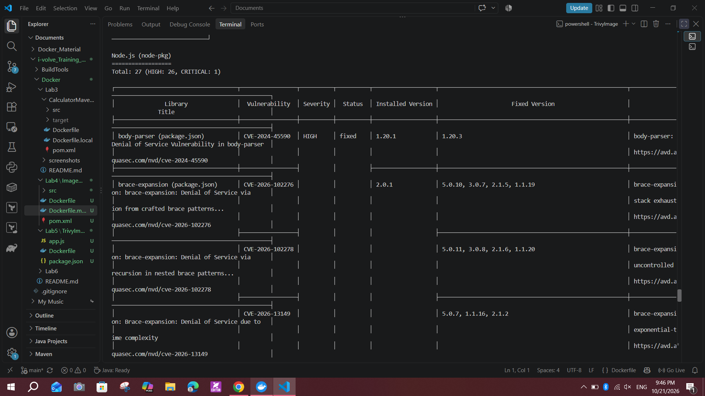
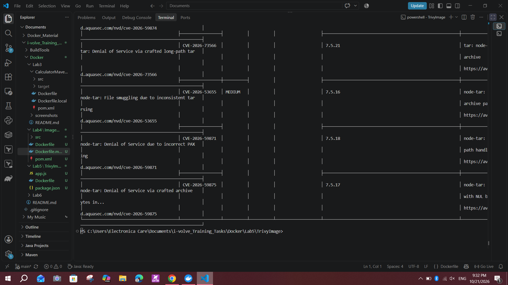
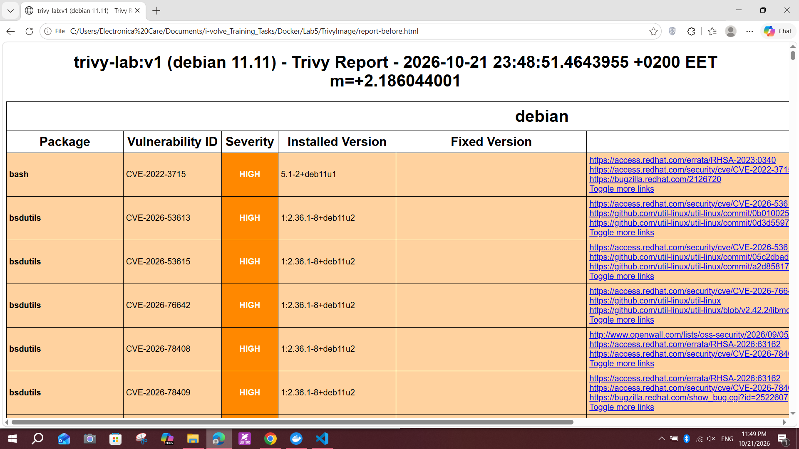
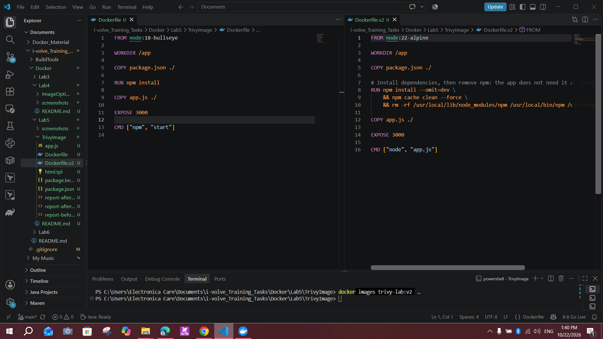
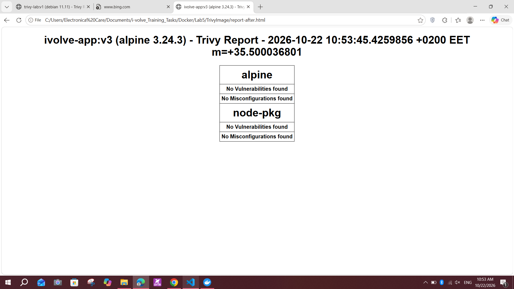
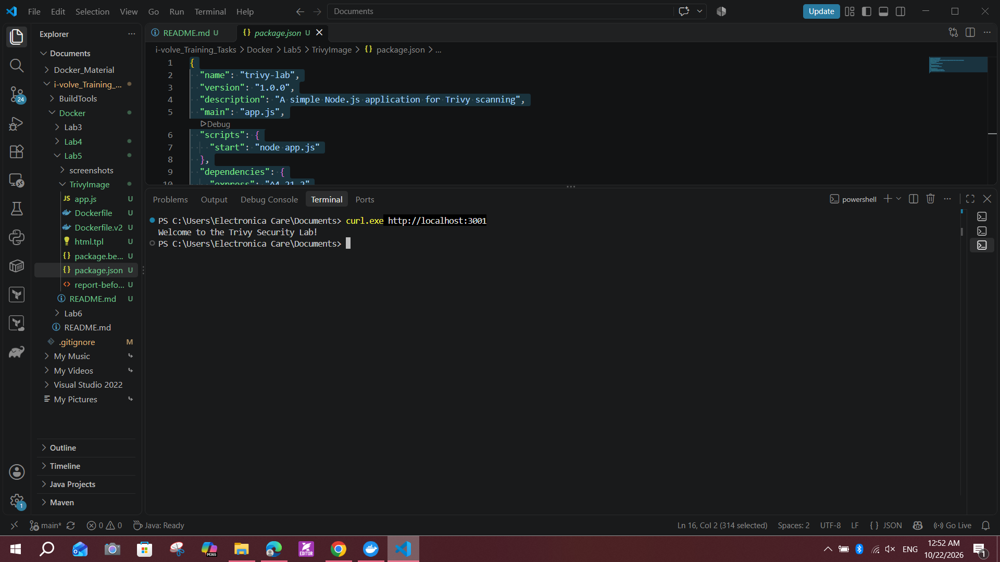
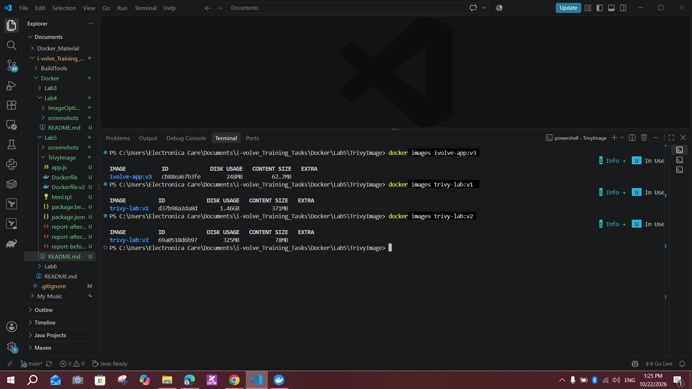

# Lab 5: Docker Image Vulnerability Scanning with Trivy

## Objective
Build a Docker image from a provided Dockerfile, scan it with Trivy, generate HTML reports, then remediate the HIGH and CRITICAL vulnerabilities and verify with a rescan.

Source: https://github.com/Ibrahim-Adel15/TrivyImage.git

## Environment
- Windows 10, Docker Desktop (WSL 2), Trivy 0.76.0 (installed with `winget install AquaSecurity.Trivy`)
- App: small Node.js/Express application (`app.js`, `package.json`)

## Part 1: Required steps

### 1. Clone and build `trivy-lab:v1`
```powershell
git clone https://github.com/Ibrahim-Adel15/TrivyImage.git
cd TrivyImage
docker build -t trivy-lab:v1 .
```
The provided Dockerfile uses `FROM node:18-bullseye`.



### 2. Install Trivy and verify
```powershell
winget install AquaSecurity.Trivy --source winget
trivy --version
```


### 3. Download the vulnerability database
My connection was slow, so the default 5-minute timeout failed. I downloaded the database separately with a longer timeout and reused it for all scans:
```powershell
trivy image --download-db-only --timeout 30m
```

### 4. Scan the image
```powershell
trivy image --skip-db-update --skip-version-check --scanners vuln --timeout 30m trivy-lab:v1
```
`--scanners vuln` disables secret scanning, which was slow and not required.

### 5. Scan only HIGH and CRITICAL
```powershell
trivy image --skip-db-update --skip-version-check --scanners vuln --timeout 30m --severity HIGH,CRITICAL trivy-lab:v1
```
The Node.js packages section reported **Total: 27 (HIGH: 26, CRITICAL: 1)**, and the Debian 11 OS packages section reported **Total: ___**.




### 6. Generate the HTML report
```powershell
Invoke-WebRequest https://raw.githubusercontent.com/aquasecurity/trivy/main/contrib/html.tpl -OutFile html.tpl
trivy image --skip-db-update --skip-version-check --scanners vuln --timeout 30m --severity HIGH,CRITICAL --format template --template "@html.tpl" -o report-before.html trivy-lab:v1
```
Report: [`report-before.html`](report-before.html)



### Findings review
- **OS packages (Debian 11 "bullseye"):** a very large number of findings. The `node:18-bullseye` base is a full image with many development libraries the app does not use (ImageMagick, libpq-dev, libopenexr, libheif, python3.9, perl, kernel headers `linux-libc-dev`). Many findings had no fixed version available.
- **From `package.json`:** `body-parser 1.20.1` and `path-to-regexp 0.1.7`, both pulled in by Express 4.18.2.
- **From the npm bundled in the image:** `tar` (the one CRITICAL), `brace-expansion`, `minimatch`, `glob`, `cross-spawn`, `pacote`, `sigstore`, `ip-address`, `http-cache-semantics`.

## Part 2: Bonus, remediation

### Original Dockerfile (before)
```dockerfile
FROM node:18-bullseye
WORKDIR /app
COPY package.json ./
RUN npm install
COPY app.js ./
EXPOSE 3000
CMD ["npm", "start"]
```

### Fix 1: newer, smaller base image and updated dependencies
- Changed the base image to `node:22-alpine`, which removes the whole Debian package set.
- Upgraded Express from `4.18.2` to `^4.21.2` and added `overrides` to force fixed versions:

```json
"dependencies": { "express": "^4.21.2" },
"overrides": { "body-parser": "1.20.3", "path-to-regexp": "0.1.13" }
```
- Added `RUN npm install -g npm@latest` to replace the vulnerable packages bundled with npm.

Result of this first rebuild (`trivy-lab:v2`): Alpine **0**, application dependencies **0**, but **3 HIGH** remained inside npm's own bundled tools (`brace-expansion` x2 and `undici`). Report: [`report-after-step1.html`](report-after-step1.html)

### Fix 2: remove npm from the final image
The app is started with `node app.js` and does not need npm at runtime. After installing the dependencies, npm is deleted, and `CMD` calls `node` directly. This removes the vulnerable files and shrinks the image.

```dockerfile
FROM node:22-alpine
WORKDIR /app
COPY package.json ./
RUN npm install --omit=dev \
    && npm cache clean --force \
    && rm -rf /usr/local/lib/node_modules/npm /usr/local/bin/npm /usr/local/bin/npx
COPY app.js ./
EXPOSE 3000
CMD ["node", "app.js"]
```



### Rebuild and rescan
```powershell
docker build -f Dockerfile.v2 -t ivolve-app:v3 .
trivy image --skip-db-update --skip-version-check --scanners vuln --timeout 30m --severity HIGH,CRITICAL --format template --template "@html.tpl" -o report-after.html ivolve-app:v3
trivy image --skip-db-update --skip-version-check --scanners vuln --timeout 30m --severity HIGH,CRITICAL --ignore-unfixed ivolve-app:v3
```
Report: [`report-after.html`](report-after.html)

**Result: no vulnerabilities found** in Alpine 3.24.3 and in the Node.js packages.



### Verify the app still works
```powershell
docker run -d -p 3001:3000 --name ivolve-test ivolve-app:v3
curl.exe http://localhost:3001
docker rm -f ivolve-test
```
Host port 3001 was used because port 8080 is already taken by a local Jenkins.



## Before and after

| | `trivy-lab:v1` (before) | `ivolve-app:v3` (after) |
|---|---|---|
| Base image | `node:18-bullseye` (Debian 11) | `node:22-alpine` (Alpine 3.24.3) |
| Express | 4.18.2 | ^4.21.2 + overrides |
| npm in final image | yes (bundled, vulnerable) | removed |
| Start command | `npm start` | `node app.js` |
| Image size (content / disk) | 371 MB / 1.46 GB | ___ / ___ |
| OS package findings | ___ | 0 |
| Node.js findings | 27 (26 HIGH, 1 CRITICAL) | 0 |



## Notes and issues
- **Tag name:** the slide asks for `ivolve-app:v2`, but I used `ivolve-app:v3` because `v2` was an earlier attempt (`trivy-lab:v2`, which still had 3 HIGH findings).
- **Database download timeout:** the first scans failed with `context deadline exceeded` because of a slow connection. I downloaded the DB separately and used `--timeout 30m` and `--scanners vuln` (and `--skip-db-update` once the DB was cached).
- **Slow base image pull:** `node:18-bullseye` took a long time to download, which is another benefit of the smaller Alpine image.
- **Why `--ignore-unfixed`:** it matches the lab wording "where fixes are available". The final report is clean even without it.
- **Why this works:** most findings came from an old, large base image plus the npm tooling inside it. Using a minimal base, updating dependencies and removing unused tooling fixed them without changing the app code.