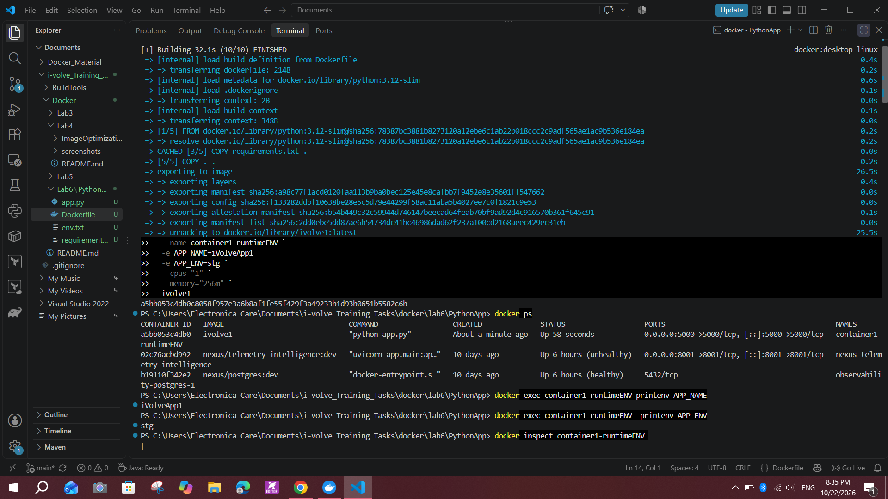
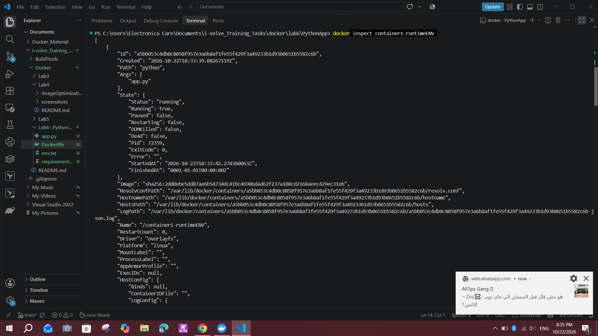
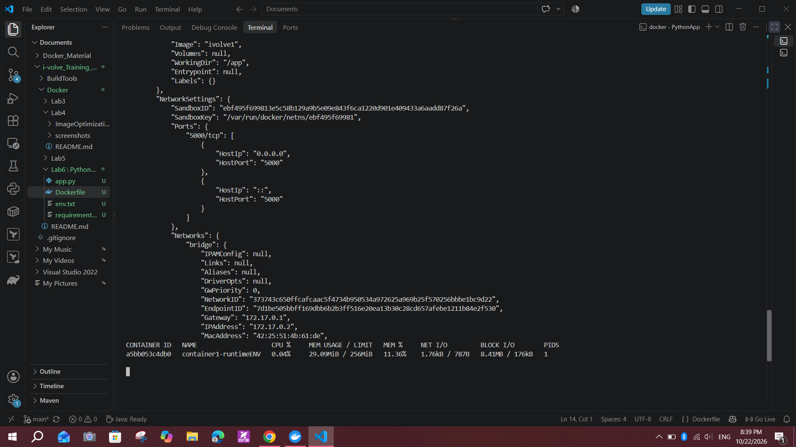
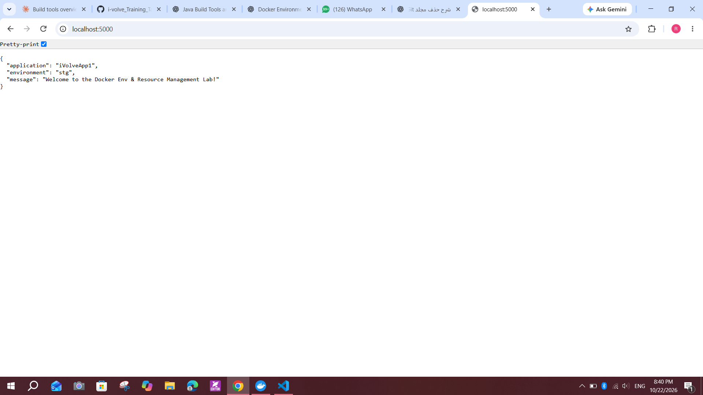
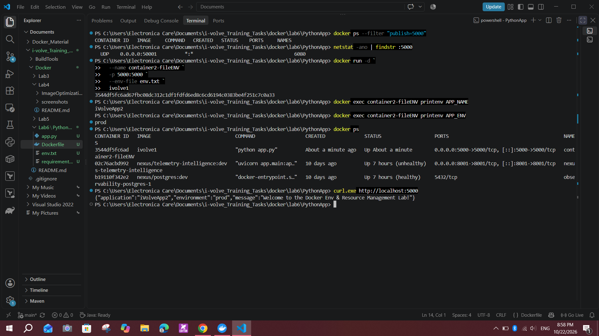
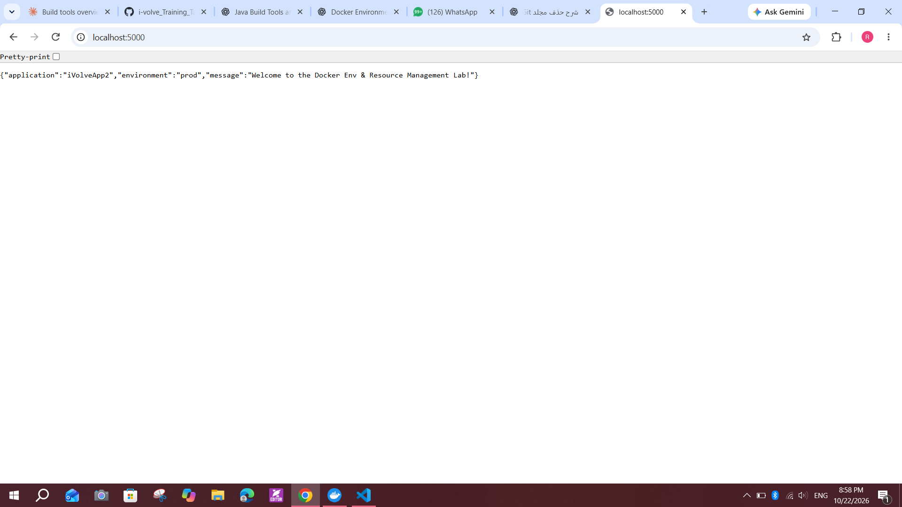
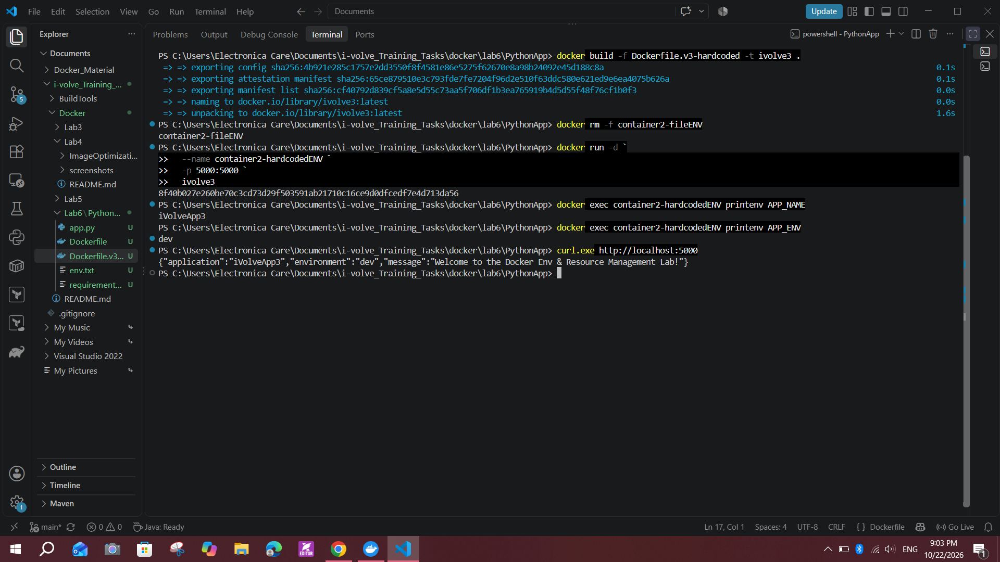
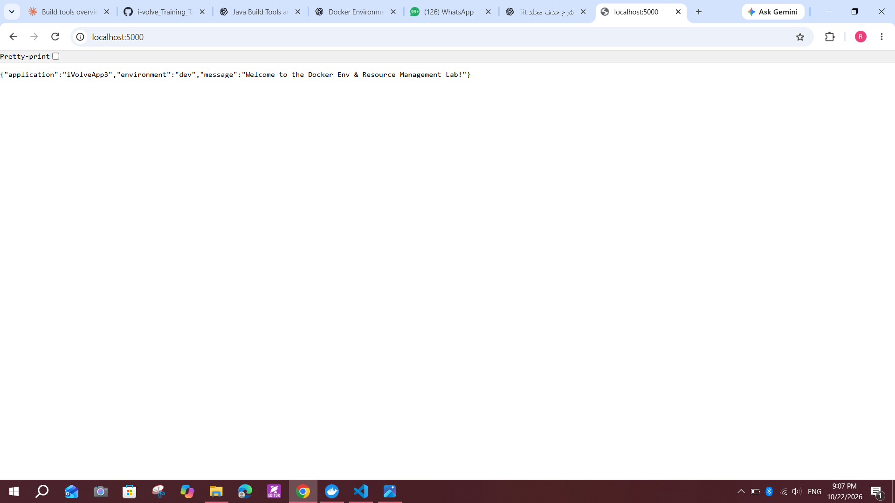

# Lab 6: Docker Environment Variables and Resource Management

## Objective
Build a Docker image for a Python application, configure environment variables in three different ways (runtime `-e`, an env file, and hardcoded in the Dockerfile), limit a container's CPU and memory, and verify the application and its configuration.

Source: https://github.com/Ibrahim-Adel15/PythonApp.git

## Environment
- Windows 10, PowerShell, Docker Desktop (WSL 2)
- Base image: `python:3.12-slim`
- App: Python application (`app.py`) listening on port `5000`, returning a JSON response with the application name and environment
- Images: `ivolve1`, `ivolve3`
- Files: `Dockerfile`, `Dockerfile.v3-hardcoded`, `env.txt`, `requirements.txt`

## Part 1: Environment variables passed at runtime

### 1. Clone the repository
```powershell
git clone https://github.com/Ibrahim-Adel15/PythonApp.git
cd PythonApp
```

### 2. Create the Dockerfile
```dockerfile
FROM python:3.12-slim

WORKDIR /app

COPY requirements.txt .
RUN pip install --no-cache-dir -r requirements.txt

COPY . .

EXPOSE 5000

CMD ["python", "app.py"]
```
No environment variables are hardcoded here. The app listens on `0.0.0.0:5000`, so the published Docker port can reach it.

### 3. Build `ivolve1`
```powershell
docker build -t ivolve1 .
docker images ivolve1
```

### 4. Run `container1-runtimeENV` with variables and resource limits
```powershell
docker run -d `
  --name container1-runtimeENV `
  -p 5000:5000 `
  -e APP_NAME=iVolveApp1 `
  -e APP_ENV=stg `
  --cpus="1" `
  --memory="256m" `
  ivolve1
```
- `-e` sets environment variables at runtime.
- `--cpus="1"` limits the container to one CPU.
- `--memory="256m"` limits it to 256 MB of memory.
- `-p 5000:5000` maps host port 5000 to container port 5000.

The build finished in about 32 seconds. `docker ps` shows `container1-runtimeENV` running with port `5000` published, and `printenv` inside the container returns `iVolveApp1` and `stg`.



### 5. Inspect the container
```powershell
docker inspect container1-runtimeENV
```
The output shows the container is `running` (not OOM-killed), started with `python app.py` from the `ivolve1` image, and that port `5000/tcp` is mapped to host port `5000`.



### 6. Monitor CPU and memory usage
```powershell
docker stats container1-runtimeENV
```
`docker stats` shows the memory **limit of 256 MiB** taking effect:

| CPU % | Memory usage / limit | Mem % | Net I/O | PIDs |
|---|---|---|---|---|
| 0.04% | 29.09 MiB / 256 MiB | 11.36% | 1.76 kB / 787 B | 1 |

Press `Ctrl+C` to stop monitoring. (The slide writes `docker stats cont1`, which is a typo, so I used the real container name.)



### 7. Test the application
```powershell
curl.exe http://localhost:5000
```
Response from http://localhost:5000:
```json
{ "application": "iVolveApp1", "environment": "stg", "message": "Welcome to the Docker Env & Resource Management Lab!" }
```



## Part 2: Environment variables loaded from `env.txt`

### 1. Create the env file
```powershell
@"
APP_NAME=iVolveApp2
APP_ENV=prod
"@ | Set-Content -Encoding ascii env.txt
```
There are no quotes and no spaces around `=`, because `--env-file` takes values literally.

### 2. Run `container2-fileENV`
All containers use host port 5000, so I removed the previous container first and checked that the port was free:
```powershell
docker rm -f container1-runtimeENV
docker ps --filter "publish=5000"

docker run -d `
  --name container2-fileENV `
  -p 5000:5000 `
  --env-file env.txt `
  ivolve1
```
The same `ivolve1` image is reused. Changing the values in `env.txt` does not require a rebuild.

### 3. Verify the variables
```powershell
docker exec container2-fileENV printenv APP_NAME
docker exec container2-fileENV printenv APP_ENV
curl.exe http://localhost:5000
```
Output: `iVolveApp2` and `prod`, and the response is
```json
{"application":"iVolveApp2","environment":"prod","message":"Welcome to the Docker Env & Resource Management Lab!"}
```



The browser shows the same response:



## Part 3: Environment variables hardcoded in the Dockerfile

### 1. Create `Dockerfile.v3-hardcoded`
```dockerfile
FROM python:3.12-slim

WORKDIR /app

COPY requirements.txt .
RUN pip install --no-cache-dir -r requirements.txt

COPY . .

ENV APP_NAME=iVolveApp3
ENV APP_ENV=dev

EXPOSE 5000

CMD ["python", "app.py"]
```
A separate file was used so the original `Dockerfile` stays unchanged. The `ENV` values become defaults stored in the image.

### 2. Build `ivolve3`
```powershell
docker build -f Dockerfile.v3-hardcoded -t ivolve3 .
docker images ivolve3
```

### 3. Run `container2-hardcodedENV`
```powershell
docker rm -f container2-fileENV

docker run -d `
  --name container2-hardcodedENV `
  -p 5000:5000 `
  ivolve3
```
No `-e` or `--env-file` is needed, because the values come from the image.

### 4. Verify the variables
```powershell
docker exec container2-hardcodedENV printenv APP_NAME
docker exec container2-hardcodedENV printenv APP_ENV
curl.exe http://localhost:5000
```
Output: `iVolveApp3` and `dev`, and the response is
```json
{"application":"iVolveApp3","environment":"dev","message":"Welcome to the Docker Env & Resource Management Lab!"}
```



The browser shows the same response:



## Comparison of the three approaches

| | Runtime variables | Environment file | Hardcoded in Dockerfile |
|---|---|---|---|
| Image | `ivolve1` | `ivolve1` | `ivolve3` |
| Container | `container1-runtimeENV` | `container2-fileENV` | `container2-hardcodedENV` |
| Method | `docker run -e` | `--env-file env.txt` | Dockerfile `ENV` |
| `APP_NAME` | `iVolveApp1` | `iVolveApp2` | `iVolveApp3` |
| `APP_ENV` | `stg` | `prod` | `dev` |
| Rebuild to change values | No | No | Yes |
| CPU / memory limit | 1 CPU, 256 MB | not set | not set |

## Notes and issues
- **Container names:** the slide names the containers `container1` and `container2` (and uses `container2` twice). I used descriptive names (`container1-runtimeENV`, `container2-fileENV`, `container2-hardcodedENV`) so each approach is clear.
- **Port conflict:** all three containers publish host port 5000, so each one was removed before the next started. I confirmed the port was free with `docker ps --filter "publish=5000"` and `netstat -ano | findstr :5000`. Using a different host port (for example `-p 5001:5000`) would let them run side by side.
- **Precedence:** a value passed with `-e` or `--env-file` overrides an `ENV` default set in the Dockerfile.
- **Hardcoded values are baked into the image:** anyone with the image can read them with `docker image inspect`, so secrets should never be stored with `ENV`.
- **Resource limits:** `--cpus` and `--memory` apply to `container1-runtimeENV` only, as the lab asks. `docker stats` shows the 256 MiB limit.
- **Slide typo:** the slide writes `docker stats cont1`, but the container is named `container1-runtimeENV`.

## Conclusion
Runtime variables and env files let the same image run with different configurations without rebuilding, while Dockerfile `ENV` sets defaults inside the image. CPU and memory limits control how much of the host a container can use.