# Docker Lab 7: Multi-Network Microservices, Volumes, and Bind Mounts

## 1. Lab Overview

This lab containerizes a three-tier microservices application with Docker, connects the services through two separate bridge networks, and persists data using Docker named volumes and a host bind mount.

| Service | Port | Role |
|---|---:|---|
| Frontend | 3000 | Web interface for creating and displaying messages |
| Backend | 5000 | Stores and retrieves messages, sends notification requests |
| Notification | 5001 | Receives requests at `/notify` and writes notification logs |

**Technologies:** Docker Desktop, Python/Flask, Docker bridge networks, named volumes, host bind mounts, PowerShell (Windows).

**Project location:**
```powershell
C:\Users\Electronica Care\Documents\i-volve_Training_Tasks\docker\lab7\MicroserviceApp
```

**Source repository:** https://github.com/Ibrahim-Adel15/MicroserviceApp.git

---

## 2. Lab Requirements

- Clone the application code.
- Create Dockerfiles for frontend, backend, and notification, then build the images.
- Create two bridge networks with separate subnets: `frontend-backend` and `backend-notification`.
- Create two Docker volumes for backend and notification logs.
- Create a host directory for backend data and bind-mount it into the backend container.
- Run notification on `backend-notification`.
- Run backend on both networks and configure the notification URL.
- Run frontend on `frontend-backend`, publish a port, and configure the backend URL.
- Access the web page and verify messages can be created and retrieved.

---

## 3. Application Configuration

| Service | Configuration |
|---|---|
| Frontend | `BACKEND_URL=http://backend:5000` |
| Backend | `NOTIFICATION_URL=http://notification:5001/notify` |
| Notification | Receives requests at `/notify` |

Containers reach each other by name; Docker's internal DNS resolves these names on shared networks, so no hardcoded IPs are needed.

**Storage paths inside containers**

- Messages: `/app/data/messages.json` (backend, bind mount)
- Logs: `/app/logs/backend.log` and `/app/logs/notification.log` (named volumes)

---

## 4. Dockerfiles

### Frontend (`frontend/Dockerfile`)
```dockerfile
FROM python:3.12-slim
WORKDIR /app
COPY requirements.txt .
RUN pip install --no-cache-dir -r requirements.txt
COPY app.py .
EXPOSE 3000
CMD ["python", "app.py"]
```

### Backend (`backend/Dockerfile`)
```dockerfile
FROM python:3.12-slim
WORKDIR /app
COPY requirements.txt .
RUN pip install --no-cache-dir -r requirements.txt
RUN mkdir -p /app/data /app/logs
COPY app.py .
EXPOSE 5000
CMD ["python", "app.py"]
```

### Notification (`notification/Dockerfile`)
```dockerfile
FROM python:3.12-slim
WORKDIR /app
COPY requirements.txt .
RUN pip install --no-cache-dir -r requirements.txt
RUN mkdir -p /app/logs
COPY app.py .
EXPOSE 5001
CMD ["python", "app.py"]
```

Requirements: frontend and backend use `Flask==3.1.2` and `requests==2.32.5`; notification uses `Flask==3.1.2`.

---

## 5. Building the Images

```powershell
docker build -t frontend-img .\frontend
docker build -t backend-img .\backend
docker build -t notification-img .\notification
docker images
```

---

## 6. Creating the Networks

```powershell
docker network create --driver bridge --subnet 10.10.1.0/24 frontend-backend
docker network create --driver bridge --subnet 10.10.2.0/24 backend-notification
```

The backend joins both networks. The frontend never talks to the notification service directly.

```text
Browser
   |  http://localhost:8081
   v
Frontend  --(frontend-backend)-->  Backend  --(backend-notification)-->  Notification
```

Verification (screenshots 3, 4, 5):

```powershell
docker network inspect frontend-backend
docker network inspect backend-notification
```

| Network | Subnet | Gateway | Containers seen |
|---|---|---|---|
| `frontend-backend` | 10.10.1.0/24 | 10.10.1.1 | backend, frontend (frontend requests appear in backend logs from 10.10.1.3) |
| `backend-notification` | 10.10.2.0/24 | 10.10.2.1 | notification (10.10.2.2), backend (10.10.2.3) |

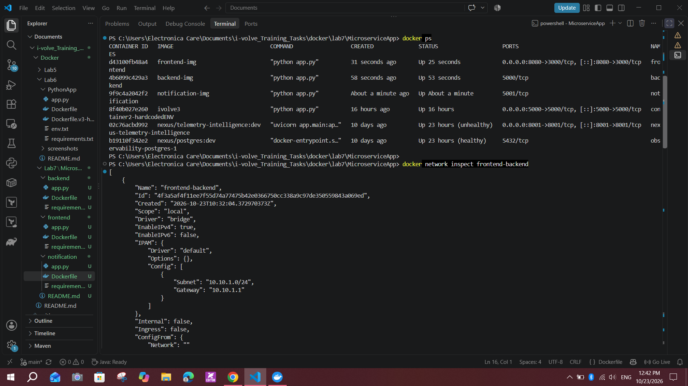
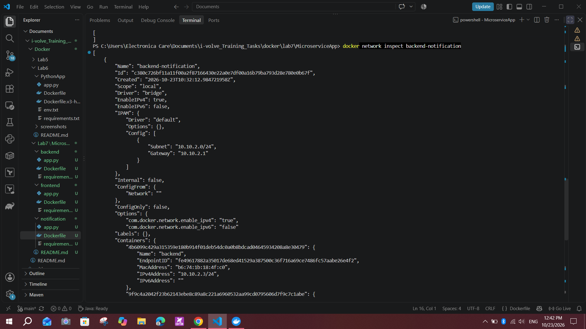
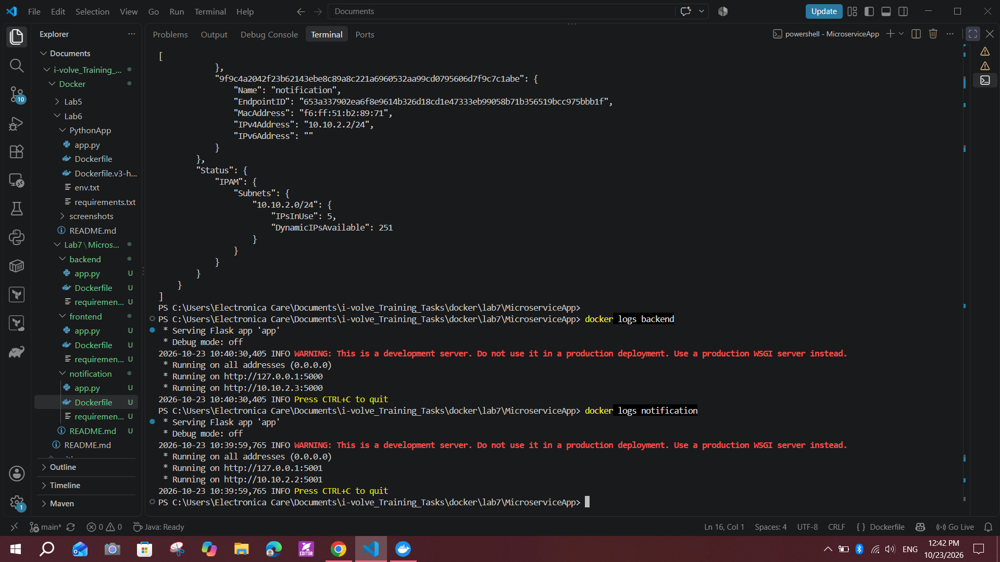

---

## 7. Creating Volumes and the Host Directory

```powershell
docker volume create backend-logs
docker volume create notification-logs
New-Item -ItemType Directory -Force -Path C:\docker-data\backend
docker volume ls
```

- `backend-logs` and `notification-logs` are mounted at `/app/logs` in their containers.
- `C:\docker-data\backend` is bind-mounted to `/app/data` in the backend container.

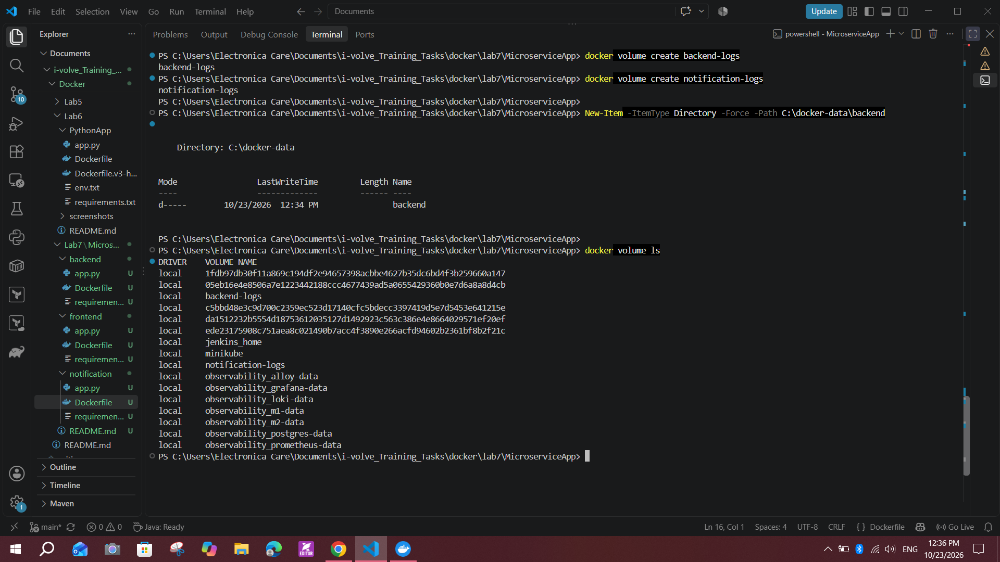

---

## 8. Running the Containers

### Notification (on `backend-notification`)
```powershell
docker run -d --name notification --network backend-notification -v notification-logs:/app/logs notification-img
```

### Backend (on both networks)
`docker create` is used so the second network can be attached before the container starts.

```powershell
docker create --name backend --network frontend-backend `
  -e NOTIFICATION_URL=http://notification:5001/notify `
  -v backend-logs:/app/logs `
  -v C:\docker-data\backend:/app/data `
  backend-img

docker network connect backend-notification backend
docker start backend
```

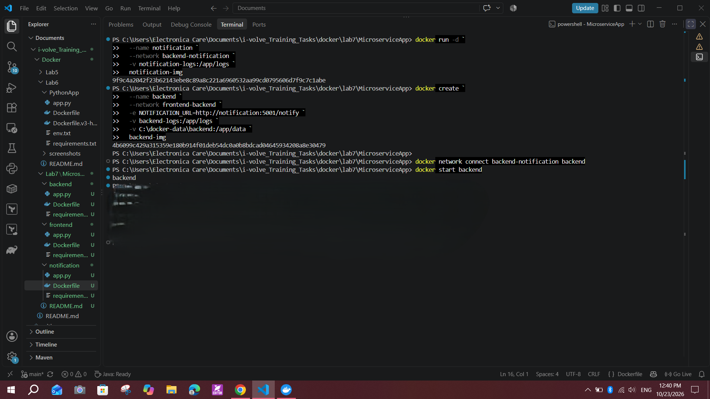

### Frontend (on `frontend-backend`)
```powershell
docker run -d --name frontend --network frontend-backend -p 8081:3000 -e BACKEND_URL=http://backend:5000 frontend-img
```

---

## 9. Port Conflict: Changing the Frontend from 8080 to 8081

The lab asks to publish port 8080. The frontend was first started with `-p 8080:3000` (this mapping is visible in screenshot 3, `docker ps`).

**Problem:** Opening `http://localhost:8080` did not show the microservices app. Another application on this machine (Jenkins) was already using port 8080, so the page was blocked/occupied.

**Solution:** The frontend container was removed and recreated on host port 8081:

```powershell
docker rm -f frontend

docker run -d --name frontend --network frontend-backend -p 8081:3000 -e BACKEND_URL=http://backend:5000 frontend-img
```

**Result:** The app opened at `http://localhost:8081`.

> Note: this step was performed but not captured in a screenshot.


---

## 10. Verifying the Application

Open `http://localhost:8081/`, type a message, click **Send**, then **Refresh Messages**.

| Step | Screenshot |
|---|---|
| First message: `Hi,I'm rahma` | `06-browser-first-message.png` |
| Second message: `I'm an intern at i-volve` | `07-browser-second-message.png` |

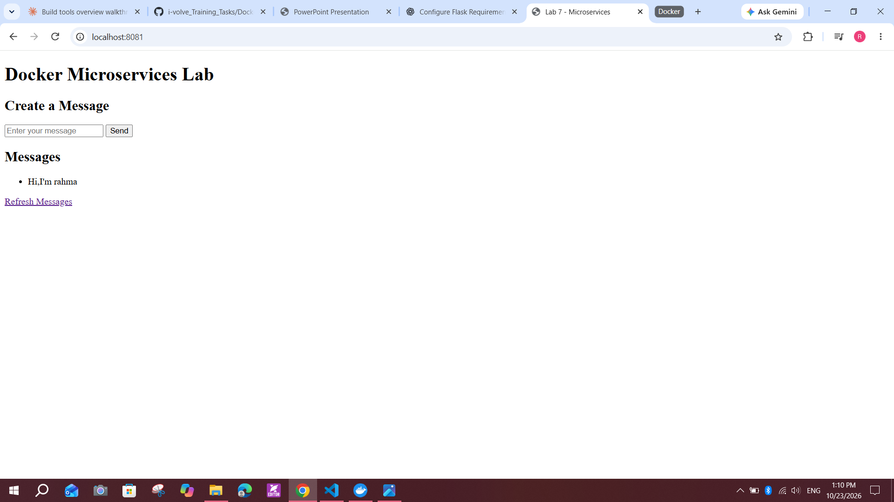
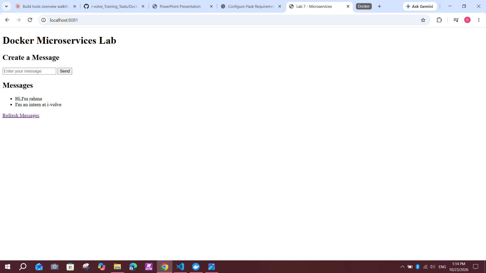

### Logs

```powershell
docker logs --tail 30 backend
docker logs --tail 30 notification
docker exec backend ls -la /app/logs
docker exec notification ls -la /app/logs
```

The logs show:
- `POST /messages` returned `201` and `GET /messages` returned `200` in the backend.
- `Message created successfully` followed by `Notification sent successfully`.
- The notification service logged `Notification received for message: ...` and returned `200` on `POST /notify`.
- `backend.log` and `notification.log` exist inside the mounted volumes.

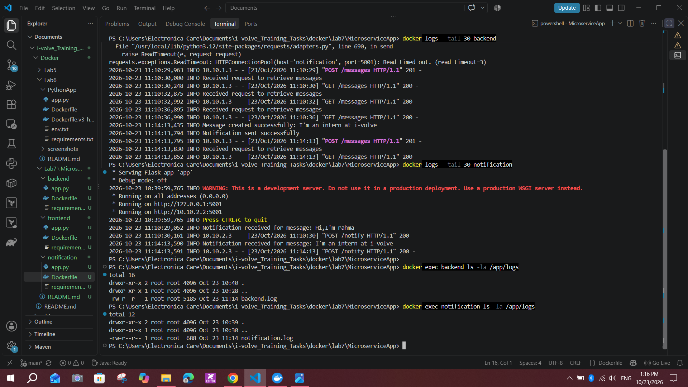

---

## 11. Verifying the Bind Mount and Persistence

Before recreation, the host file contained two messages:

```powershell
Get-Content C:\docker-data\backend\messages.json
```
```json
["Hi,I'm rahma", "I'm an intern at i-volve"]
```

The backend container was then removed and recreated with the same mounts:

```powershell
docker rm -f backend
docker create --name backend --network frontend-backend `
  -e NOTIFICATION_URL=http://notification:5001/notify `
  -v backend-logs:/app/logs `
  -v C:\docker-data\backend:/app/data `
  backend-img
docker network connect backend-notification backend
docker start backend
```

After recreation, the page still showed the earlier messages, and a third message (`I'm eager to learn and develop my skills with i-volve`) was added.

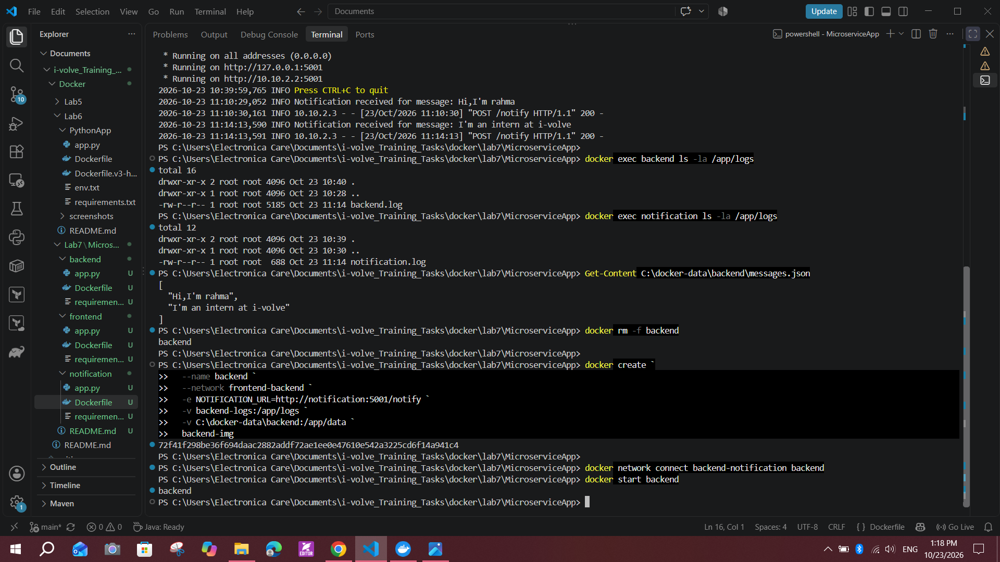
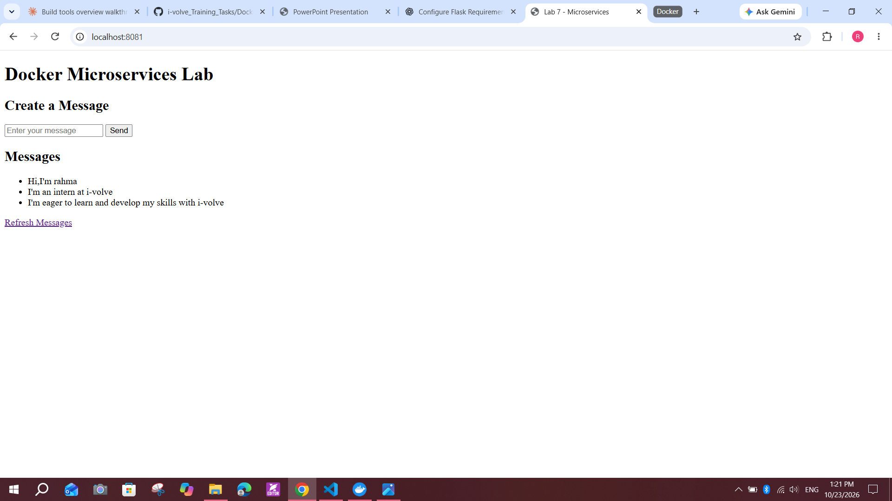

Final host check:

```powershell
Get-Content C:\docker-data\backend\messages.json
Get-ChildItem C:\docker-data\backend -Force
docker volume ls
```

`messages.json` on Windows contains all three messages, and `backend-logs` and `notification-logs` are present in `docker volume ls`.

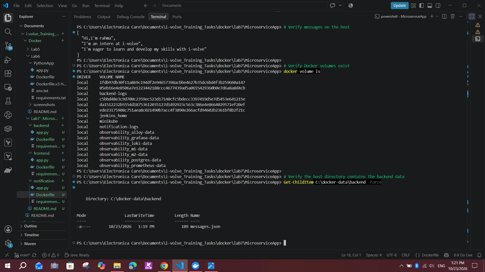

---

## 12. Issues Encountered

### Port 8080 occupied by Jenkins
See section 9. Fixed by remapping the frontend to host port 8081.

### Notification request timeout
The backend logs showed:
```text
requests.exceptions.ReadTimeout: HTTPConnectionPool(host='notification', port=5001): Read timed out. (read timeout=3)
```
The backend waited 3 seconds for the notification service and got no response. Later requests succeeded (`Notification sent successfully`, notification returned `200`), so it appears transient, but the exact cause was not established. If it recurs, check `docker ps`, `docker logs --tail 50 backend`, `docker logs --tail 50 notification`, and `docker network inspect backend-notification`.

### Flask development server warning
```text
WARNING: This is a development server. Do not use it in a production deployment.
```
Expected for this lab. A production WSGI server (for example gunicorn) should be used in production.

---

## 13. Useful Commands

```powershell
docker ps -a
docker images
docker network ls
docker volume ls
docker volume inspect backend-logs
docker inspect backend --format '{{json .Mounts}}'
docker inspect backend --format '{{json .Config.Env}}'
docker inspect frontend --format '{{json .Config.Env}}'
docker logs --tail 50 backend
```

---

## 14. Final Results

| Requirement | Result |
|---|---|
| Dockerfiles for all three services | Completed |
| Build the three images | Completed |
| Two bridge networks with separate subnets | Completed |
| Two volumes for backend and notification logs | Completed |
| Host directory with bind mount to `/app/data` | Completed |
| Notification on `backend-notification` | Completed |
| Backend on both networks with notification URL | Completed |
| Frontend on `frontend-backend` with backend URL | Completed |
| Publish frontend port | Completed on 8081 (8080 was occupied by Jenkins) |
| Create and retrieve messages in the browser | Verified |
| Messages stored on the host | Verified |
| Messages survive backend container recreation | Verified |

---

## 15. Screenshots Index

| File | Description |
|---|---|
| `01-create-volumes-and-host-directory.png` | Volumes and host directory creation |
| `02-run-notification-and-create-backend.png` | Notification run, backend create/connect/start |
| `03-docker-ps-and-inspect-frontend-backend.png` | Running containers and `frontend-backend` network |
| `04-inspect-backend-notification-network.png` | `backend-notification` network |
| `05-network-containers-and-service-logs.png` | Notification IP and startup logs |
| `06-browser-first-message.png` | First message in the browser |
| `07-browser-second-message.png` | Second message in the browser |
| `08-service-logs-and-log-volume-files.png` | Service logs and log files in volumes |
| `09-bind-mount-data-and-backend-recreation.png` | Host data and backend recreation |
| `10-browser-persistence-after-recreation.png` | Three messages after recreation |
| `11-final-host-data-and-volumes-verification.png` | Final host and volume verification |

**Steps performed without screenshots:** Dockerfile creation, image builds, network creation, the final frontend run, and the 8080 to 8081 change.

---

## 16. Conclusion

The frontend, backend, and notification services were containerized and connected through two isolated bridge networks, with the backend bridging both. Logs are kept in named volumes and message data in a Windows bind mount. The app was reached at `http://localhost:8081`, messages were created and retrieved, and the data survived removing and recreating the backend container.