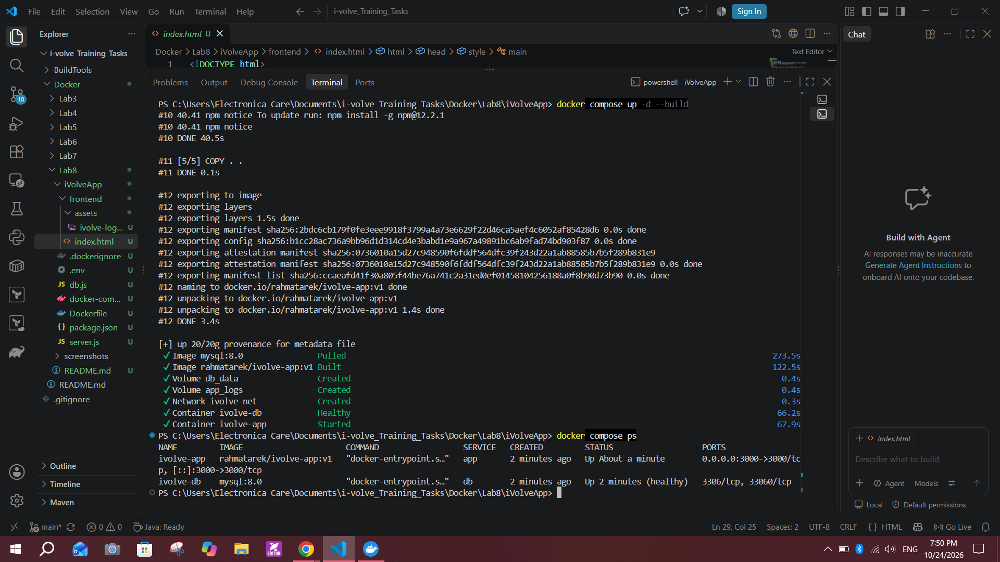
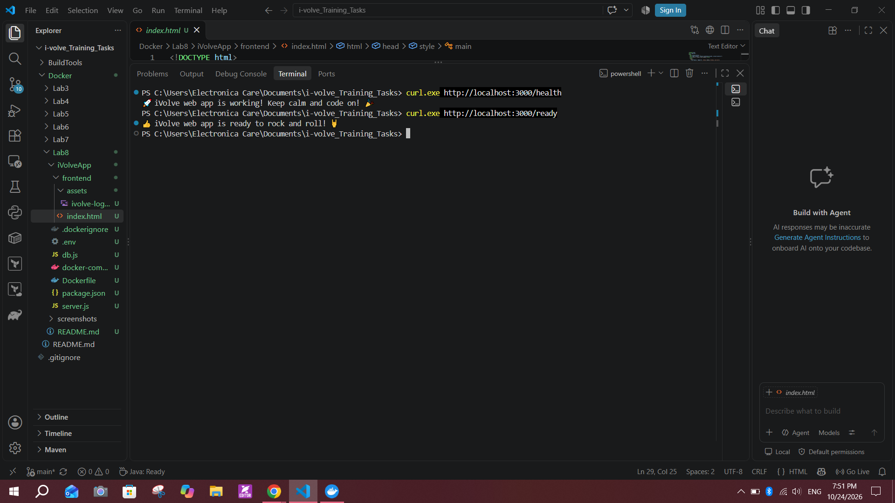
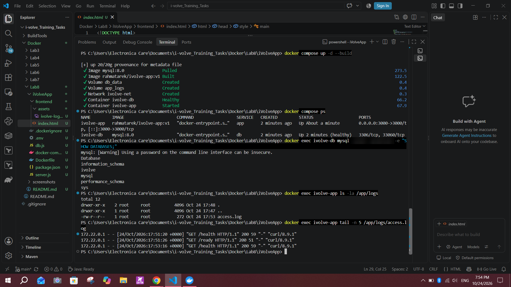
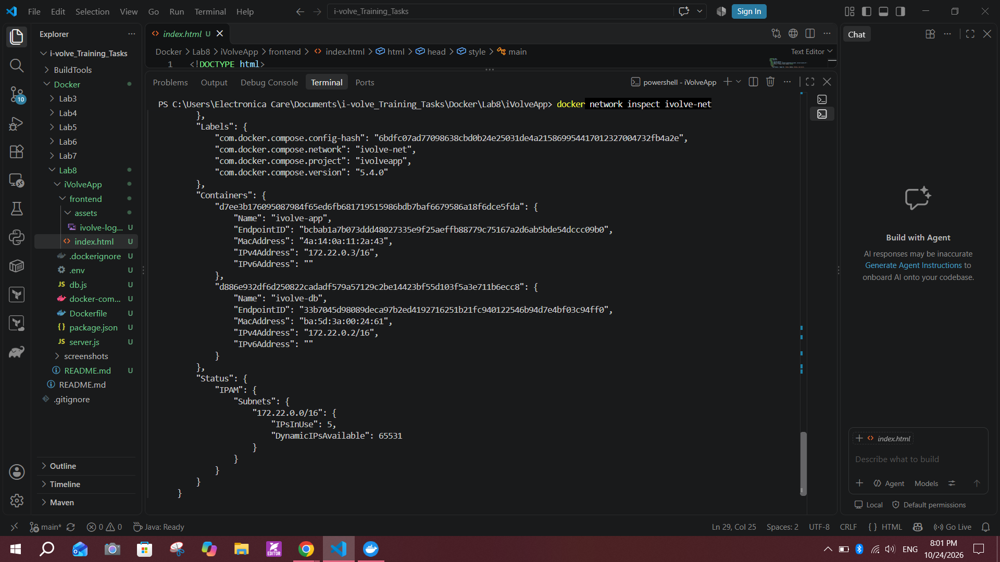
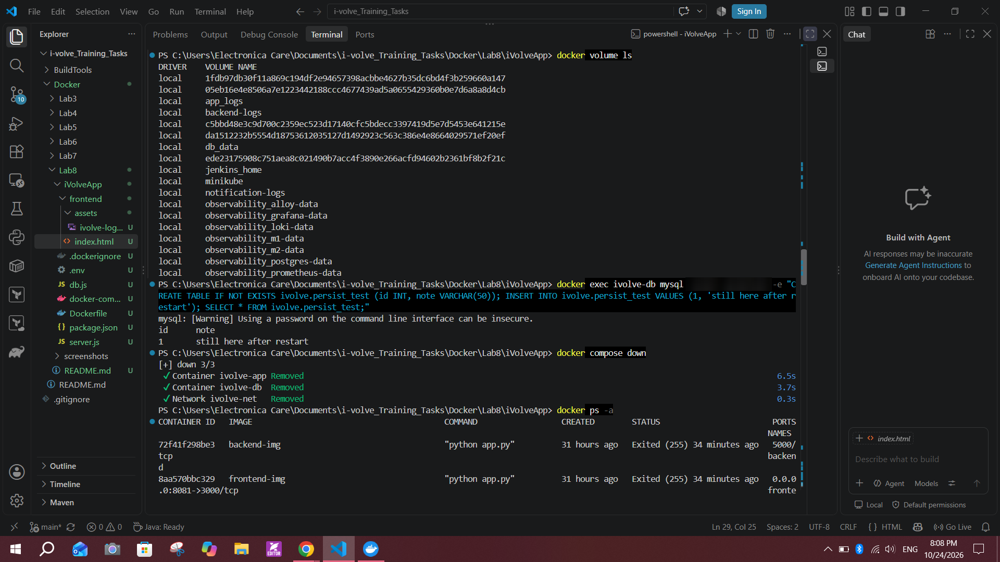
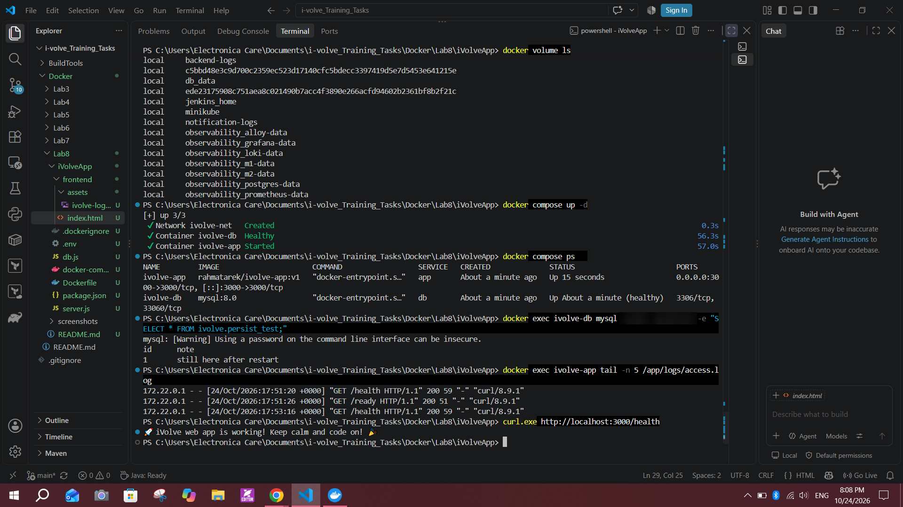
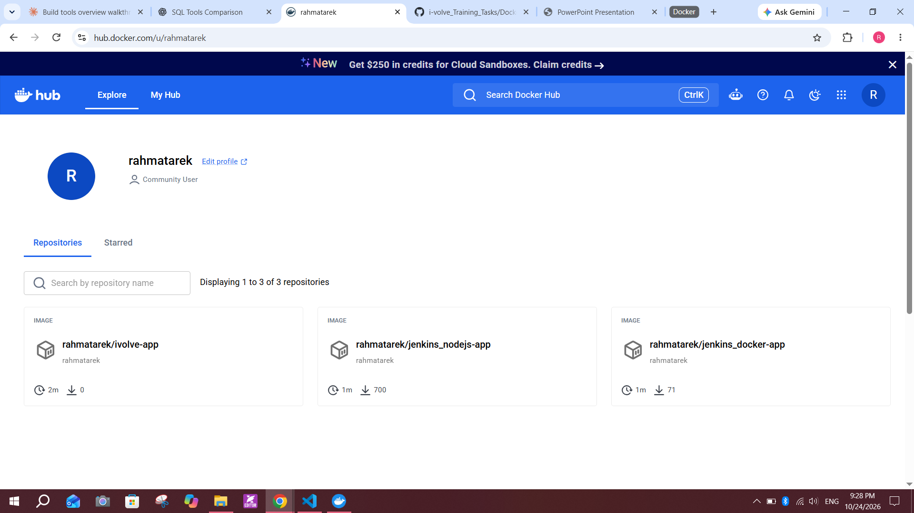

# Lab 8: Containerized Node.js and MySQL Stack Using Docker Compose

## Objective
Run a Node.js application and a MySQL database together with Docker Compose. The application needs a MySQL connection and a database named `ivolve` to start. The stack uses a custom network (`ivolve-net`), persists application logs and database data in named volumes, and the application image is tagged with a Docker Hub username and pushed.

Source: https://github.com/Ibrahim-Adel15/iVolveApp.git

## Environment
- Windows 10, Docker Desktop (Docker Compose v5.4.0), PowerShell in VS Code
- App: Node.js/Express application (`server.js`, `db.js`, `frontend/`) using `mysql2`
- Database: `mysql:8.0`
- Docker Hub user: `rahmatarek`

## Part 1: Required steps

### 1. Clone the application
```powershell
cd "C:\Users\Electronica Care\Documents\i-volve_Training_Tasks\Docker\Lab8"
git clone https://github.com/Ibrahim-Adel15/iVolveApp.git
cd iVolveApp
```
The repository already contains a `Dockerfile`:
```dockerfile
FROM node:18-alpine
WORKDIR /app
COPY package.json ./
RUN npm install
COPY . .
EXPOSE 3000
CMD ["node", "server.js"]
```

### 2. Analyze the application
Reading the source code gave the requirements for the Compose file:

| Item | Value |
|---|---|
| Framework | Node.js + Express |
| Port | 3000 |
| Start command | `node server.js` |
| DB environment variables | `DB_HOST`, `DB_USER`, `DB_PASSWORD` (and `DB_NAME` in `db.js`) |
| Database required | `ivolve` |
| Health endpoints | `/health` and `/ready` (both run `SELECT 1` on the DB) |
| Access log | `/app/logs/access.log` |

`server.js` only checks that the `ivolve` database exists and retries until it does, it never creates it. The MySQL container therefore creates it with `MYSQL_DATABASE=ivolve`.

### 3. Create the configuration files
**`.env`** (the real password is not shown here and the file is not committed to Git):
```text
DB_USER=root
DB_PASSWORD=<your-password>
DB_NAME=ivolve
DOCKERHUB_USER=rahmatarek
```

**`.dockerignore`**:
```text
node_modules
screenshots
.git
README.md
.env
logs
```

### 4. Create `docker-compose.yml`
```yaml
services:
  app:
    build:
      context: .
      dockerfile: Dockerfile
    image: ${DOCKERHUB_USER}/ivolve-app:v1
    container_name: ivolve-app
    ports:
      - "3000:3000"
    environment:
      DB_HOST: db
      DB_USER: ${DB_USER}
      DB_PASSWORD: ${DB_PASSWORD}
      DB_NAME: ${DB_NAME}
    volumes:
      - app_logs:/app/logs
    depends_on:
      db:
        condition: service_healthy
    networks:
      - ivolve-net

  db:
    image: mysql:8.0
    container_name: ivolve-db
    environment:
      MYSQL_ROOT_PASSWORD: ${DB_PASSWORD}
      MYSQL_DATABASE: ${DB_NAME}
    volumes:
      - db_data:/var/lib/mysql
    healthcheck:
      test: ["CMD", "mysqladmin", "ping", "-h", "localhost", "-p${DB_PASSWORD}"]
      interval: 10s
      timeout: 5s
      retries: 10
      start_period: 30s
    networks:
      - ivolve-net

networks:
  ivolve-net:
    name: ivolve-net

volumes:
  db_data:
    name: db_data
  app_logs:
    name: app_logs
```

What each part does:
- `DB_HOST: db` makes the app reach MySQL by its service name, not `localhost`.
- `MYSQL_DATABASE: ${DB_NAME}` makes MySQL create the `ivolve` database on first start.
- `db_data:/var/lib/mysql` persists database data (`name: db_data` keeps the exact volume name from the lab).
- `app_logs:/app/logs` persists application logs.
- The `healthcheck` with `depends_on: condition: service_healthy` starts the app only after MySQL is ready.
- `ivolve-net` is the custom network shared by both services.
- `image: rahmatarek/ivolve-app:v1` tags the built image with the Docker Hub username.

Validate the file:
```powershell
docker compose config
```

### 5. Start the stack
```powershell
docker compose up -d --build
docker compose ps
```
The build created `rahmatarek/ivolve-app:v1`, the volumes `db_data` and `app_logs` and the network `ivolve-net`. `ivolve-db` became healthy and `ivolve-app` started on port 3000.



### 6. Verify the application and the database connection
```powershell
curl.exe http://localhost:3000/health
curl.exe http://localhost:3000/ready
```
Both endpoints query the database, so a successful response proves the app is connected to MySQL:
- `/health` returned "iVolve web app is working!"
- `/ready` returned "iVolve web app is ready to rock and roll!"



Check the database and the log volume:
```powershell
docker exec ivolve-db mysql -uroot -p<password> -e "SHOW DATABASES;"
docker exec ivolve-app ls -la /app/logs
docker exec ivolve-app tail -n 5 /app/logs/access.log
```
`SHOW DATABASES` lists `ivolve`, and `access.log` exists in `/app/logs` with the `/health` and `/ready` requests in it.



Check the network:
```powershell
docker network inspect ivolve-net
```
Both containers are on `ivolve-net` (subnet `172.22.0.0/16`): `ivolve-db` at `172.22.0.2` and `ivolve-app` at `172.22.0.3`. These addresses are from this run and may change if the network is recreated.



### 7. Verify persistence
A test row was added, then the containers were removed (without `-v`, so the volumes were kept):
```powershell
docker volume ls
docker exec ivolve-db mysql -uroot -p<password> -e "CREATE TABLE IF NOT EXISTS ivolve.persist_test (id INT, note VARCHAR(50)); INSERT INTO ivolve.persist_test VALUES (1, 'still here after restart'); SELECT * FROM ivolve.persist_test;"
docker compose down
docker ps -a
```


The stack was then started again and the data checked:
```powershell
docker compose up -d
docker compose ps
docker exec ivolve-db mysql -uroot -p<password> -e "SELECT * FROM ivolve.persist_test;"
docker exec ivolve-app tail -n 5 /app/logs/access.log
curl.exe http://localhost:3000/health
```
- The test row was still in the database, so `db_data` works.
- `access.log` still contained the earlier requests, so `app_logs` works.
- `/health` returned the working message again.



### 8. Tag and push the image to Docker Hub
The image is tagged with the Docker Hub username by the `image:` line in `docker-compose.yml` (`rahmatarek/ivolve-app:v1`).
```powershell
docker images
docker login -u rahmatarek
docker buildx build -t rahmatarek/ivolve-app:v1 --push .
```
The output ended with:
```text
pushing layers
pushing manifest for docker.io/rahmatarek/ivolve-app:v1@sha256:52fb02c6f366c8212d437ac3c64ef851dae3e77c208fc9d9913080ed2b1e13ad
```
The repository `rahmatarek/ivolve-app` appears in the Docker Hub account.



Repository: https://hub.docker.com/r/rahmatarek/ivolve-app

## Results

| Requirement | Result |
|---|---|
| Clone the application | Done |
| App service: build from Dockerfile, port 3000, DB env vars, logs persisted | Done |
| Database service: MySQL with required env vars, `db_data` volume | Done |
| Custom network `ivolve-net` | Done |
| Logs at `/app/logs`, data at `/var/lib/mysql` persisted | Done, verified after restart |
| `ivolve` database exists and the app connects to it | Verified (`SHOW DATABASES`, `/health`, `/ready`) |
| Image tagged with Docker Hub username and pushed | Done (`rahmatarek/ivolve-app:v1`) |

## Notes and issues
- **Terminal error when pasting the file:** pasting the whole `docker-compose.yml` into PowerShell showed "Oops, something went wrong" from PSReadLine. It was only a display problem in the console. The file was written correctly by a second paste and `docker compose config` validated it with no errors.
- **Docker Hub login failed first:** `unauthorized: incorrect username or password`. Logging in with the correct credentials fixed it (an access token can be used instead of a password).
- **`docker push` timed out:** the upload repeatedly failed on one layer of about 40 MB with `net/http: timeout awaiting response headers`. This was a network timeout, not a problem with the image or the account. Retrying `docker push` gave the same result. Using `docker buildx build -t rahmatarek/ivolve-app:v1 --push .` solved it, because it uses BuildKit's own uploader and the layers came from the build cache.
- **Why the healthcheck:** without it the app could start before MySQL was ready and spend time retrying its connection.
- **Products table:** `db.js` creates a `products` table, but `server.js` never calls it. The app and its `/health` and `/ready` checks work without it, so it was left as is.
- **Credentials:** the database password is shown as `<password>` in this README and is blurred in the screenshots. `.env` is listed in `.dockerignore` so it is not copied into the image, and it should not be committed to Git.
- **Persistence test:** `docker compose down` was used without `-v`, because `-v` would delete `db_data` and `app_logs`.