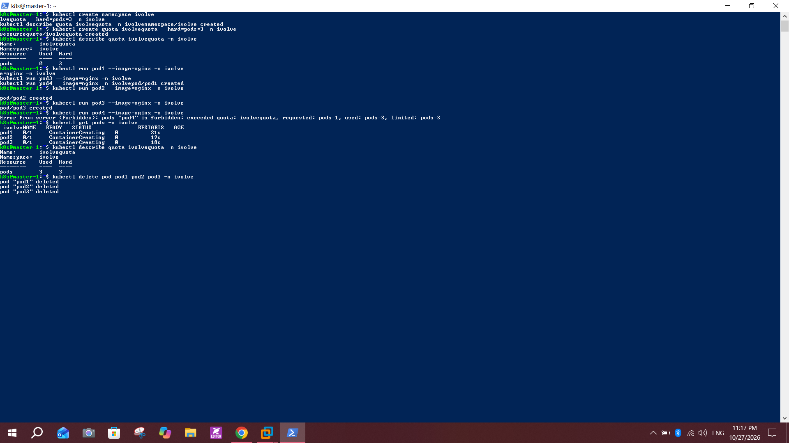

# Lab 11: Namespace Management and Resource Quota Enforcement

## Objective
Create a namespace named `ivolve`, create a ResourceQuota that limits the namespace to 3 pods, verify it, and confirm Kubernetes refuses to create more pods once the limit is reached.

## Environment
- Cluster from Lab 9: `master-1` and `worker-1`, Kubernetes `v1.28.15`
- Image used for test pods: `nginx`

## Steps

### 1. Create the namespace
```bash
kubectl create namespace ivolve
```

### 2. Create the ResourceQuota
```bash
kubectl create quota ivolvequota --hard=pods=3 -n ivolve
kubectl describe quota ivolvequota -n ivolve
```
The quota shows `pods  0  3` (used 0, hard 3).

### 3. Test the limit
```bash
kubectl run pod1 --image=nginx -n ivolve
kubectl run pod2 --image=nginx -n ivolve
kubectl run pod3 --image=nginx -n ivolve
kubectl run pod4 --image=nginx -n ivolve
```
The first three pods are created. The fourth is rejected:
```
Error from server (Forbidden): pods "pod4" is forbidden: exceeded quota: ivolvequota, requested: pods=1, used: pods=3, limited: pods=3
```

### 4. Verify
```bash
kubectl get pods -n ivolve
kubectl describe quota ivolvequota -n ivolve
```
Only `pod1`, `pod2` and `pod3` exist (`ContainerCreating` while the image was pulled), and the quota shows `pods  3  3`.



### 5. Cleanup
```bash
kubectl delete pod pod1 pod2 pod3 -n ivolve
```
This frees the quota for Lab 12.

## Notes and issues
- **Resource name:** the lab names the quota `ivolveQuota`. Kubernetes resource names must be lowercase, so I used `ivolvequota`.
- **Pasted commands:** several `kubectl run` lines were pasted together, so the terminal output looks mixed up in the screenshot. Each command still ran once, as `kubectl get pods` and the quota output show.
- **SSH timeout before the labs:** see Lab 10. I installed and checked the SSH server, confirmed the IPs, tested port 22 with `Test-NetConnection`, and restarting both VMs fixed the connection.

## Conclusion
The ResourceQuota enforces a hard limit of 3 pods in the `ivolve` namespace. The API server rejects the fourth pod at creation, so it never reaches the scheduler.
