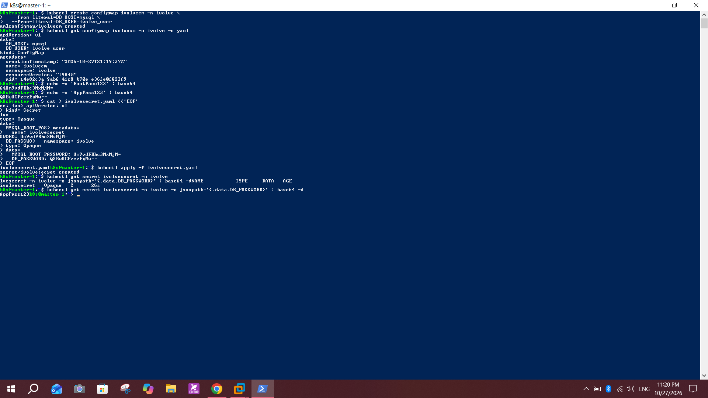

# Lab 12: Managing Configuration and Sensitive Data with ConfigMaps and Secrets

## Objective
In the `ivolve` namespace, create a ConfigMap for non-sensitive MySQL settings and a Secret for MySQL credentials, using Base64-encoded values in a YAML manifest for the Secret.

## Environment
- Cluster from Lab 9: `master-1` and `worker-1`, Kubernetes `v1.28.15`
- Namespace `ivolve` (created in Lab 11)

## Steps

### 1. Create the ConfigMap `ivolvecm`
```bash
kubectl create configmap ivolvecm -n ivolve \
  --from-literal=DB_HOST=mysql \
  --from-literal=DB_USER=ivolve_user
kubectl get configmap ivolvecm -n ivolve -o yaml
```
- `DB_HOST=mysql`: the name of the MySQL StatefulSet's headless Service (the Service itself is not part of this lab)
- `DB_USER=ivolve_user`: the application database user

### 2. Encode the secret values with Base64
```bash
echo -n 'RootPass123' | base64
echo -n 'AppPass123'  | base64
```
Use `-n` so no newline is added to the encoded value. The passwords here are lab examples only.

### 3. Create the Secret manifest `ivolvesecret.yaml`
```yaml
apiVersion: v1
kind: Secret
metadata:
  name: ivolvesecret
  namespace: ivolve
type: Opaque
data:
  MYSQL_ROOT_PASSWORD: Um9vdFBhc3MxMjM=
  DB_PASSWORD: QXBwUGFzczEyMw==
```
```bash
kubectl apply -f ivolvesecret.yaml
```

### 4. Verify
```bash
kubectl get secret ivolvesecret -n ivolve
kubectl get secret ivolvesecret -n ivolve -o jsonpath='{.data.DB_PASSWORD}' | base64 -d
```
- The Secret shows `Opaque` with `2` data items
- Decoding `DB_PASSWORD` returns `AppPass123`



## Notes and issues
- **Resource names:** the lab names are `ivolveCM` and `ivolveSecret`. Kubernetes names must be lowercase, so I used `ivolvecm` and `ivolvesecret`.
- **Base64 is not encryption:** anyone who can read the Secret can decode it with `base64 -d`. Access should be restricted with RBAC, and real passwords should not be committed to Git.
- **Garbled paste:** the multi-line `cat > ivolvesecret.yaml <<'EOF'` paste was mixed up in the terminal. The Secret was still created, and I checked it with `get secret` and by decoding the value.
- **SSH timeout before the labs:** see Lab 10. I installed and checked the SSH server, confirmed the IPs, tested port 22 with `Test-NetConnection`, and restarting both VMs fixed the connection.

## Conclusion
Non-sensitive settings live in a ConfigMap, while credentials live in a Secret created from a manifest with Base64-encoded values. Both are available to workloads in the `ivolve` namespace.
