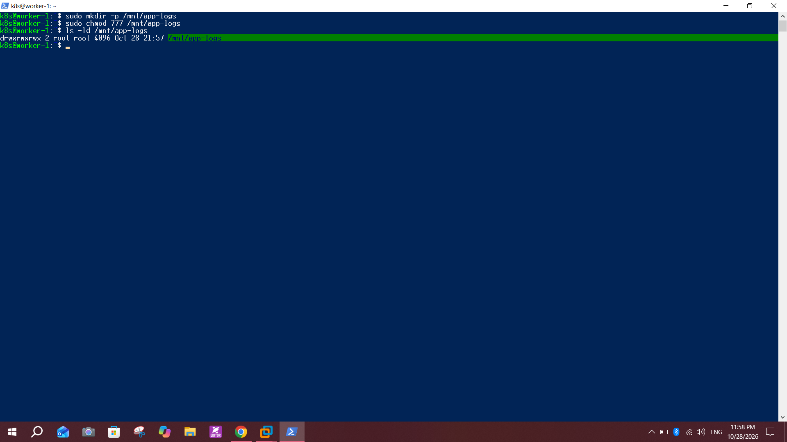
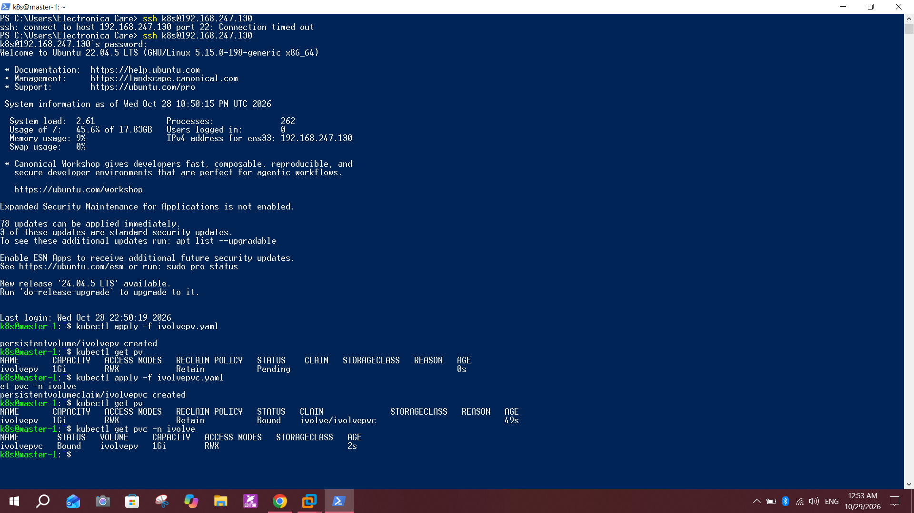
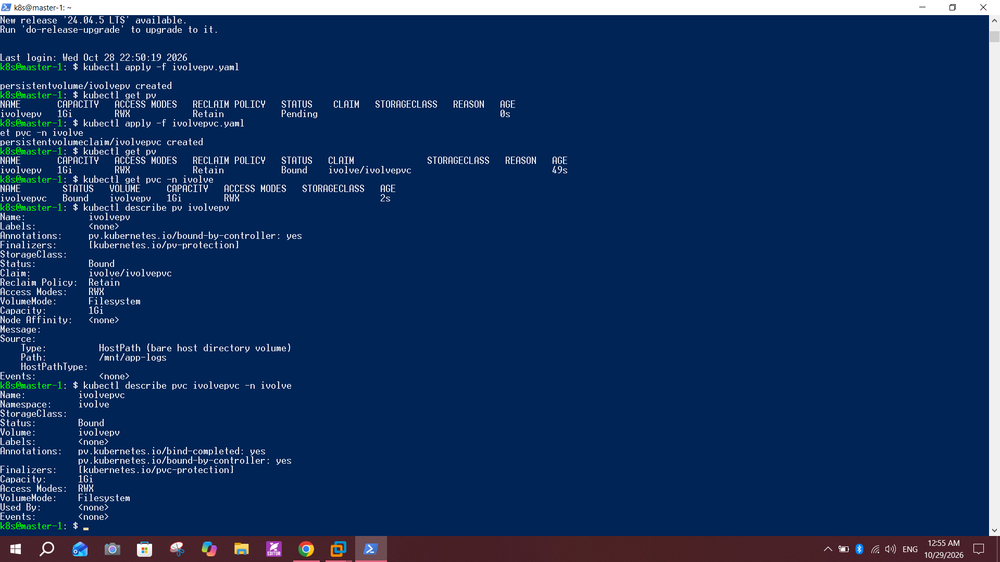

# Lab 13: Persistent Storage Setup for Application Logging

## Objective
Define a static PersistentVolume (hostPath, 1Gi, ReadWriteMany, Retain) and a PersistentVolumeClaim that requests 1Gi with the same access mode, without using any StorageClass.

## Environment
- Cluster from Lab 9: `master-1` and `worker-1`, Kubernetes `v1.28.15`
- Namespace `ivolve` (Lab 11)
- Storage: directory `/mnt/app-logs` on `worker-1`

## Steps

### 1. Create the directory on the worker
On `worker-1`:
```bash
sudo mkdir -p /mnt/app-logs
sudo chmod 777 /mnt/app-logs
ls -ld /mnt/app-logs
```
`chmod 777` is for the lab only, so any pod can write to the directory.



### 2. Create the PersistentVolume `ivolvepv.yaml`
```yaml
apiVersion: v1
kind: PersistentVolume
metadata:
  name: ivolvepv
spec:
  capacity:
    storage: 1Gi
  accessModes:
    - ReadWriteMany
  persistentVolumeReclaimPolicy: Retain
  storageClassName: ""
  hostPath:
    path: /mnt/app-logs
```

### 3. Create the PersistentVolumeClaim `ivolvepvc.yaml`
```yaml
apiVersion: v1
kind: PersistentVolumeClaim
metadata:
  name: ivolvepvc
  namespace: ivolve
spec:
  accessModes:
    - ReadWriteMany
  resources:
    requests:
      storage: 1Gi
  storageClassName: ""
```

### 4. Apply and check
```bash
kubectl apply -f ivolvepv.yaml
kubectl get pv
kubectl apply -f ivolvepvc.yaml
kubectl get pv
kubectl get pvc -n ivolve
```
The PV was `Pending` right after creation, then both the PV and the PVC became `Bound`.



### 5. Verify the details
```bash
kubectl describe pv ivolvepv
kubectl describe pvc ivolvepvc -n ivolve
```
- PV: `Capacity 1Gi`, `Access Modes RWX`, `Reclaim Policy Retain`, `StorageClass` empty, source `HostPath /mnt/app-logs`, claim `ivolve/ivolvepvc`
- PVC: `Status Bound`, `Volume ivolvepv`, `StorageClass` empty, `Access Modes RWX`



## Notes and issues
- **Static provisioning:** I created the PV by hand and set `storageClassName: ""` in both objects. This keeps the cluster from using a default StorageClass, and the claim binds by matching size and access mode.
- **Resource names:** the lab names are `ivolvePV` and `ivolvePVC`. Kubernetes names must be lowercase, so I used `ivolvepv` and `ivolvepvc`.
- **hostPath and ReadWriteMany:** the access mode is only a declaration. A hostPath volume is a local directory, so replicas share data only when they run on the same node. With one worker this works, but with several workers each node would have its own copy. NFS would solve that, but I did not use it because the lab asks for hostPath.
- **Retain policy:** if the PVC is deleted, the PV becomes `Released` and the files stay on the node.
- **SSH timeout:** before this lab, `ssh` to the master timed out once, then worked on the next attempt (visible at the top of the screenshot). The cluster needs a few minutes to settle after a boot.

## Conclusion
A static PV backed by a hostPath directory and a matching PVC give the application a persistent place for its logs. Both objects are `Bound`, use `RWX` and `Retain`, and no StorageClass is involved.