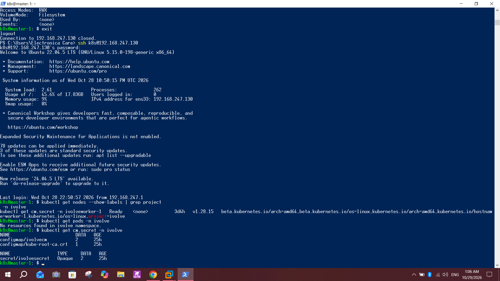
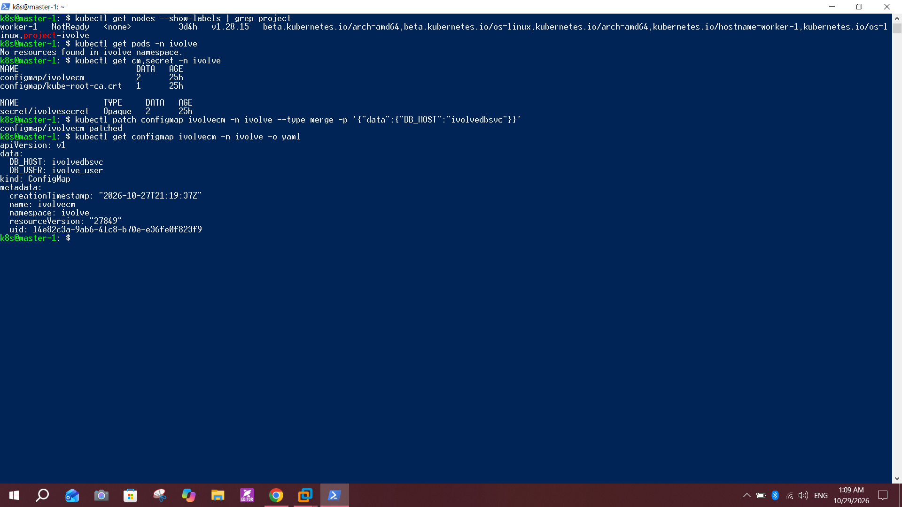
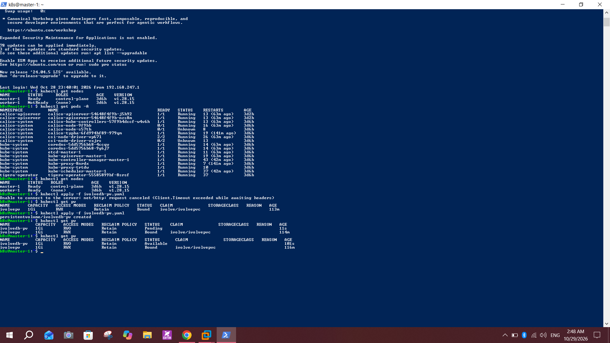
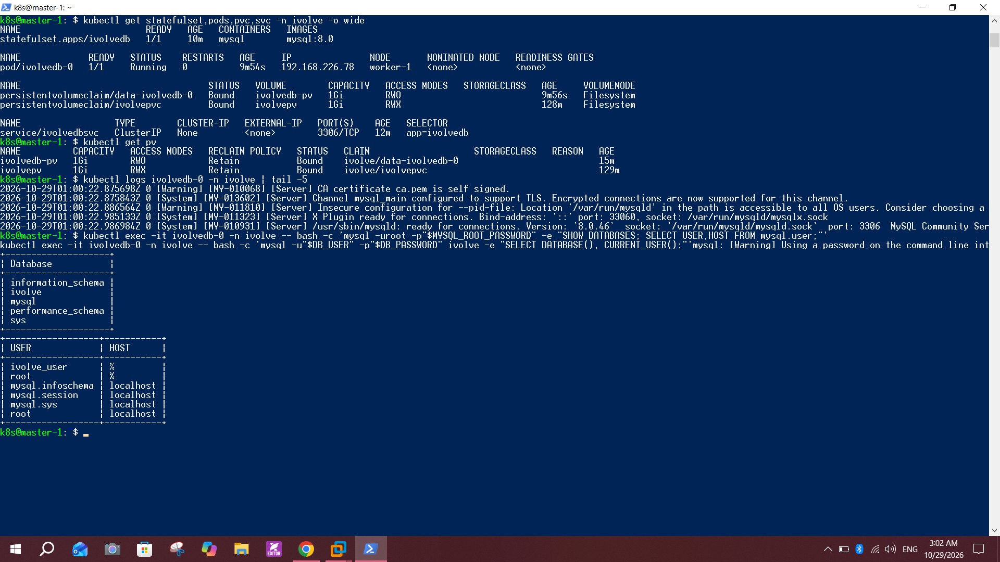
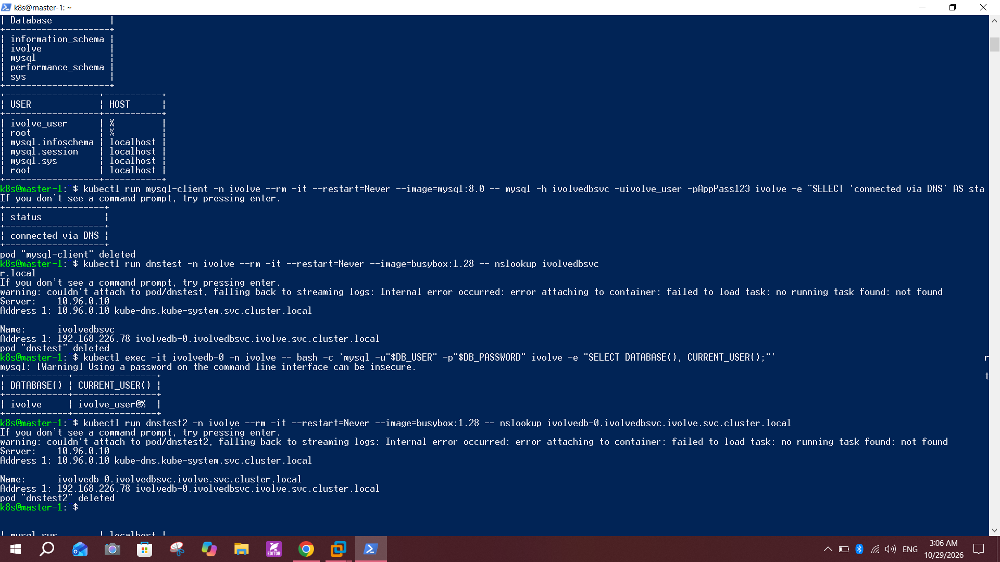
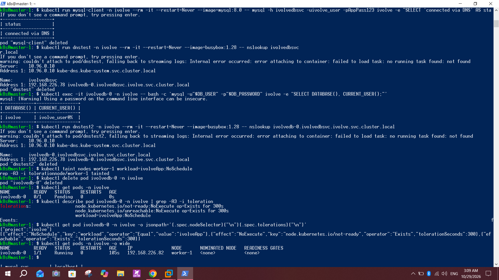
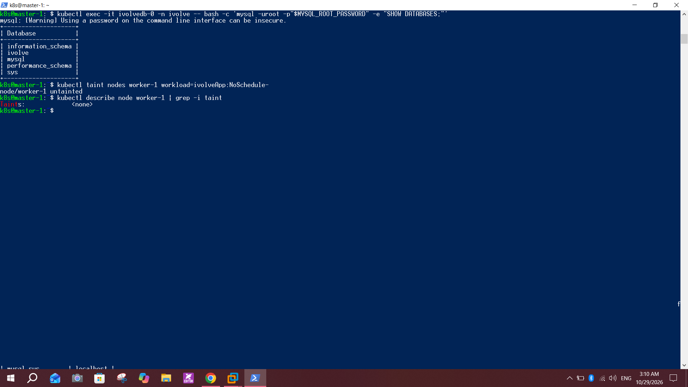

# Lab 14: StatefulSet with Headless Service

## Objective
Run MySQL as a StatefulSet named `ivolvedb` (1 replica) in the `ivolve` namespace, load its settings from the ConfigMap and Secret, schedule it with a node selector and a toleration, store its data on a PVC created from a template, expose it with a headless Service, then verify the database connection and DNS resolution.

## Environment
- Cluster from Lab 9: `master-1` and `worker-1`, Kubernetes `v1.28.15`
- Image: `mysql:8.0` (MySQL 8.0.46)
- Uses: `ivolvecm` and `ivolvesecret` (Lab 12), label `project=ivolve` and taint `workload=ivolveApp:NoSchedule` (Lab 10), namespace `ivolve` (Lab 11)

## Part 1: Prerequisites

Check the label, the namespace contents, and the ConfigMap and Secret:
```bash
kubectl get nodes --show-labels | grep project
kubectl get pods -n ivolve
kubectl get cm,secret -n ivolve
```
`worker-1` has `project=ivolve`, the namespace has no pods, and `ivolvecm` and `ivolvesecret` exist.



### Point `DB_HOST` at the headless Service
`DB_HOST` was `mysql` in Lab 12. The Service in this lab is named `ivolvedbsvc`, so I updated it:
```bash
kubectl patch configmap ivolvecm -n ivolve --type merge -p '{"data":{"DB_HOST":"ivolvedbsvc"}}'
kubectl get configmap ivolvecm -n ivolve -o yaml
```



## Part 2: Storage

### 1. Directory on the worker
```bash
sudo mkdir -p /mnt/mysql-data
sudo chmod 777 /mnt/mysql-data
```


### 2. PersistentVolume `ivolvedb-pv.yaml`
The PV from Lab 13 (`ivolvepv`) is already bound to `ivolvepvc`, so MySQL gets its own static PV:
```yaml
apiVersion: v1
kind: PersistentVolume
metadata:
  name: ivolvedb-pv
spec:
  capacity:
    storage: 1Gi
  accessModes:
    - ReadWriteOnce
  persistentVolumeReclaimPolicy: Retain
  storageClassName: ""
  hostPath:
    path: /mnt/mysql-data
```
```bash
kubectl apply -f ivolvedb-pv.yaml
kubectl get pv
```
`ivolvedb-pv` is `Available` until the StatefulSet creates its claim.



## Part 3: Headless Service and StatefulSet

### 1. Headless Service `ivolvedbsvc.yaml`
```yaml
apiVersion: v1
kind: Service
metadata:
  name: ivolvedbsvc
  namespace: ivolve
spec:
  clusterIP: None
  selector:
    app: ivolvedb
  ports:
    - port: 3306
      name: mysql
```
`clusterIP: None` makes it headless.

### 2. StatefulSet `ivolvedb.yaml`
```yaml
apiVersion: apps/v1
kind: StatefulSet
metadata:
  name: ivolvedb
  namespace: ivolve
spec:
  serviceName: ivolvedbsvc
  replicas: 1
  selector:
    matchLabels:
      app: ivolvedb
  template:
    metadata:
      labels:
        app: ivolvedb
    spec:
      nodeSelector:
        project: ivolve
      tolerations:
        - key: workload
          operator: Equal
          value: ivolveApp
          effect: NoSchedule
      containers:
        - name: mysql
          image: mysql:8.0
          ports:
            - containerPort: 3306
              name: mysql
          envFrom:
            - configMapRef:
                name: ivolvecm
            - secretRef:
                name: ivolvesecret
          env:
            - name: MYSQL_DATABASE
              value: ivolve
            - name: MYSQL_USER
              valueFrom:
                configMapKeyRef:
                  name: ivolvecm
                  key: DB_USER
            - name: MYSQL_PASSWORD
              valueFrom:
                secretKeyRef:
                  name: ivolvesecret
                  key: DB_PASSWORD
          volumeMounts:
            - name: data
              mountPath: /var/lib/mysql
  volumeClaimTemplates:
    - metadata:
        name: data
      spec:
        accessModes: ["ReadWriteOnce"]
        storageClassName: ""
        resources:
          requests:
            storage: 1Gi
```
- `envFrom` loads every key of the ConfigMap and Secret (`DB_HOST`, `DB_USER`, `MYSQL_ROOT_PASSWORD`, `DB_PASSWORD`).
- The MySQL image creates its user from `MYSQL_USER` and `MYSQL_PASSWORD`, so these are mapped from `DB_USER` and `DB_PASSWORD`. `MYSQL_DATABASE=ivolve` creates the `ivolve` database.

```bash
kubectl apply -f ivolvedbsvc.yaml
kubectl apply -f ivolvedb.yaml
kubectl get statefulset,pods,pvc,svc -n ivolve -o wide
kubectl get pv
kubectl logs ivolvedb-0 -n ivolve | tail -5
```
- StatefulSet `1/1`, pod `ivolvedb-0` `Running` on `worker-1`
- PVC `data-ivolvedb-0` `Bound` to `ivolvedb-pv` (RWO, no StorageClass)
- Service `ivolvedbsvc` has `CLUSTER-IP None` (headless)
- The log ends with `ready for connections`



## Part 4: Verify MySQL and DNS

### 1. Databases and users
```bash
kubectl exec -it ivolvedb-0 -n ivolve -- bash -c 'mysql -uroot -p"$MYSQL_ROOT_PASSWORD" -e "SHOW DATABASES; SELECT USER,HOST FROM mysql.user;"'
```
The `ivolve` database and the `ivolve_user` account exist.

### 2. Connect as the application user
```bash
kubectl exec -it ivolvedb-0 -n ivolve -- bash -c 'mysql -u"$DB_USER" -p"$DB_PASSWORD" ivolve -e "SELECT DATABASE(), CURRENT_USER();"'
```
Result: `ivolve` and `ivolve_user@%`.

### 3. Connect from another pod through the Service
```bash
kubectl run mysql-client -n ivolve --rm -it --restart=Never --image=mysql:8.0 -- mysql -h ivolvedbsvc -uivolve_user -p<password> ivolve -e "SELECT 'connected via DNS' AS status;"
```
Result: `connected via DNS`.

### 4. DNS resolution
```bash
kubectl run dnstest -n ivolve --rm -it --restart=Never --image=busybox:1.28 -- nslookup ivolvedbsvc
kubectl run dnstest2 -n ivolve --rm -it --restart=Never --image=busybox:1.28 -- nslookup ivolvedb-0.ivolvedbsvc.ivolve.svc.cluster.local
```
Both names resolve to the pod IP (`192.168.226.78`) because the Service is headless and has no ClusterIP.



## Part 5: Toleration and data persistence

I temporarily re-applied the taint from Lab 10 and recreated the pod:
```bash
kubectl taint nodes worker-1 workload=ivolveApp:NoSchedule
kubectl delete pod ivolvedb-0 -n ivolve
kubectl describe pod ivolvedb-0 -n ivolve | grep -A3 -i toleration
kubectl get pod ivolvedb-0 -n ivolve -o jsonpath='{.spec.nodeSelector}{"\n"}{.spec.tolerations}{"\n"}'
kubectl get pods -n ivolve -o wide
```
- The pod has `nodeSelector {"project":"ivolve"}` and the toleration `workload=ivolveApp:NoSchedule`
- It started as `Pending`, then became `1/1 Running` on `worker-1` even though the node is tainted, so the toleration works
- The pod IP changed from `192.168.226.78` to `192.168.226.82`, but the DNS name stayed the same



Then I checked that the data survived the pod being recreated and removed the taint:
```bash
kubectl exec -it ivolvedb-0 -n ivolve -- bash -c 'mysql -uroot -p"$MYSQL_ROOT_PASSWORD" -e "SHOW DATABASES;"'
kubectl taint nodes worker-1 workload=ivolveApp:NoSchedule-
kubectl describe node worker-1 | grep -i taint
```
The `ivolve` database is still there and the node shows `Taints: <none>`.



## Notes and issues
- **Resource names:** the lab names are `ivolveDB` and `ivolveDBSvc`. Kubernetes names must be lowercase, so I used `ivolvedb` and `ivolvedbsvc`.
- **Static storage:** `ivolvedb-pv` is created by hand and `storageClassName: ""` is set in both the PV and the volume claim template, so no StorageClass is used.
- **Separate PV:** `ivolvepv` from Lab 13 is already bound to `ivolvepvc`, so MySQL needed its own PV.
- **hostPath:** MySQL data lives on `worker-1` only. If the pod ran on another node it would start with an empty database.
- **`DB_HOST` update:** I changed it from `mysql` (Lab 12) to `ivolvedbsvc` to match the headless Service.
- **API server timeout:** the first `kubectl apply -f ivolvedb-pv.yaml` failed with `request canceled (Client.Timeout exceeded)`, and `worker-1` briefly showed `NotReady`, because the control plane was still busy after a boot (high load). Waiting a few minutes and applying again worked.
- **Quota:** the namespace allows 3 pods (Lab 11), so the test client pods used `--rm` and were removed right away.
- **Harmless warnings:** `couldn't attach to pod ... falling back to streaming logs` and `Using a password on the command line` do not affect the result. The test password is a lab example.
- **Pasted commands:** a few pasted commands ran together in the terminal, so some lines in the screenshots look mixed. Each command still ran once.

## Conclusion
MySQL runs as a one-replica StatefulSet that reads its configuration from the ConfigMap and Secret, is pinned to the labeled node, tolerates the node taint, and keeps its data on a static PV. The headless Service gives the pod a stable DNS name, and both the database connection and the DNS lookups were verified.