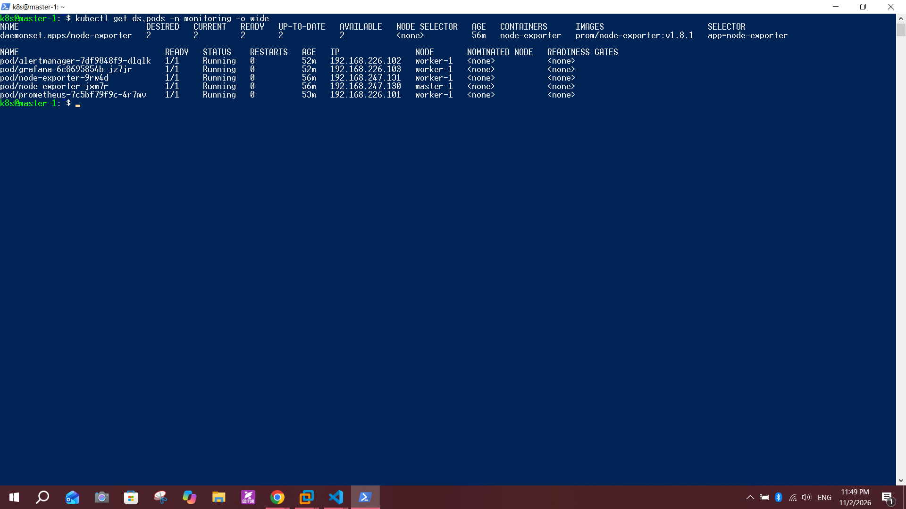
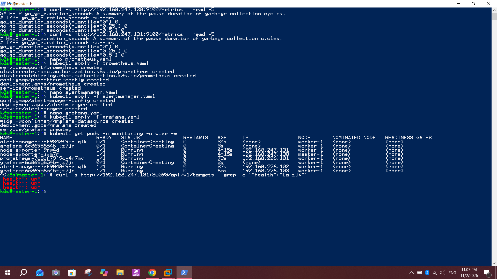
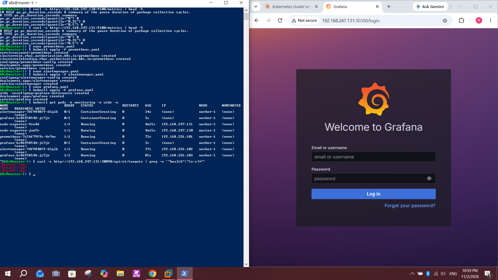
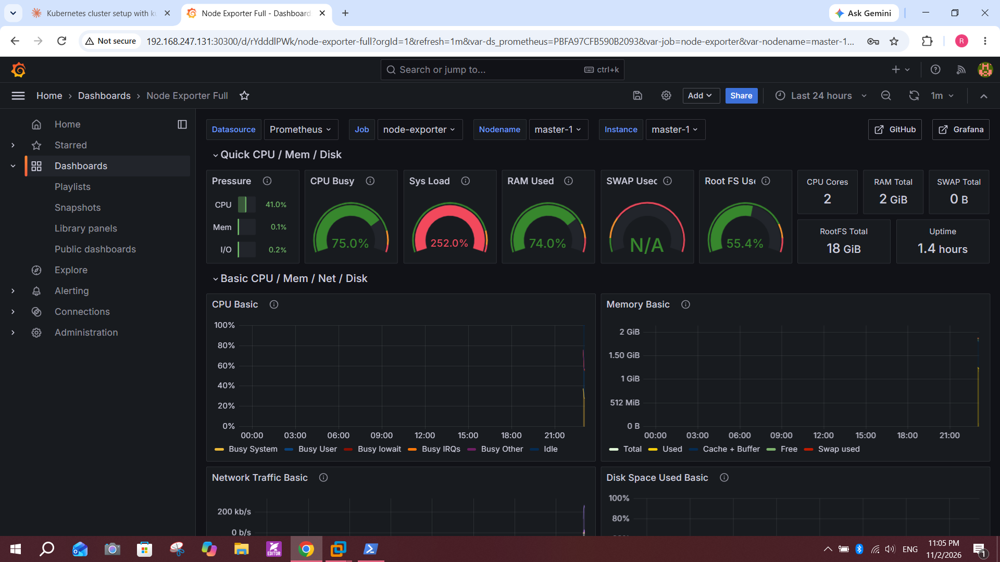
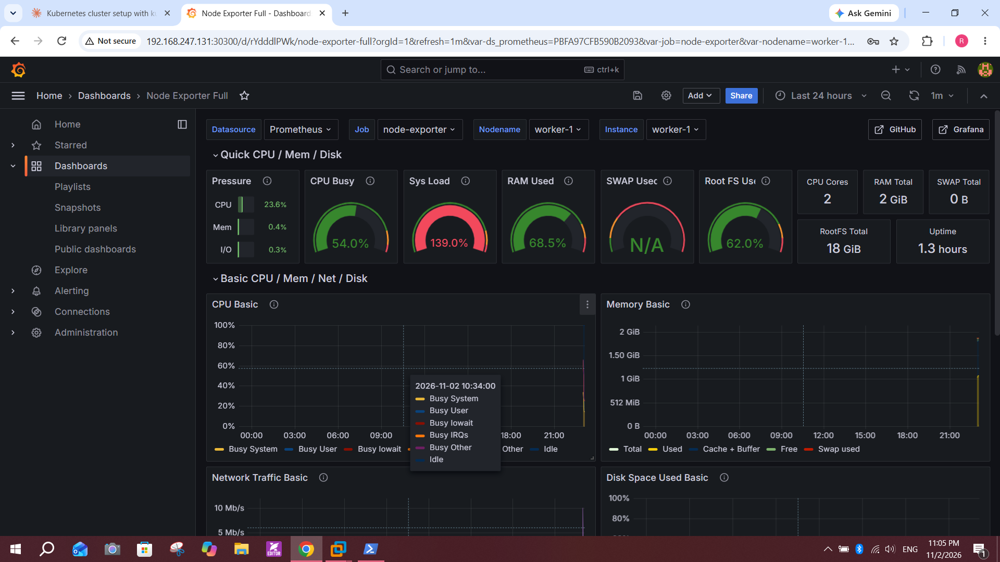

# Lab 18: Node-Wide Pod Management with DaemonSet

## Objective
In a new `monitoring` namespace, deploy Prometheus, Alertmanager and Grafana, and run Prometheus `node-exporter` as a DaemonSet so that one exporter pod runs on every node. Confirm the metrics endpoint on `<node_IP>:9100/metrics`, configure Prometheus to scrape the exporters, and build a Grafana dashboard.

## Environment
- Cluster from Lab 9: `master-1` (`192.168.247.130`) and `worker-1` (`192.168.247.131`), Kubernetes `v1.28.15`
- Namespace `monitoring` (created in this lab)
- Each VM has 2 vCPU and 2 GiB RAM, so every workload uses small resource requests and no persistent storage

## Steps

### 1. Create the namespace
```bash
kubectl create namespace monitoring
```

### 2. Deploy node-exporter as a DaemonSet (`node-exporter.yaml`)
Key settings:
- `hostNetwork: true` and `hostPort: 9100`: the exporter is reachable on the node IP directly
- `hostPID: true` and read-only `hostPath` mounts for `/proc`, `/sys` and `/`: the exporter reads the node's own data, not the container's
- A toleration for `node-role.kubernetes.io/control-plane:NoSchedule`: without it no pod would be scheduled on `master-1`
- Small resources: requests `50m` CPU / `32Mi`, memory limit `128Mi`

```bash
kubectl apply -f node-exporter.yaml
kubectl get ds,pods -n monitoring -o wide
```
- One `node-exporter` pod runs on `master-1` and one on `worker-1`



Check the metrics endpoint on each node:
```bash
curl -s http://192.168.247.130:9100/metrics | head -5
curl -s http://192.168.247.131:9100/metrics | head -5
```

### 3. Deploy Prometheus (`prometheus.yaml`)
The manifest contains a ServiceAccount, a ClusterRole and ClusterRoleBinding (so Prometheus can list nodes), a ConfigMap with `prometheus.yml`, a Deployment and a NodePort Service on `30090`.

The scrape configuration that collects data from node-exporter:
```yaml
scrape_configs:
  - job_name: node-exporter
    kubernetes_sd_configs:
      - role: node
    relabel_configs:
      - source_labels: [__meta_kubernetes_node_address_InternalIP]
        target_label: __address__
        replacement: "$1:9100"
      - source_labels: [__meta_kubernetes_node_name]
        target_label: node
```
The `node` role discovers every node automatically, and the relabeling points each target at `<node_IP>:9100`.

```bash
kubectl apply -f prometheus.yaml
```

### 4. Deploy Alertmanager (`alertmanager.yaml`)
A ConfigMap with a minimal route and receiver, a Deployment, and a NodePort Service on `30093`. Prometheus sends alerts to `alertmanager:9093`.
```bash
kubectl apply -f alertmanager.yaml
```

### 5. Deploy Grafana (`grafana.yaml`)
A ConfigMap that provisions Prometheus as the default data source (`http://prometheus:9090`), a Deployment, and a NodePort Service on `30300`.
```bash
kubectl apply -f grafana.yaml
kubectl get pods -n monitoring -o wide -w
```
- All pods reach `Running`: `node-exporter` on both nodes, plus Prometheus, Alertmanager and Grafana on `worker-1`



### 6. Verify Prometheus targets
```bash
curl -s http://192.168.247.131:30090/api/v1/targets | grep -o '"health":"[a-z]*"'
```
- Three targets report `"health":"up"`: Prometheus itself and the node-exporter on `master-1` and `worker-1`

### 7. Grafana dashboard
1. Open `http://192.168.247.131:30300` and log in with `admin` / `admin`.
2. Check that the Prometheus data source works (Connections, Data sources, Save & test).
3. Dashboards, New, Import, enter ID `1860` (Node Exporter Full), choose the Prometheus data source, Import.



Dashboard for `master-1`:



Dashboard for `worker-1`:



## Notes and issues
- **Dashboard choice:** the ready-made Kubernetes dashboards (for example ID 315) need `kube-state-metrics` and cAdvisor, which are not installed here. I used dashboard `1860` (Node Exporter Full), which works with the node-exporter metrics this lab collects.
- **Control-plane taint:** `master-1` is tainted, so the DaemonSet needs the toleration. Without it only `worker-1` gets a pod.
- **Limited RAM:** the VMs have only 2 GiB each, so I kept requests small and limited memory on every container. The dashboards show the nodes with high memory use and a Sys Load gauge above 100% on both nodes.
- **No persistent storage:** Prometheus, Alertmanager and Grafana use `emptyDir`, so metrics and Grafana settings are lost if a pod restarts. Prometheus retention is set to 2 days.
- **Credentials:** `admin` / `admin` for Grafana is a lab example only and must not be used outside a lab.
- **Garbled paste:** pasting the Grafana command in the terminal mixed up part of the output (`wide -wconfigmap/...`). The resources were still created, as the pod list shows.
- **Slow image pulls:** the first start takes a few minutes while images are pulled, so pods stay in `ContainerCreating` for a while.

## Conclusion
node-exporter runs on every node through a DaemonSet and exposes metrics on port 9100. Prometheus discovers the nodes and scrapes them, Alertmanager is ready to receive alerts, and Grafana shows CPU, memory, network and disk graphs for both `master-1` and `worker-1`.