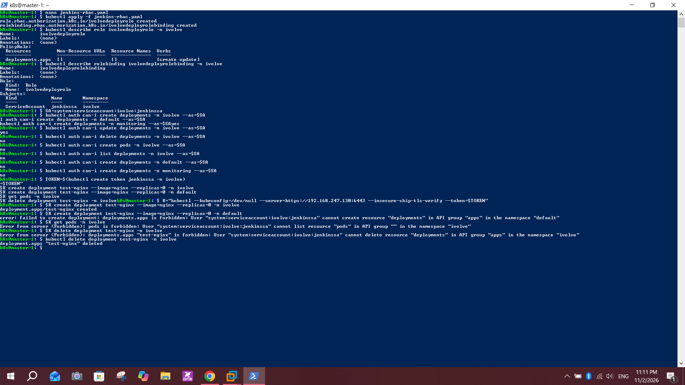

# Lab 19: Securing Kubernetes with RBAC and Service Accounts

## Objective
In the `ivolve` namespace, create a Service Account for Jenkins, generate a token for it, and give it a Role that only allows creating and updating Deployments. Then validate that the account cannot do anything else.

## Environment
- Cluster from Lab 9: `master-1` (`192.168.247.130`) and `worker-1` (`192.168.247.131`), Kubernetes `v1.28.15`
- Namespace `ivolve` (created in Lab 11)

## Steps

### 1. Create the Service Account and a token
```bash
kubectl create serviceaccount jenkinssa -n ivolve
kubectl create token jenkinssa -n ivolve
```
The token is printed once, is short-lived, and is not stored in this repository.

### 2. Create the Role and RoleBinding (`jenkins-rbac.yaml`)
```yaml
apiVersion: rbac.authorization.k8s.io/v1
kind: Role
metadata:
  name: ivolvedeployrole
  namespace: ivolve
rules:
  - apiGroups: ["apps"]
    resources: ["deployments"]
    verbs: ["create", "update"]
---
apiVersion: rbac.authorization.k8s.io/v1
kind: RoleBinding
metadata:
  name: ivolvedeployrolebinding
  namespace: ivolve
subjects:
  - kind: ServiceAccount
    name: jenkinssa
    namespace: ivolve
roleRef:
  apiGroup: rbac.authorization.k8s.io
  kind: Role
  name: ivolvedeployrole
```
```bash
kubectl apply -f jenkins-rbac.yaml
kubectl describe role ivolvedeployrole -n ivolve
kubectl describe rolebinding ivolvedeployrolebinding -n ivolve
```
- `apiGroups: ["apps"]` because Deployments belong to `apps/v1`
- The Role shows `deployments.apps` with verbs `[create update]`, and the RoleBinding links it to `jenkinssa`

### 3. Validate with `kubectl auth can-i`
```bash
SA=system:serviceaccount:ivolve:jenkinssa
kubectl auth can-i create deployments -n ivolve --as=$SA
kubectl auth can-i update deployments -n ivolve --as=$SA
kubectl auth can-i delete deployments -n ivolve --as=$SA
kubectl auth can-i create pods -n ivolve --as=$SA
kubectl auth can-i list deployments -n ivolve --as=$SA
kubectl auth can-i create deployments -n default --as=$SA
kubectl auth can-i create deployments -n monitoring --as=$SA
```

| Check | Result |
|---|---|
| create deployments in `ivolve` | yes |
| update deployments in `ivolve` | yes |
| delete deployments in `ivolve` | no |
| create pods in `ivolve` | no |
| list deployments in `ivolve` | no |
| create deployments in `default` | no |
| create deployments in `monitoring` | no |

### 4. Real test with the token
```bash
TOKEN=$(kubectl create token jenkinssa -n ivolve)
K="kubectl --kubeconfig=/dev/null --server=https://192.168.247.130:6443 --insecure-skip-tls-verify --token=$TOKEN"
$K create deployment test-nginx --image=nginx --replicas=0 -n ivolve
$K create deployment test-nginx --image=nginx --replicas=0 -n default
$K get pods -n ivolve
$K delete deployment test-nginx -n ivolve
```
- Creating the Deployment in `ivolve` succeeds
- Creating it in `default`, listing pods, and deleting the Deployment all return `Forbidden`

Cleanup with admin rights:
```bash
kubectl delete deployment test-nginx -n ivolve
```



## Notes and issues
- **Resource names:** the lab names are `jenkinsSA`, `ivolveDeployRole` and `ivolveDeployRoleBinding`. Kubernetes names must be lowercase, so I used `jenkinssa`, `ivolvedeployrole` and `ivolvedeployrolebinding`.
- **`--kubeconfig=/dev/null`:** without it `kubectl` uses the admin certificate and ignores the token, so the real test would pass for the wrong reason.
- **`--replicas=0`:** the test Deployment uses zero replicas so the pod quota in `ivolve` does not interfere.
- **Garbled paste:** pasting several commands at once mixed up some lines in the terminal (the first `can-i` line and the `$K` lines). The commands still ran, and each result is visible in the screenshot.
- **Only `create` and `update`:** the Role follows the lab exactly. Tools such as `kubectl apply` use the `patch` verb (and often `get`), so a real Jenkins pipeline would need those added.
- **Token handling:** the token is not shown in the screenshot or stored in the repository. Tokens expire and can be re-created at any time.

## Conclusion
`jenkinssa` can create and update Deployments in `ivolve` only. It cannot delete Deployments, touch pods, or do anything in other namespaces, which matches the least-privilege goal of the lab.