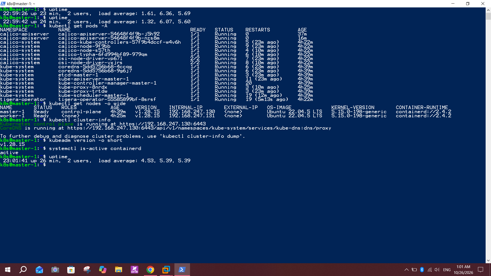
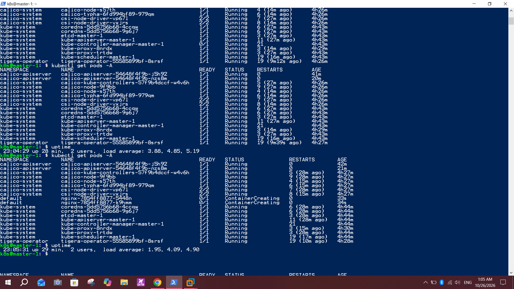
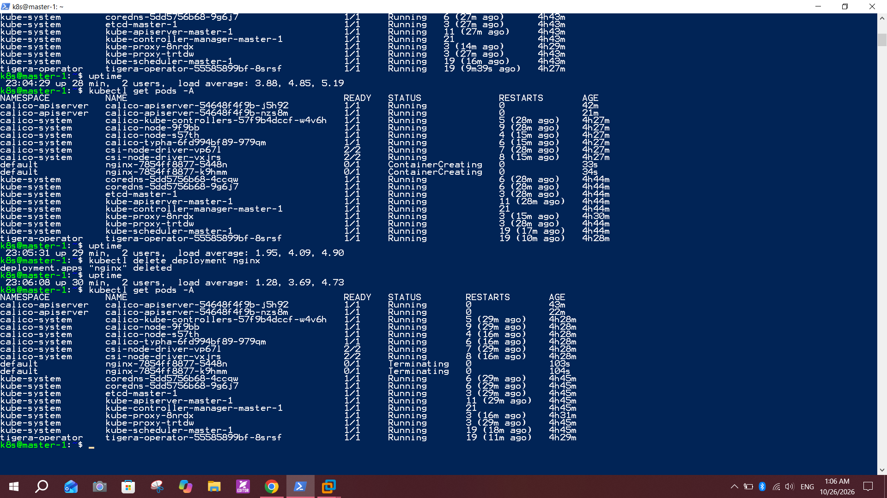
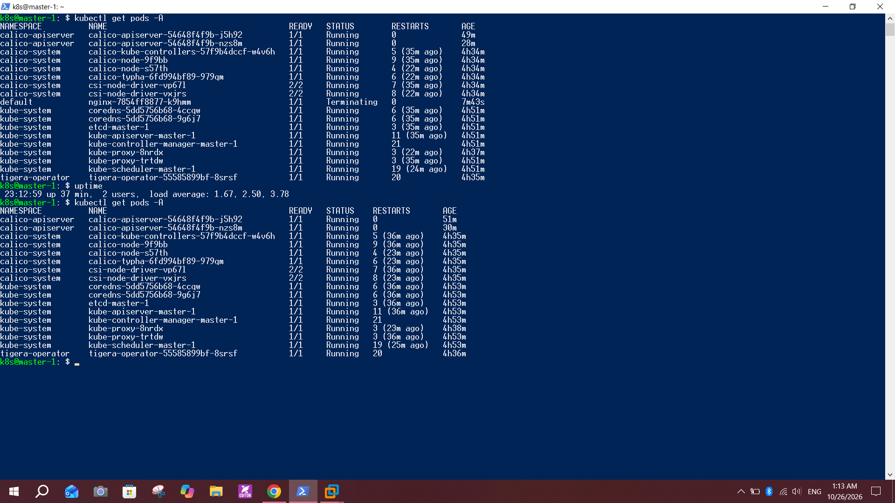

# Lab 9: Deploy a Kubernetes Cluster Using kubeadm

## Objective
Build a Kubernetes cluster with kubeadm: install containerd on all nodes, install kubeadm, kubelet and kubectl, initialize the control plane, configure kubectl, install the Calico CNI, join a worker node, and verify that all nodes are `Ready` and the cluster components are running.

Source: the provided HA Cluster Setup Guide (kubeadm), simplified to one control plane and one worker.

## Environment
- Windows 10, PowerShell (SSH client), VMware Workstation Pro
- OS: Ubuntu Server 22.04.5 LTS
- Kubernetes: `v1.28.15`
- Container runtime: containerd with `SystemdCgroup = true`
- CNI: Calico v3.27.0 (Tigera operator)
- Pod CIDR: `192.168.0.0/16`
- Network: VMware NAT (VMnet8) with static IPs

| Node | Role | IP | vCPU | RAM |
|---|---|---|---|---|
| master-1 | Control plane | 192.168.247.130 | 4 | 4 GB |
| worker-1 | Worker | 192.168.247.131 | 2 | 2 GB |

## Part 1: Prepare the nodes

### 1. Create the VMs
I created `master-1` from the Ubuntu Server ISO with OpenSSH server enabled, prepared it fully, then made a full clone named `worker-1`. VM files are stored on drive `E:` (not OneDrive). After cloning, I changed the hostname and regenerated the machine-id on the worker:
```bash
sudo hostnamectl set-hostname worker-1
sudo rm -f /etc/machine-id /var/lib/dbus/machine-id
sudo systemd-machine-id-setup
sudo reboot
```

### 2. Disable swap, load kernel modules, set sysctl
```bash
sudo swapoff -a
sudo sed -i '/swap/ s/^/#/' /etc/fstab

printf "overlay\nbr_netfilter\n" | sudo tee /etc/modules-load.d/k8s.conf
sudo modprobe overlay
sudo modprobe br_netfilter

printf "net.bridge.bridge-nf-call-iptables = 1\nnet.bridge.bridge-nf-call-ip6tables = 1\nnet.ipv4.ip_forward = 1\n" | sudo tee /etc/sysctl.d/k8s.conf
sudo sysctl --system
```
Verified with `swapon --show` (empty output) and `sysctl net.ipv4.ip_forward` (`1`).

### 3. Set static IPs
`/etc/netplan/00-installer-config.yaml` (each node uses its own address):
```yaml
network:
  version: 2
  ethernets:
    ens33:
      dhcp4: false
      addresses: [192.168.247.130/24]
      routes:
        - to: default
          via: 192.168.247.2
      nameservers:
        addresses: [8.8.8.8, 1.1.1.1]
```
Then I stopped cloud-init from recreating a DHCP config:
```bash
echo "network: {config: disabled}" | sudo tee /etc/cloud/cloud.cfg.d/99-disable-network-config.cfg
sudo rm -f /etc/netplan/50-cloud-init.yaml
sudo reboot
```

## Part 2: Install containerd

```bash
sudo apt-get update
sudo apt-get install -y ca-certificates curl gnupg lsb-release
sudo install -m 0755 -d /etc/apt/keyrings
curl -fsSL https://download.docker.com/linux/ubuntu/gpg | sudo gpg --dearmor -o /etc/apt/keyrings/docker.gpg
echo "deb [arch=$(dpkg --print-architecture) signed-by=/etc/apt/keyrings/docker.gpg] https://download.docker.com/linux/ubuntu $(lsb_release -cs) stable" | sudo tee /etc/apt/sources.list.d/docker.list
sudo apt-get update
sudo apt-get install -y containerd.io

sudo mkdir -p /etc/containerd
containerd config default | sudo tee /etc/containerd/config.toml
sudo sed -i 's/SystemdCgroup = false/SystemdCgroup = true/' /etc/containerd/config.toml
sudo systemctl enable --now containerd
systemctl is-active containerd
```
`SystemdCgroup = true` makes containerd use the same cgroup driver as the kubelet.

## Part 3: Install kubeadm, kubelet and kubectl

```bash
curl -fsSL https://pkgs.k8s.io/core:/stable:/v1.28/deb/Release.key | sudo gpg --dearmor -o /etc/apt/keyrings/kubernetes-apt-keyring.gpg
echo "deb [signed-by=/etc/apt/keyrings/kubernetes-apt-keyring.gpg] https://pkgs.k8s.io/core:/stable:/v1.28/deb/ /" | sudo tee /etc/apt/sources.list.d/kubernetes.list
sudo apt-get update
sudo apt-get install -y kubelet kubeadm kubectl
sudo apt-mark hold kubelet kubeadm kubectl
sudo systemctl enable kubelet
kubeadm version -o short
```
Output: `v1.28.15`. The packages are held so `apt upgrade` cannot change the version.

## Part 4: Initialize the control plane (master-1)

```bash
sudo kubeadm init \
  --pod-network-cidr=192.168.0.0/16 \
  --apiserver-advertise-address=192.168.247.130
```
The init finished with `Your Kubernetes control-plane has initialized successfully!` and printed the `kubeadm join` command for the worker.

## Part 5: Configure kubectl

```bash
mkdir -p $HOME/.kube
sudo cp -i /etc/kubernetes/admin.conf $HOME/.kube/config
sudo chown $(id -u):$(id -g) $HOME/.kube/config
kubectl get nodes
```
`master-1` shows `NotReady` until a CNI is installed.

## Part 6: Join the worker (worker-1)

```bash
sudo kubeadm join 192.168.247.130:6443 --token <TOKEN> \
  --discovery-token-ca-cert-hash sha256:<HASH>
```
Output: `This node has joined the cluster`.

## Part 7: Install Calico (master-1)

```bash
kubectl create -f https://raw.githubusercontent.com/projectcalico/calico/v3.27.0/manifests/tigera-operator.yaml
curl -O https://raw.githubusercontent.com/projectcalico/calico/v3.27.0/manifests/custom-resources.yaml
grep cidr custom-resources.yaml
kubectl create -f custom-resources.yaml
```
`grep` shows `cidr: 192.168.0.0/16`, which matches `--pod-network-cidr`. After a few minutes both nodes become `Ready`.

## Part 8: Verify the cluster

```bash
kubectl get nodes -o wide
kubectl get pods -A
kubectl cluster-info
kubeadm version -o short
systemctl is-active containerd
```
Results:
- `master-1` (control-plane) and `worker-1` are both `Ready`, version `v1.28.15`, runtime `containerd://2.4.2`
- Control plane runs at `https://192.168.247.130:6443`, CoreDNS is running
- `kubeadm` is `v1.28.15`, `containerd` is `active`
- All pods in `kube-system`, `calico-system`, `calico-apiserver` and `tigera-operator` are `Running`



### Network smoke test
```bash
kubectl create deployment nginx --image=nginx --replicas=2
kubectl get pods -A
kubectl delete deployment nginx
```
The two nginx pods were scheduled on `worker-1` (the master has the control-plane taint), which confirms scheduling and the pod network work.





### Final state
After the nginx pods were removed, every pod was `Running` and the load average was back to normal (about 1.7).



## Notes and issues
- **One worker only:** the guide uses 3 masters, 3 workers, an HAProxy load balancer and an NFS node. The lab only asks for a control plane and worker nodes, so I built one master and one worker. For that reason I removed `controlPlaneEndpoint` and used `--apiserver-advertise-address` directly.
- **Guide version not available:** the guide pins `1.28.9-1.1`, which is no longer in the repository (the build is `1.28.9-2.1`). I installed the latest 1.28 release, `1.28.15`.
- **Guide typo:** the guide downloads `customresources.yaml`, but the real file is `custom-resources.yaml` (with a dash).
- **Swap came back after reboot:** the `/etc/fstab` swap line uses tabs, so the guide's `sed '/ swap /'` did not match it. `kubeadm init` failed with "kubelet is not running". Fixed with `sed -i '/swap/ s/^/#/' /etc/fstab`, then `kubeadm reset -f` and init again.
- **Static IP did not apply:** the netplan file had a typo in its name (`.yamal`), and `50-cloud-init.yaml` kept forcing DHCP. After fixing the name and disabling cloud-init network config, the IPs stayed fixed. Before that, the worker briefly had a second DHCP address.
- **Control plane restarting:** with 2 vCPUs the master load average reached about 20, the API server answered slowly, and `kube-controller-manager` and `kube-scheduler` lost their leader lease and restarted. Raising the master to 4 vCPU / 4 GB fixed it. The restart counters in the screenshots come from that earlier period and did not increase afterwards.
- **Paste problems in the VM console:** long pasted commands were cut off, so I used SSH from PowerShell and short scripts instead.

## Conclusion
kubeadm bootstrapped a working Kubernetes cluster: containerd provides the runtime, kubeadm initializes the control plane and joins the worker, and Calico supplies pod networking. Both nodes are `Ready`, all system pods are running, and a test deployment scheduled and ran correctly on the worker.